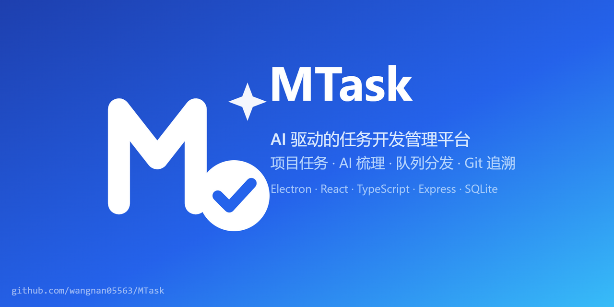

# MTask · AI 任务开发管理工具

<p align="center">
  
</p>

<div align="center">

[]()
[]()
[]()
[]()
[]()
[]()

</div>

**MTask** 是面向开发者的 AI 任务开发管理工具，用「项目维度 + AI 梳理 + 队列分发」替代基于 txt 的粗糙任务管理方式：
按项目组织开发任务，由 AI 自动梳理任务内容，可配置多种 AI 开发工具，把每日任务队列分发给 AI 工具开发，完成归可档可删。

> **一句话**：面向开发者的 AI 任务开发管理工具——项目维度任务管理 + AI 梳理 + 队列分发。
> 技术选型：Electron（桌面壳）+ React 18 / Vite / TypeScript（前端）+ Express / TypeScript（后端）+ SQLite（better-sqlite3）。

---

## 目录

- [功能特性](#功能特性)
- [技术栈](#技术栈)
- [目录结构](#目录结构)
- [环境要求](#环境要求)
- [安装](#安装)
- [快速开始](#快速开始)
- [构建与打包](#构建与打包)
- [配置](#配置)
- [数据与安全](#数据与安全)
- [MCP / API 接口](#mcp--api-接口)
- [开发者指南](#开发者指南)
- [功能与需求对照](#功能与需求对照)
- [相关文档](#相关文档)
- [许可证](#许可证)

---

## 功能特性

**任务管理**
- 按项目维度建任务，支持分类、优先级、状态、验证标记、置顶与截图附件
- 父子两级层级（epic → task）、拖拽排序、CSV 批量导入
- 待办 / 已完成双列表，搜索检索，一键归档（仅归档任务可删除，可还原）

**AI 能力**
- AI 梳理：单条 / 批量梳理任务内容，草稿确认后回填，支持标题美化、描述优化、智能分类
- 队列分发：将待办任务与指定 AI 工具组队发送，支持同步即时与异步提交 + 轮询收口两种模式，回执落库、行展开审阅、采纳 / 复制
- AI 控制台并行分析：多任务并行分析并汇总

**需求与计划**
- 需求仓库与需求跟踪矩阵（WBS 拆解、依赖编排）
- 项目计划：甘特 / 串行瀑布时间线
- PRD 生成与导入，测试用例管理

**知识沉淀与报表**
- 提示词仓库、通用需求仓库
- 周报 / 月报导出（Excel / Word / PDF / PPT），并附 AI 洞察

**工程化与运维**
- 数据迁移：换机 bundle 导入 / 导出；数据维护：DB 在线 CRUD
- 内网穿透：Cloudflare / Cpolar / Tailscale + 访问令牌
- 应用自更新：基于 GitHub Releases 的版本检查
- 执行会话监督审计、后台日志、用量统计

**多端接入**
- 桌面（Electron）+ 移动 Web（随手记 / 离线草稿）
- 对外 **MCP（Model Context Protocol）** 接口，使外部 AI Agent 可读写同一套数据

---

## 技术栈

| 层 | 选型 | 说明 |
|----|------|------|
| 桌面壳 | Electron 33 | 主进程内嵌本地 HTTP 服务并加载前端产物 |
| 前端 | React 18 + Vite + TypeScript | SPA，以 `tab` 状态路由（无 react-router） |
| 后端 | Express 4 + TypeScript | 本地 API 服务，UI 与数据层解耦 |
| 数据库 | SQLite（better-sqlite3） | 同步 API、零配置、单文件可移植，WAL 模式 |
| AI 接入 | `@modelcontextprotocol/sdk` + 自研适配器 | OpenAI 兼容 / Claude / Ollama / WorkBuddy 四类协议 |
| 报表 | exceljs / docx / pptxgenjs / pdfkit | Worker 线程内合成报表文件，不阻塞主循环 |
| 加密 | Node `crypto` AES-256-GCM | API Key / 更新 Token 加密落库 |
| 构建 | electron-builder（NSIS） | Windows 安装包；asar 打包（better-sqlite3 解包） |

---

## 目录结构

```
server/   # 后端：Express + SQLite + AIAdapter（OpenAI 兼容 / Claude / Ollama / WorkBuddy）
          #   └─ src/mcp/   MCP 服务（向外部 AI Agent 暴露 mtask_* 工具）
web/      # 前端：React + Vite
electron/ # 桌面壳主进程（内嵌启动后端、加载前端产物）
scripts/  # Windows 一键脚本（构建打包 / 启动服务 / 停止服务）与联调脚本
docs/     # 概要设计 / 详细设计 / MCP 接口文档 / PRD / 测试报告
build/    # 品牌资源（社交预览图等）
```

---

## 环境要求

- **Node.js** ≥ 20（开发与构建）
- **npm**（随 Node 提供；仓库按工作区一次装齐依赖）
- **Windows**（一键脚本与 NSIS 打包为 Windows 场景；后端 / 前端本身跨平台）

---

## 安装

```bash
# 克隆仓库后，在根工作区一次装齐依赖
npm install
```

---

## 快速开始

```bash
# 1. 启动后端（默认 http://127.0.0.1:39876，自动建库 server/data/mtask.db）
npm run dev:server

# 2. 另开终端启动前端（Vite dev server，/api 代理到后端）
npm run dev:web
# 浏览器打开 http://localhost:5173

# 3. 类型检查
npm run typecheck
```

### Windows 一键脚本（`scripts/`）

| 脚本 | 作用 |
|------|------|
| `scripts\构建打包.bat` | 依赖检查 / 自动安装 + 类型检查 + 后端编译 + 前端构建 |
| `scripts\启动服务.bat` | 清理旧进程 → 启动后端(39876) + 前端(5173) → 等待就绪 → 健康检查 → 打开浏览器 |
| `scripts\停止服务.bat` | PID 文件优先停止，端口扫描兜底，验证端口释放 |

> PID 文件存于 `logs\`（`server.pid` / `web.pid`）。若修改端口，请同步修改三个脚本中的 `SERVER_PORT` / `WEB_PORT`。

---

## 构建与打包

```bash
# 分别构建后端与前端
npm run build:server
npm run build:web

# 生产模式运行桌面壳（加载 web/dist，内嵌启动后端）
npm run electron

# 开发模式（前端走 Vite 热更新，需另开 npm run dev:server）
MTask_DEV=1 npm run electron

# 打 Windows 安装包 / 免安装目录
npm run dist        # electron-builder（NSIS）
npm run dist:dir    # 输出目录版（免安装）
npm run make:icon   # 生成应用图标
```

接入要点：
- 主进程内嵌启动后端（tsx 直跑 TS 源）；`file://` 页面的 `/api/*` 请求由 `session.webRequest` 重定向到 `http://127.0.0.1:39876`，前端零改动；
- 后端已启用 CORS（本地服务放行），供桌面壳跨协议 `fetch`。

---

## 配置

| 变量 | 说明 | 默认 |
|------|------|------|
| `MTask_PORT` | 后端端口 | `39876` |
| `MTask_DATA_DIR` | SQLite 数据目录 | `server/data` |
| `MTask_MASTER_KEY` | API Key 加密主密钥（生产必配） | 本机指纹派生（仅开发兜底） |
| `MTask_DEV` | Electron 加载 Vite dev server | 关闭 |

---

## 数据与安全

- 数据存储于本地 **SQLite 单文件**（WAL 模式），桌面版位于用户数据目录，开发版位于 `server/data/mtask.db`。
- 敏感字段（AI 工具 API Key、更新 Token）使用 **AES-256-GCM** 加密落库，界面脱敏显示；生产环境务必配置 `MTask_MASTER_KEY`。
- AI 分发结果仅以文本形式留存，人工确认后合并入库，不自动入库。

---

## MCP / API 接口

- 后端暴露 REST API（`/api/*`），供前端与桌面壳调用。
- 同时提供 **MCP（Model Context Protocol）** 服务，向外部 AI Agent 暴露 `mtask_*` 工具（任务读写、进度上报、计划 / 需求 / 测试用例管理等），使 Agent 可读写同一套数据。
- 接口清单详见 [`docs/MCP接口文档.md`](docs/MCP接口文档.md)。

---

## 开发者指南

```bash
# 类型检查（前后端）
npm run typecheck

# API 冒烟测试
npm run test:api
```

### 适配器联调验证（本地 mock，无需外网 / API Key）

验证 AI 适配器的协议正确性（请求构造、解析、错误 / 超时路径）：

```bash
cd server/scripts
node mock-ai-server.mjs                          # 终端 1：模拟 OpenAI/Claude/Ollama/WorkBuddy 端点
node ../../node_modules/tsx/dist/cli.mjs adapter-e2e.mjs  # 终端 2：真实跑适配器代码
```

> 适配器源码使用不带扩展名的相对导入（如 `./netutil`），需用 workspace 根下的 tsx 运行。
> 联调覆盖协议 / 解析 / 错误透传 / 超时，及 WorkBuddy 的异步提交（submit）+ 轮询收口（poll）。

---

## 功能与需求对照

| 需求（SRS） | 实现位置 |
|-------------|----------|
| FR1.1 项目管理 | `server/routes` /projects；`web/pages/TasksPage` |
| FR1.2/1.3 任务创建/编辑 | `TaskService.create/update`；TasksPage 标题/描述/优先级 |
| FR1.4 列表视图 + 检索 | `GET /tasks?projectId&archived`；TasksPage 搜索框 |
| FR1.5 非归档禁删 | `ArchiveService.remove` 仅 `archived=1` |
| FR2  AI 梳理（单条/批量 + 确认回填） | `POST /api/ai/organize`；TasksPage 草稿→保存 |
| FR3.1–3.3 AI 工具配置 | `ConfigService`（加密/脱敏/连接测试） |
| FR3.4 默认工具绑定 | `POST /aitools/:id/set-default`；AIToolsPage |
| FR4.1–4.5 队列构建/发送/回执/重试 | `QueueService`（Job 状态机）；QueuePage |
| FR4.4 采纳 = 仅保存文本 | `POST /tasks/:id/adopt`（`ai_summary` + done） |
| FR5.1/5.3 完成/退回 | `TaskService.setStatus` |
| FR6.1–6.5 归档/还原/删除 | `ArchiveService`；ArchivePage |

---

## 相关文档

- [`docs/概要设计.md`](docs/概要设计.md) — 系统概要设计
- [`docs/详细设计/`](docs/详细设计) — 各模块详细设计
- [`docs/MCP接口文档.md`](docs/MCP接口文档.md) — MCP 工具与 REST 接口说明
- [`docs/技术设计.md`](docs/技术设计.md) — 技术设计
- `需求规格说明书.md`、`同类产品分析报告.md` — 需求与竞品分析

---

## 许可证

本项目为**私有项目**（`package.json` 中 `private: true`），暂未声明开源许可证。未经许可请勿分发或商用。
