# MTask · AI 任务开发管理工具

<p align="center">
  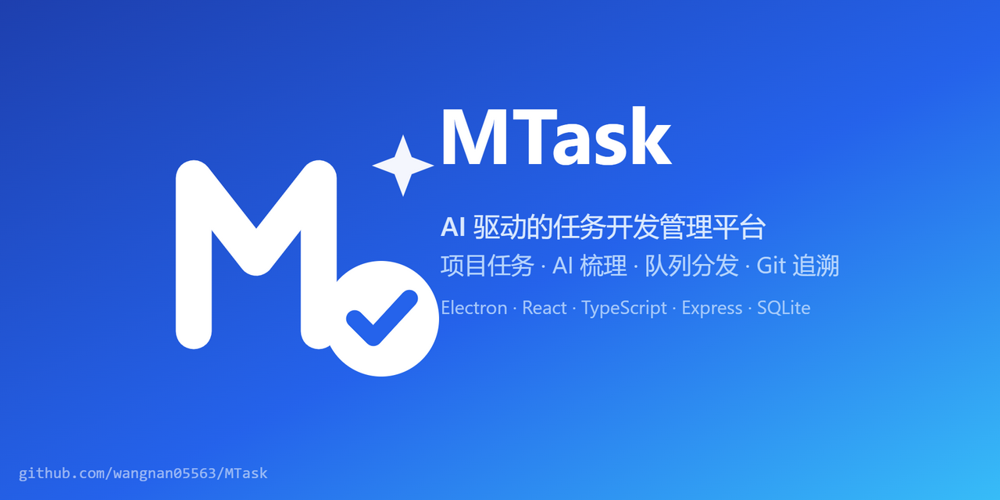
</p>

<div align="center">

[]()
[]()
[]()
[]()
[]()
[]()

</div>

**MTask** 是面向开发者的 AI 任务开发管理工具，用「项目维度 + AI 梳理 + 队列分发」替代基于 txt 的粗糙任务管理方式：
按项目组织开发任务，由 AI 自动梳理任务内容，可配置多种 AI 开发工具，把每日任务队列分发给 AI 工具开发，完成后可归档、可删除。

> **一句话**：面向开发者的 AI 任务开发管理工具——项目维度任务管理 + AI 梳理 + 队列分发。
> 技术选型：Electron（桌面壳）+ React 18 / Vite / TypeScript（前端）+ Express / TypeScript（后端）+ SQLite（better-sqlite3）。

---

## 目录

- [产品概览](#产品概览)
- [功能特性](#功能特性)
- [产品截图](#产品截图)
- [应用场景](#应用场景)
- [技术栈](#技术栈)
- [目录结构](#目录结构)
- [环境要求](#环境要求)
- [安装](#安装)
- [快速开始](#快速开始)
- [构建与打包](#构建与打包)
- [配置](#配置)
- [数据与安全](#数据与安全)
- [MCP / API 接口](#mcp--api-接口)
- [MTask 技能与 MCP 使用指南](#mtask-技能与-mcp-使用指南)
- [开发者指南](#开发者指南)
- [GitHub 发布与更新](#github-发布与更新)
- [品牌与社交预览](#品牌与社交预览)
- [功能与需求对照](#功能与需求对照)
- [相关文档](#相关文档)
- [许可证](#许可证)

---

## 产品概览

MTask 不是一个待办清单，而是把 **任务 → 代码 → 结论 → 交付** 四件事放进同一条流水线，让人和 AI 在同一个任务主键上协作：任务按项目组织，内容由 AI 梳理，多个 AI 工具统一配置并按队列批量分发，处理结论回写到任务本身，最终与 Git 提交、质量扫描结果串成一条可追溯的证据链。

**它解决什么问题**

| 常见痛点 | 具体表现 | MTask 的做法 |
|---|---|---|
| 任务散落 | 需求在群里、计划在表格、进度在脑子里 | 项目维度的统一任务池，待办 / 已完成 / 搁置三态 + 分类 + 优先级 |
| AI 结论无处安放 | AI 给了一大段建议，复制到哪儿都找不到上下文 | 处理结论直接回写任务，保留多次修改的结果历史，可与上一版对比 |
| 代码与任务对不上 | 想知道「这条任务改了哪些文件」，只能翻 Git 日志靠猜 | 任务与 Git 提交双向绑定，抽屉内直接看 diff 与文件统计 |
| 计划与执行脱节 | 甘特图是画给人看的，改了代码没人回头更新计划 | 需求跟踪矩阵把需求、计划、待办、用例、PRD 串起来，进度自动汇算 |
| AI 用量不透明 | 不知道哪个工具在跑、花了多少、失败率多高 | 统一 AI 用量统计：按天、按工具、按卡片维度统计调用、耗时与输出量 |

**面向谁**

| 角色 | 关注点 | 在 MTask 中做什么 |
|---|---|---|
| 研发负责人 / 项目经理 | 全局进度、风险、投入产出 | 看计划视图与需求矩阵，用报表和 AI 洞察做周会材料 |
| 一线开发 | 今天做什么、改了什么、有没有漏 | 待办列表按项目与优先级排列，任务内直接看关联提交与处理结论 |
| 测试 / 质量 | 需求有没有被覆盖、缺陷有没有复发 | 需求跟踪矩阵 + 测试用例 + 完成前的「已验证」标记 |
| AI 重度使用者 | 让自建的 Agent 参与真实开发 | 队列分发 + MCP 接口，外部 Agent 读写同一套任务数据 |

---

## 功能特性

**任务管理**
- 按项目维度建任务，支持分类、优先级、状态、验证标记、置顶、自定义字段与截图附件
- 父子两级层级（epic → task）、拖拽排序、CSV 批量导入、任务导出
- 待办 / 已完成双列表，结构化搜索（命令面板 `Ctrl+K`、数字键 1–9 切页、深链直达），一键归档与还原（仅归档任务可删除）
- 任务 ↔ Git 提交关联：绑定 / 解绑提交、抽屉内查看 diff 与文件统计，并支持 AI 智能关联推荐

**AI 能力**
- AI 梳理：单条 / 批量梳理任务内容，草稿确认后回填，支持标题美化、描述优化、智能分类（批量走服务端分批与失败拆分）
- 队列分发：将待办任务与指定 AI 工具组队发送，支持同步即时与异步提交 + 轮询收口两种模式，回执落库、行展开审阅、采纳 / 复制
- AI 工作台：周报 / 月报、PRD 生成与导入、测试用例生成、项目启动会与汇报 PPT、代码评审讲稿（分段生成）
- 工作空间只读问答：基于本地符号索引回答并给出 `file:line` 引用，统计提问数、回答成功率、引用点击与有用 / 无用反馈
- AI 控制台并行分析：多任务并行分析并汇总

**项目与计划**
- 需求仓库与需求跟踪矩阵（WBS 拆解、依赖编排）
- 项目计划：甘特 / 串行瀑布时间线、里程碑与阻塞依赖
- 迭代与燃尽图；估算视图（工作量 / 工期 / 成本，可导出）
- PRD 生成与导入，测试用例管理

**知识沉淀与报表**
- 提示词仓库、通用需求仓库
- 报表导出（Excel / Word / PDF / PPT），并附 AI 洞察
- AI 用量统计、指标基线与项目洞察

**工程化与运维**
- 数据迁移：换机 bundle 导入 / 导出，覆盖导入前自动快照；数据维护：DB 在线 CRUD；本地备份 / 恢复
- 内网穿透：Cloudflare / Cpolar / Tailscale + 访问令牌
- 应用自更新：基于 GitHub Releases 的版本检查与断点续传（详见 [GitHub 发布与更新](#github-发布与更新)）
- 执行会话监督审计、后台日志、项目级 Webhook、SonarQube 质量扫描
- 发布门禁：`scripts/tests/` 下的 `verify-*` 脚本覆盖 HEAD 自洽性、原生模块 ABI、打包壳与各特性回归

**多端接入**
- 桌面（Electron）+ 移动 Web（随手记 / 离线草稿）
- 对外 **MCP（Model Context Protocol）** 接口，使外部 AI Agent 可读写同一套数据

---

## 产品截图

> 以下均为 MTask 桌面端**真实运行界面**截图（1440×900，移动端 390×844）；图中项目、任务、提交与用量数据均为演示用的虚构数据。完整图文版见 [`docs/产品介绍-MTask.md`](docs/产品介绍-MTask.md)（同内容 Word 版：[`docs/产品介绍-MTask.docx`](docs/产品介绍-MTask.docx)）。

### 任务与协作

| 任务列表：待办 / 已完成 / 搁置三态，行内展开与优先级徽标 | 任务详情抽屉：八个页签覆盖完整生命周期 |
|:--:|:--:|
| 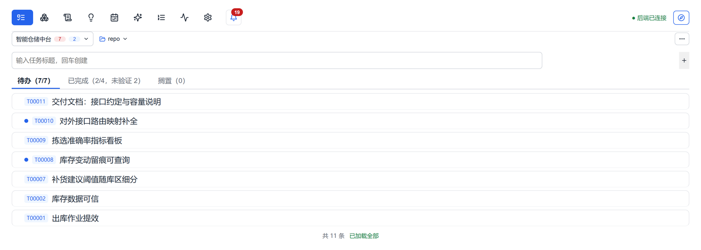 | 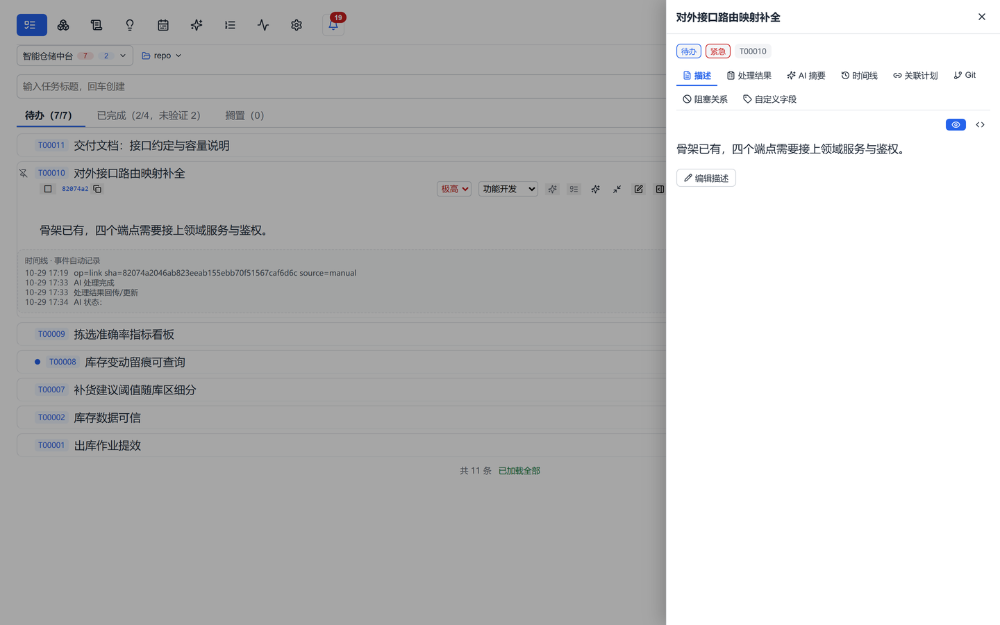 |

| Git 关联页签：主提交、变更文件统计与提交 SHA | 处理结果页签：Markdown 结论与结果历史对比 |
|:--:|:--:|
| 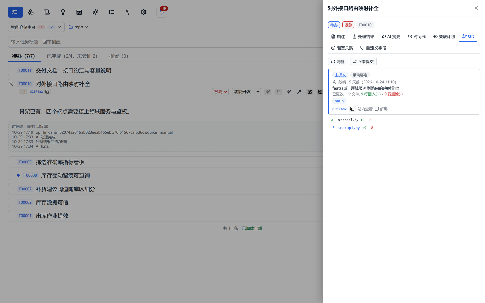 | 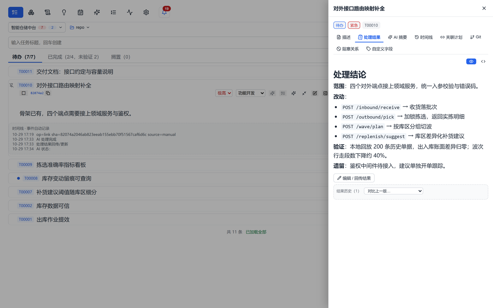 |

| 已完成列表与「仅未验证」筛选 | 命令面板：结构化搜索语法与跨页面跳转 |
|:--:|:--:|
| 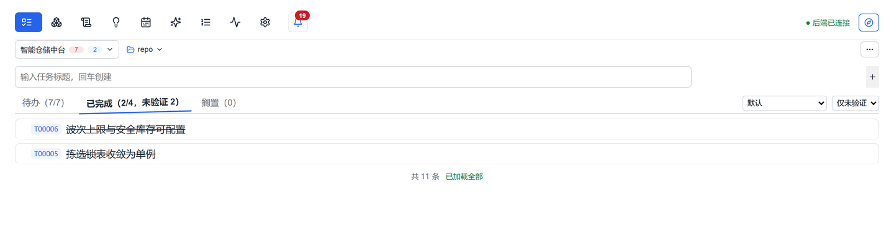 | 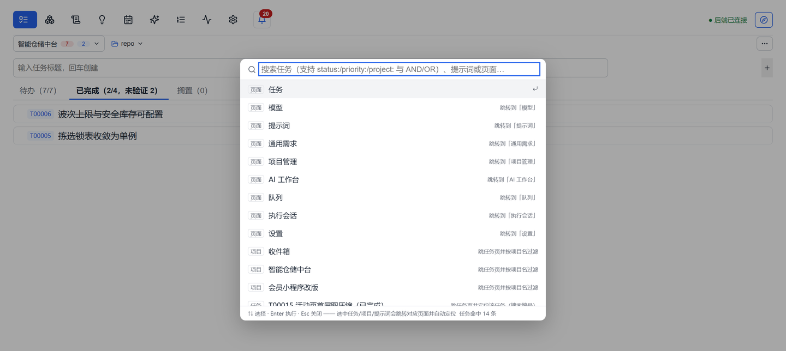 |

### 计划与需求

| 计划 WBS 视图：里程碑汇算与行内编辑 | 甘特视图：状态配色、周末底色与今日基准线 |
|:--:|:--:|
| 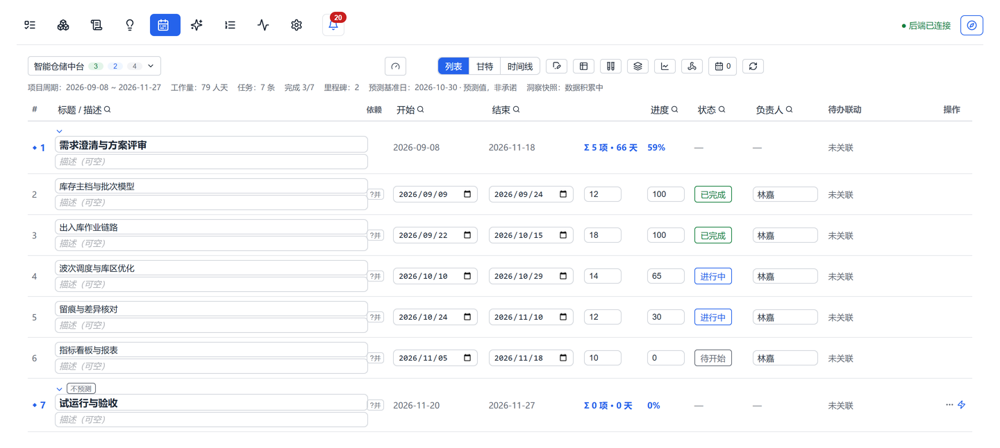 | 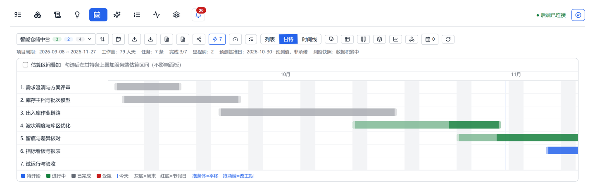 |

<p align="center">
  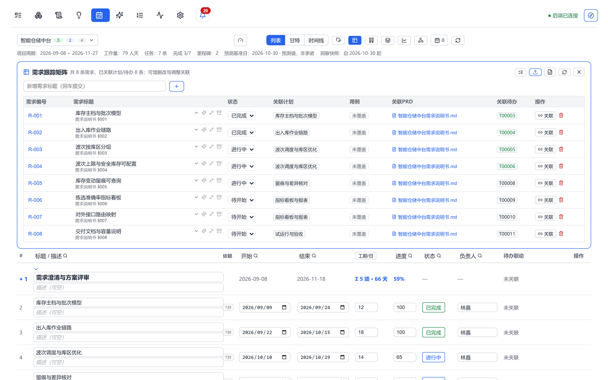
  <br />
  <sub>需求跟踪矩阵：需求编号 → 状态 → 关联计划 → 用例覆盖 → 关联 PRD → 关联待办</sub>
</p>

### AI 能力

| AI 工作台：卡片式入口与实时控制台 | 队列分发：任务与工具组队、状态机与回执摘要 |
|:--:|:--:|
| 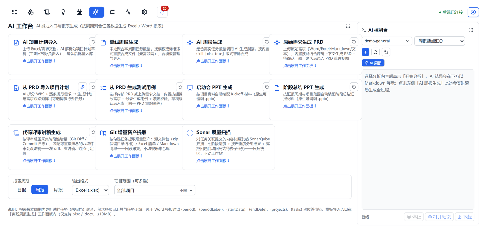 | 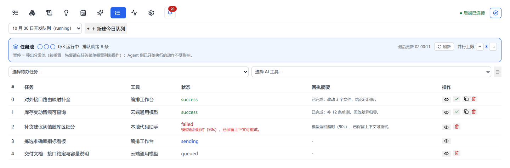 |

| 提示词仓库：分类、正文预览与一键发起 | 模型配置与 AI 用量统计：按天 / 按工具双维度 |
|:--:|:--:|
| 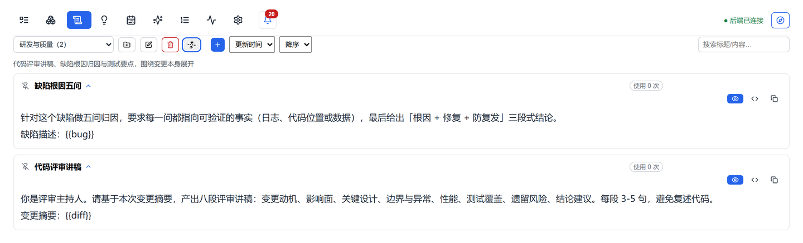 | 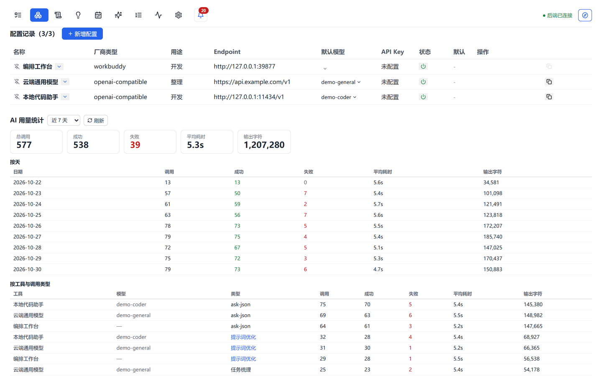 |

### 多端

<p align="center">
  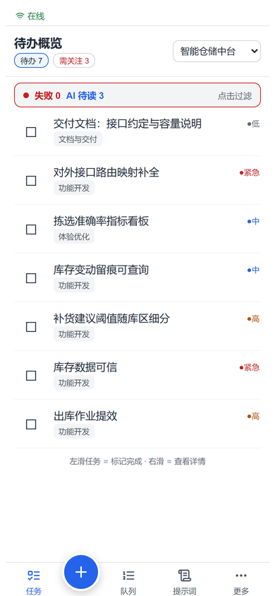
  <br />
  <sub>移动 Web：待办概览、随手记与离线草稿，左滑完成、右滑看详情</sub>
</p>

---

## 应用场景

**版本迭代的日常推进** — 每天从待办列表开始，按优先级处理；完成后把改动对应的提交绑到任务上，处理结论写回「处理结果」；周会前用「仅未验证」筛出待验任务，验收后打标。整条链路的证据都在任务里，交接时不用再问「这个当时是怎么做的」。

**把重复的文档工作交给 AI** — 启动会前用「启动会 PPT 生成」拉出骨架，周会前用「AI 周报生成」按周期聚合任务流水，评审前用「代码评审讲稿生成」把变更整理成八段讲稿。生成结果先落为草稿，人确认后再引用。

**让自建 Agent 参与真实开发** — 通过 MCP 接口把任务队列交给自建的 Agent 处理：Agent 读取待办、领取任务、上报进度、回写结论；人只负责裁决与验收。MTask 负责留存过程，不替人做决定。

---

## 技术栈

| 层 | 选型 | 说明 |
|----|------|------|
| 桌面壳 | Electron 33 | 主进程内嵌本地 HTTP 服务并加载前端产物 |
| 前端 | React 18 + Vite 6 + TypeScript | SPA，以 `tab` 状态路由（无 react-router），含移动端外壳 |
| 后端 | Express 4 + TypeScript | 本地 API 服务，UI 与数据层解耦，开发期用 tsx 直跑 |
| 数据库 | SQLite（better-sqlite3） | 同步 API、零配置、单文件可移植，WAL 模式 |
| AI 接入 | `@modelcontextprotocol/sdk` + 自研适配器 | OpenAI 兼容 / Claude / Ollama / WorkBuddy 四类协议 |
| 报表 | exceljs / docx / pptxgenjs / pdfkit | Worker 线程内合成报表文件，不阻塞主循环 |
| 加密 | Node `crypto` AES-256-GCM | API Key / 更新 Token 加密落库 |
| 构建 | electron-builder（NSIS） | Windows 安装包；asar 打包（better-sqlite3 解包） |

---

## 目录结构

```
server/            # 后端：Express + SQLite + AIAdapter（OpenAI 兼容 / Claude / Ollama / WorkBuddy）
  src/routes/      #   REST 路由（任务、计划、估算、迭代、Git 关联、Webhook、Sonar 等）
  src/services/    #   业务服务（TaskService / QueueService / ArchiveService / taskGitLinks …）
  src/mcp/         #   MCP 服务（向外部 AI Agent 暴露 mtask_* 工具）
  src/db/          #   建表与连接（better-sqlite3，WAL）
web/               # 前端：React + Vite
  src/pages/       #   一级页面（任务 / 模型 / 提示词 / 通用需求 / 项目管理 / AI 工作台 / 队列 …）
  src/components/  #   抽屉、估算、Git 提交、甘特、图表等组件
  src/mobile/      #   移动端外壳（随手记 / 离线草稿）
electron/          # 桌面壳主进程（内嵌启动后端、api:// 协议代理、加载前端产物）
scripts/           # 构建打包 / 启动停止 / 发布 / 联调脚本
  tests/           #   发布与特性门禁（verify-*）
docs/              # 概要设计 / 详细设计 / MCP 接口 / 产品介绍与截图 / PRD / 测试报告
build/             # 品牌资源（图标、社交预览图）
```

---

## 环境要求

- **Node.js** ≥ 20（开发与构建）
- **npm**（随 Node 提供；仓库按工作区一次装齐依赖）
- **Windows**（一键脚本与 NSIS 打包为 Windows 场景；后端 / 前端本身跨平台）

---

## 安装

```bash
# 克隆仓库后，在根工作区一次装齐依赖
npm install
```

---

## 快速开始

```bash
# 1. 启动后端（默认 http://127.0.0.1:39876，自动建库 server/data/mtask.db）
npm run dev:server

# 2. 另开终端启动前端（Vite dev server，/api 代理到后端）
npm run dev:web
# 浏览器打开 http://localhost:5175

# 3. 后端类型检查（前端类型检查在 npm run build:web 内）
npm run typecheck
```

### 桌面应用上手（安装包）

1. 下载并安装 Windows 安装包（NSIS），首次启动自动建库
2. 新建项目，在项目设置中绑定代码仓库的工作空间路径（用于 Git 关联）
3. 在「模型配置」中添加至少一个 AI 工具并完成连通性探测
4. 录入任务或由 PRD 导入计划，开始第一条任务的推进
5. 需要外部 Agent 协作时，在客户端配置 MCP 服务地址，即可读写同一套数据

### Windows 一键脚本（`scripts/`）

| 脚本 | 作用 |
|------|------|
| `scripts\构建打包.bat` | 依赖检查 / 自动安装 + HEAD 自洽预检 + 类型检查 + 后端编译 + 前端构建 |
| `scripts\启动服务.bat` | 清理旧进程 → 启动后端(39876) + 前端(5175) → 等待就绪 → 健康检查 → 打开浏览器 |
| `scripts\停止服务.bat` | PID 文件优先停止，端口扫描兜底，验证端口释放 |

> PID 文件存于 `logs\`（`server.pid` / `web.pid`）。若修改端口，请同步修改三个脚本中的 `SERVER_PORT` / `WEB_PORT`。

---

## 构建与打包

```bash
# 完整发布链路（推荐）：依赖检查 → HEAD 自洽预检 → 后端 typecheck/build → 前端构建
# → 版本号递增 → 切 Electron ABI → electron-builder → 还原工作区 ABI
node scripts/打包.mjs

# 仅出包（不会重新构建前后端，需先跑上面的构建步骤）
npm run dist        # NSIS 安装包
npm run dist:dir    # 输出目录版（免安装）

# 应用图标 / 社交预览图
npm run make:icon
npx electron scripts/make-social-preview.js
```

桌面壳运行：

```bash
# 生产模式（加载 web/dist，内嵌启动后端）
npm run electron

# 开发模式（前端走 Vite 热更新，需另开 npm run dev:server）
MTask_DEV=1 npm run electron
```

接入要点：
- 主进程内嵌启动后端（开发期 tsx 直跑 TS 源）；前端在 Electron 壳内以 `api://` 前缀请求，由主进程代理转发到本地 HTTP 服务；
- 打包态默认使用独立端口 **39877**（开发态 39876），避免与仍在运行的开发服务抢占端口；
- `npm run dist` 与 `scripts/打包.mjs` 共用 HEAD 自洽预检与 ABI 守卫；原生模块 ABI 不匹配的包装机即废，不要绕过。

---

## 配置

| 变量 | 说明 | 默认 |
|------|------|------|
| `MTask_PORT` | 后端端口 | 开发 `39876`，打包态 `39877` |
| `MTask_DATA_DIR` | SQLite 数据目录 | `server/data`（打包态为用户数据目录） |
| `MTask_MASTER_KEY` | API Key 加密主密钥（生产必配） | 本机指纹派生（仅开发兜底） |
| `MTask_DEV` | Electron 加载 Vite dev server | 关闭 |

---

## 数据与安全

- 数据存储于本地 **SQLite 单文件**（WAL 模式），桌面版位于用户数据目录，开发版位于 `server/data/mtask.db`。
- 敏感字段（AI 工具 API Key、更新 Token）使用 **AES-256-GCM** 加密落库，界面脱敏显示；生产环境务必配置 `MTask_MASTER_KEY`。
- AI 分发结果仅以文本形式留存，人工确认后合并入库，不自动入库。
- 开启内网穿透时可配置访问令牌，所有 `/api` 数据接口需携带 `X-Access-Token`。

---

## MCP / API 接口

- 后端暴露 REST API（`/api/*`），供前端与桌面壳调用；开发态 `http://127.0.0.1:39876`，打包态 `http://127.0.0.1:39877`。
- 同时提供 **MCP（Model Context Protocol）** 服务（`/api/mcp`），向外部 AI Agent 暴露 `mtask_*` 工具（任务读写、进度上报、计划 / 需求 / 测试用例管理等），使 Agent 可读写同一套数据。
- 接口清单详见 [`docs/MCP接口文档.md`](docs/MCP接口文档.md)。

---

## MTask 技能与 MCP 使用指南

MTask 随发行版提供 **技能包 `mtask`**（`skills/mtask`），配合本应用内置的 **MCP 服务** 使用：在外部 AI Coding 平台的对话框里直接用自然语言点名任务，由技能驱动 Agent 读取任务、执行、把结论回写到 MTask，人只负责裁决与验收。技能包与安装包在 [GitHub Release](#github-发布与更新) 中是**两个独立附件**，可只下载技能包做集成。

### 1. 安装技能包

把 `skills/mtask` **整个目录**放到所用平台的技能目录下（保持 `SKILL.md` 在目录根）：

| 平台 | 技能目录 | 平台标识（写入执行会话） |
| --- | --- | --- |
| WorkBuddy | 用户级 `~/.workbuddy-ai/skills/`，或项目级 `<workspace>/.workbuddy-ai/skills/` | `workbuddy` |
| Trae | 按该平台自身的项目级技能目录放置（宿主目录名含 `.trae-cn`） | `trae` |
| Qoder | 按该平台自身的项目级技能目录放置（宿主目录名含 `.qoder-cn`） | `qoder` |

> 平台标识由 `scripts/mcp-direct-call.py` 按**脚本所在宿主目录**推断：含 `.trae-cn` → `trae`、含 `.qoder-cn` → `qoder`、其余 → `workbuddy`；也可用环境变量 `MTASK_PLATFORM` 显式覆盖。口径声明见 `skills/mtask/config/config.yaml` 的 `exec-session.platform`。

技能包核心文件（清理后仅 15 个）：`SKILL.md`（主文件）、`references/`（分层工作流与踩坑库）、`config/config.yaml`（规则配置）、`assets/result-template.md`（结论模板）、`scripts/`（`mcp-direct-call.py` 直连回传器、`prd_to_plan.py` 计划回写、`list-todo.ps1` 清单解析）。

### 2. 配置 MCP 服务

MTask 桌面端已在本地提供 MCP 端点，**无需另起服务**。在所用平台的 MCP 配置里加入 `mtask` 条目（WorkBuddy 为 `~/.workbuddy/mcp.json`）：

```json
{
  "mcpServers": {
    "mtask": {
      "url": "http://127.0.0.1:39877/api/mcp",
      "headers": { "X-Access-Token": "<在 设置 → API Token 中生成的令牌>" }
    }
  }
}
```

- 端点 `/api/mcp`：**打包版端口 `39877`**，开发版 `39876`；跨机 / 内网穿透时换成实际可达地址。
- 应用内若已开启访问令牌，请求必须带 `X-Access-Token`，否则返回 `401`；未开启令牌时可省略 `headers`。
- `skills/mtask/scripts/mcp-direct-call.py` 会自动读取该配置的 `url` 与令牌；也可用 `MTASK_MCP_URL` / `MTASK_MCP_TOKEN` 覆盖，便于指向隔离测试实例。

### 3. 在对话框中调用

技能由自然语言触发，无需记命令。`SKILL.md` 声明的触发语包括：

```
处理 T05210 任务
mtask 执行 T05210 并回传
按顺序处理待办
处理待办
回传任务
```

计划类需求（「编写项目计划 / 拆解 WBS / 输出里程碑工期」）会转去读 `references/7-plan-workflow.md`，把方案回写到「项目计划」菜单，并强制携带需求关联。

### 4. 交互示例：输入「处理 T05210 任务」

| 阶段 | 系统行为 |
| --- | --- |
| 定位 | 解析任务号 → `mtask_get_task` 取回标题、描述、历史结论与 PRD 上下文 |
| 开工 | 显式置 `ai_state=running`，同批 `progress start` 建立执行会话（「执行会话」面板可见） |
| 执行 | 按 `SKILL.md` 硬规则逐单闭环：判定归属 / 可落地性 → 实际修改 → 自检验证 |
| 回写 | 独立 Git 提交 → `mtask_link_git_commit` 关联提交 SHA → `mtask_update_task_result` 回传结构化结论（根因 / 影响范围 / 修复 / 验证 / 本次回写） |
| 收口 | `progress done` 结束会话 → 标注 `done`（派生单归并归档）；回写后自动进入 `unread`，界面提示待查阅 |
| 复核 | 回传后再 `get` 复核 `status` / `verified` 实际值，避免「标了但没落库」 |

结论固定回写到任务的「处理结果」页签，并保留历史版本可对比；全过程数据与 Git 提交双向留痕，不绕过 `TaskService` 钩子，**严禁 sqlite 直写**。

> MCP 工具在会话里未注册时（部分平台只暴露查询工具），技能会走 `scripts/mcp-direct-call.py` 的 HTTP 降级通道，支持 `get / list / result / done / status / create / merge / raw / progress` 全部子命令。

### 5. 跨平台兼容与配置要点

- **协议**：标准 MCP Streamable HTTP + JSON-RPC 2.0，任何支持该传输的 Agent 平台均可接入，不依赖特定 IDE 插件。
- **端口**：开发版 `39876` / 打包版 `39877`，由 `MTask_PORT` 控制；改端口需同步改 MCP 配置里的 `url`。
- **令牌**：只读令牌无法调用写操作（`403`）；需要回写结论的 Agent 请配可写令牌。凭据只存在本地配置，不入库、不随技能包分发。
- **隔离测试**：变更类验证请用独立实例（`MTask_PORT` + `MTask_DATA_DIR` 指向临时目录），并用 `MTASK_SESSION_FILE` 隔离会话缓存，不要污染生产库。
- **Windows 注意**：`scripts/list-todo.ps1` 刻意保持纯 ASCII，以兼容 PowerShell 5.1 的 ANSI 代码页；Python 脚本需 UTF-8 环境。
- 完整 MCP 工具清单与错误码见 [`docs/MCP接口文档.md`](docs/MCP接口文档.md) 及应用内「设置 → 帮助文档 → MCP 接口」。

---

## 开发者指南

```bash
# 后端类型检查（tsc --noEmit）
npm run typecheck

# 前端类型检查 + 构建（tsc --noEmit && vite build）
npm run build:web

# API 断言套件（默认打打包态 39877，可传入实例地址与套件名）
npm run test:api
npm run test:api http://127.0.0.1:39906 t00776 t00777
```

### 发布门禁

```bash
# 示例：HEAD 自洽性 / ABI / 打包壳
npm run verify:head-selfconsistency
npm run verify:abi-switch
npm run verify:packaged-shell

# 其余门禁脚本使用 tsx 直跑
node node_modules/tsx/dist/cli.mjs scripts/tests/verify-t03637-derived-archive.mts
```

### 适配器联调验证（本地 mock，无需外网 / API Key）

验证 AI 适配器的协议正确性（请求构造、解析、错误 / 超时路径）：

```bash
cd server/scripts
node mock-ai-server.mjs                          # 终端 1：模拟 OpenAI/Claude/Ollama/WorkBuddy 端点
node ../../node_modules/tsx/dist/cli.mjs adapter-e2e.mjs  # 终端 2：真实跑适配器代码
```

> 适配器源码使用不带扩展名的相对导入（如 `./netutil`），需用 workspace 根下的 tsx 运行。
> 联调覆盖协议 / 解析 / 错误透传 / 超时，及 WorkBuddy 的异步提交（submit）+ 轮询收口（poll）。

---

## GitHub 发布与更新

MTask 的「发布」与「更新」都围绕 **GitHub Releases** 展开：维护者把 Windows 安装包发到仓库 Release，应用内「版本更新」模块再拉取最新 Release 做断点续传式升级。

### 版本号约定

安装包使用 **4 段版本号** `<major>.<minor>.<MMDD>.<seq>`（如 `0.1.1110.244`），**不是标准 semver**——这是刻意的：Windows 文件版本号每段必须 ≤ 65535，直接用 8 位日期会溢出。`scripts/bump-version.js` 每次构建自动递增该版本（写入 `package.json` / `electron/package.json` / `package-lock.json` 三处）。

- 发布时的 Release tag **等于该 4 段版本号**（前缀 `v` 可有可无，如 `v0.1.1110.244`）；
- 应用内自更新解析 tag 时按 `v?数字.数字(…)` 匹配，并逐段**数值**比较（`0.1.10 > 0.1.9`），段数不齐补 0。

### 应用自更新（基于 GitHub Releases）

入口：**设置 → 关于 → 版本更新**。它通过 HTTPS 读取仓库**最新发布的 Release**（不是 tag 本身），比较 tag 与本地版本：

- 有更新 → 展示版本号、发布时间、更新日志与「下载新版本」入口；
- 无更新 → 提示已是最新。

前置条件与配置要点：

| 项 | 说明 |
| --- | --- |
| 必须有 Release | 仅 tag 无 Release 会提示「尚未发布任何 Release」；Release 需附加 Windows 安装包 |
| 仓库地址 | `owner/repo` / 完整 URL / `.git` 后缀三种格式均可，应用自动规范化 |
| Token | 公开仓库**不需要**；私有仓库需**只读 Fine-grained PAT**（Permissions → Contents → Read-only，切勿给写权限） |
| 限速 | 未认证 60 次/小时·IP，配 Token 后 5000 次/小时；结果缓存 5 分钟 |

完整人工配置手册见 [`docs/GitHub版本更新配置手册.md`](docs/GitHub版本更新配置手册.md)。

### 一键发布（维护者）

桌面端双击 `scripts/一键发布.bat` 即可完成「构建 → 出包 → 发 Release」整链路，内部依次调用：

1. `scripts/构建打包.bat` — 依赖检查 / HEAD 自洽预检 / 类型检查 / 前后端构建 / 版本递增 / 切 Electron ABI / electron-builder 出包 / 还原 ABI（详见 [构建与打包](#构建与打包)）；
2. `scripts/publish-oneclick.ps1` — 跨 `release*` 目录找最新的 `MTask Setup *.exe`，从文件名解析版本，校验产物版本 == `package.json` 版本（防发旧包），生成 Release 说明；
3. `scripts/pack-skill.py` — 把清理后的 `skills/mtask` 打成独立技能包 `MTask_Skill_v<版本>.zip`（zip 内根目录 `mtask/`，只收录 15 个核心文件，过程产物逐条排除）；
4. `scripts/publish-release.py` — 逐资产上传到**同一个 Release**（**幂等**：Release 已存在则复用，资产已存在则跳过上传）。

**每个 Release 含两个独立附件，可单独下载：**

| 产物 | 文件 | 说明 |
| --- | --- | --- |
| 包 A · 安装包 | `MTask Setup <版本>.exe` | Windows 安装程序，应用内自更新直接使用此资产 |
| 包 B · 技能包 | `MTask_Skill_v<版本>.zip` | 解压后把 `mtask/` 整个目录放进 AI Coding 平台的技能目录，无需安装 MTask 主程序 |

> 安装包**刻意保持裸 `.exe`**：`electron/update-state.js` 按资产名 `setup|installer|.exe` 选中 Windows 资产后直接下载执行，若换成 zip 会导致自更新下载到一个压缩包却当安装程序运行。技能包则独立成 zip，互不干扰。
>
> 也可用 `python scripts/pack-skill.py <版本> <输出zip>` 单独生成技能包，不触发构建与发布。

可用环境变量：

| 变量 | 作用 |
| --- | --- |
| `SKIP_BUILD=1` | 跳过构建，复用已有安装包重新发布（此模式下版本校验按设计跳过） |
| `GH_DRY_RUN=1` | 只打印将执行的操作，不真正写 GitHub，用于预览 |
| `GH_TOKEN` | GitHub PAT；缺省时回退到本地 `.env` 与 git 凭据库 |
| `GH_REPO` / `GH_TAG` / `GH_DRAFT` / `GH_PRERELEASE` / `GH_API_BASE` | 均可选，缺省自动从 `git remote` / `git describe` 推断 |

> 发布脚本会扫描**所有** `release*` 目录取最新安装包（因为杀软占用 `app.asar` 时构建会 fallback 到 `release2..9`），并拒绝发布「文件名版本 ≠ package.json 版本」的旧产物，避免把上一版当成新版本发出去。

企业版 / 镜像站可在 `GH_API_BASE` 改 API 域名；国内环境默认走 `npmmirror` 镜像下载 Electron 与 electron-builder 二进制。

### 仓库社交预览图

GitHub 仓库页的社交预览需在 **Settings → Social preview** 上传 [`build/social-preview.png`](build/social-preview.png)（1280×640）。修改文案 / 配色后用 `npx electron scripts/make-social-preview.js` 重新渲染。详见 [品牌与社交预览](#品牌与社交预览)。

### GitHub Actions 自动构建 / 发布

仓库内置 [`.github/workflows/build.yml`](.github/workflows/build.yml)：

- **PR / push 到 main**：跑发布门禁（HEAD 自洽性、server 类型检查与构建、web 构建），不产出安装包；
- **打 `v*` tag 或手动 `workflow_dispatch`**：在 `windows-latest` 上装依赖、构建、把原生模块 `better-sqlite3` 按 **Electron ABI** 重建、出安装包，再用 `scripts/pack-skill.py` 生成技能包，最后逐资产调用 `scripts/publish-release.py` 把**安装包 + 技能包**发到同一个 GitHub Release（使用仓库 `GITHUB_TOKEN`）。

> ⚠️ **原生模块 ABI 是 CI 最易踩的坑**：本地构建靠 `scripts/lib/abi-switch.mjs` 在打包前后切换预编译的 Electron ABI 二进制；CI 上用 `npx electron-builder install-app-deps`（或 `npm rebuild better-sqlite3 --runtime=electron --target=<electron版本>`）重建，否则装出来的 `better-sqlite3` 是 Node ABI，运行即崩溃。**一键发布脚本仍是本地发布的主路径**，Actions 适合做门禁校验与 tag 触发的自动出包；首次启用建议在测试仓库先验证一次。

---

## 品牌与社交预览

- 社交预览图：[`build/social-preview.png`](build/social-preview.png)（1280×640，GitHub 推荐尺寸），矢量源文件为 [`build/social-preview.svg`](build/social-preview.svg)。
- README 顶部已引用该图；GitHub 仓库页的社交预览需在 **Settings → Social preview** 上传同一张 PNG；仓库社交预览的配置要点也见 [GitHub 发布与更新](#github-发布与更新) 的对应小节。
- 修改文案或配色后重新渲染：

```bash
npx electron scripts/make-social-preview.js
```

> 脚本用 Electron 无头渲染 SVG 并导出 PNG，保证矢量清晰度。若终端存在 `ELECTRON_RUN_AS_NODE=1`，先取消该变量再执行。

---

## 功能与需求对照

| 需求（SRS） | 实现位置 |
|-------------|----------|
| FR1.1 项目管理 | `server/src/routes/index.ts`（`/projects`）；`web/src/pages/TasksPage.tsx` |
| FR1.2/1.3 任务创建/编辑 | `server/src/services/TaskService.ts`（`create/update`）；TasksPage 标题/描述/优先级 |
| FR1.4 列表视图 + 检索 | `GET /tasks?projectId&archived`；TasksPage 搜索框与命令面板 |
| FR1.5 非归档禁删 | `server/src/services/ArchiveService.ts`（仅 `archived=1`） |
| FR2  AI 梳理（单条/批量 + 确认回填） | `POST /api/ai/organize`；TasksPage 草稿→保存 |
| FR3.1–3.3 AI 工具配置 | `server/src/services/ConfigService.ts`（加密/脱敏/连接测试） |
| FR3.4 默认工具绑定 | `POST /aitools/:id/set-default`；`web/src/pages/AIToolsPage.tsx` |
| FR4.1–4.5 队列构建/发送/回执/重试 | `server/src/services/QueueService.ts`（Job 状态机）；`web/src/pages/QueuePage.tsx` |
| FR4.4 采纳 = 仅保存文本 | `POST /tasks/:id/adopt`（`ai_summary` + done） |
| FR5.1/5.3 完成/退回 | `TaskService.setStatus` |
| FR6.1–6.5 归档/还原/删除 | `ArchiveService.ts`；`web/src/pages/ArchivePage.tsx` |
| 估算视图 | `server/src/routes/estimates.ts`；`web/src/components/EstimatePanel.tsx` |
| 迭代与燃尽 | `server/src/routes/iterations.ts`；`web/src/pages/SprintPanel.tsx` |
| 任务 ↔ Git 提交关联 | `server/src/services/taskGitLinks.ts`；`server/src/routes/gitLinks.ts`；`web/src/components/GitCommitTab.tsx` |
| 项目级 Webhook | `server/src/routes/webhooks.ts`；`web/src/pages/WebhookPanel.tsx` |
| MCP 工具 | `server/src/mcp/server.ts` |

---

## 相关文档

- [`docs/产品介绍-MTask.md`](docs/产品介绍-MTask.md) — 产品介绍（图文完整版，本 README 的产品章节由其整理而来）
- [`docs/产品介绍-MTask.docx`](docs/产品介绍-MTask.docx) — 同内容 Word 版，可直接分发或打印（A4 13 页）
- [`docs/概要设计.md`](docs/概要设计.md) — 系统概要设计
- [`docs/详细设计/`](docs/详细设计) — 各模块详细设计
- [`docs/技术设计.md`](docs/技术设计.md) — 技术设计
- [`docs/MCP接口文档.md`](docs/MCP接口文档.md) — MCP 工具与 REST 接口说明
- [`docs/需求规格说明书.md`](docs/需求规格说明书.md) — 需求规格说明书
- [`docs/同类产品分析报告.md`](docs/同类产品分析报告.md) — 竞品分析
- [`docs/验收门判据规约.md`](docs/验收门判据规约.md) — 发布门禁判据
- [`docs/GitHub版本更新配置手册.md`](docs/GitHub版本更新配置手册.md) — 应用自更新配置

---

## 许可证

本项目为**私有项目**（`package.json` 中 `private: true`），暂未声明开源许可证。未经许可请勿分发或商用。
