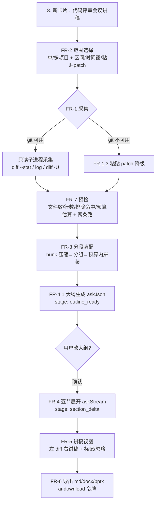

# PRD：AI 控制台「代码评审会议讲稿生成」（MTask）

> 来源任务：T02169 ｜ 版本：**v1.3（锚点校正版，评审修订内容承自 v1.1/v1.2，仍待审批）** ｜ 日期：2026-10-16（v1.2 锚点校正 2026-10-18）｜ 作者：AI 工作台产品助手 ｜ 状态：**待审批**（本文件只定义需求与设计，不含实现；含 4 个开放决策点 E-1~E-4，§9）
> 影响项目：**mtask六期**（MTask 项目 `bea1ce5b-67c1-4a0d-a08c-db0d5a3d9136`，2026-10-15 建；工作空间 `D:\code\otherProjects\26_MTask`——与四期同仓不同项目，T02169 归属六期）
> 评审报告：`docs/PRD评审报告-代码评审会议讲稿生成.md`（v1.0 → v1.1 的 1 阻塞 / 4 重要 / 3 建议问题及处置）
> 关联既有 PRD：`docs/PRD-项目启动会PPT生成.md`（T01844，v1.1 已批准，同属「AI 控制台能力卡片」家族，产物链路与下载令牌口径复用）、`docs/PRD-竞品调研与优化需求.md`
> 取证方式：全文每条技术断言锚到本仓 `路径:行号`（取证日 2026-10-16，全部只读）；「不存在」结论标注 grep 范围（§2.3）

---

## 1. 文档信息

| 项 | 内容 |
|---|---|
| 文档编号 | PRD-CRL-001 |
| 版本 | v1.3（需求口径逐字同 v1.1/v1.2，仅锚点行号校正） |
| 作者 | AI 起草（T02169），审批人待定 |
| 状态 | 待审批——含 4 个开放决策点 E-1~E-4（§9），批准前不得进入实施 |
| 对应任务 | T02169「编写代码评审会议讲稿功能PRD文档」 |
| 变更记录 | v1.0：首版，含竞品调研（§5）、UX 优化建议（§5.4）、交互设计规范（§6）、非功能需求（§7）、验收标准（§8） v1.1（评审修订）：① 修正 `projects.color` 虚构字段（§6.3 改 exportStyle 色板）；② 影响项目四期→六期；③ 补「第 8 张卡」与 T02170 PRD 的冲突声明；④ FR-1.1 补 git 输出编码配置（UTF-8/quotepath）与 CRLF 口径；⑤ FR-4.3 补锚点时效与 blob 标识；⑥ FR-1.4 补截断优先级因子；⑦ §8 A-3 扩中文可读断言；详见评审报告 v1.2（2026-10-18 **锚点行号校正，需求零变化**）：验收门 `verify-t02169-lecture-prd` 改判为「逐条解析 `文件:行号` 并回仓定位」后抓出 12 处行号漂移，按 HEAD 实测校正——`server/src/routes/index.ts` 8 处（SSE 三点 `1568/1711/1764`→`1586/1729/1782`、`/report/ai-download` `1824`→`1842`、workspace 四端点 `257/274/282/290`→`259/276/284/292`）、`server/src/db/schema.ts` 2 处（`558`→`544`）、`AIService.askStream` `556`→`584`、§2.5 术语表 `reportCards` `580`→`584`；同批把 12 处裸行号锚点补成 `路径:行号 标识符` 形态（`prd-generate-stream`、`/workspace/search`、`ensureColumn`、`trimPrdContent`、`AdapterType` 等），让符号腿覆盖面从 6 条提到 20 条以上，行号漂移可逐条回仓核对 v1.3（2026-10-23 **锚点行号校正，需求零变化**）：验收门 `verify-t02169-lecture-prd` 复跑打红符号腿——`server/src/routes/index.ts` 八处锚点自 v1.2 校正后整体位移 **+23 行**（SSE 三点 `1586/1729/1782`→`1609/1752/1805`、workspace 四端点 `259/276/284/292`→`282/299/307/315`、下载端点 `1842`→`1865`），系该文件在其后新增路由/工具接入所致，与需求口径无关；另修一处**符号腿判不住的语义错位**——原锚点指向 schema 第 544 行，该行现落在 `prd_requirements.prd_id` 的注释上（±3 窗口内有泛用标识符，门不红），而文档说的是 `projects.workspace_path`，HEAD 实测在 561 行，已按「路径:行号 字段名」收口；同批把 FR-3.3/FR-5.1 两处裸行号锚补成 `路径:行号 标识符` 形态。**未改任何需求文字、未动 §9 决策点建议值、状态仍为待审批。** |

---

## 2. 背景与目标

### 2.1 一句话

在 AI 控制台（能力卡片页）新增一张 **「代码评审会议讲稿生成」** 卡片：读取指定一个或多个项目工作空间的**阶段性增量代码**（Git Diff / Commit Logs / 变更文件），由 AI 装配成一份**可直接照着讲的评审会议讲稿**——变更摘要、逐文件讲解要点、潜在风险、规范检查、改进建议、讨论问题与结语，流式输出、可标记干预、可导出。

### 2.2 背景：为什么是「讲稿」而不是「又一款 AI 评审」

1. **评审会议是人工环节，现有 AI 评审工具都不服务它**。调研结论（§5）：GitHub Copilot Code Review、CodeRabbit、Qodo Merge/PR-Agent、Sourcery 的产物形态清一色是「PR 行内评论 / 检查清单」，面向**异步评审流**；没有任何一款输出「会议主持人照着念的结构化讲稿」。团队开评审会前仍需人工把散落的评论与 diff 组织成讲解口径——这正是本功能要的缺口。
2. **MTask 的差异化位置**：本系统是 AI 开发管理工具，掌握「项目 ↔ 工作空间 ↔ 任务/计划」的管理侧上下文（`projects.workspace_path`，`server/src/db/schema.ts:561`）。讲稿可以回答「这批变更对应哪些待办、为什么这么改」，这是挂在 Git 平台上的评审 Bot 拿不到的语境。
3. **多项目汇总缺口**：负责人跨多个项目主持阶段性评审（如迭代结束）时，没有任何工具做跨仓汇总讲稿；竞品全部是单 PR/单仓粒度。

### 2.3 现状与证据（本仓实测，全部只读）

| 事实 | 实测证据 | 对本功能的约束 |
|---|---|---|
| 「AI 控制台」卡片页是 `ReportPage.tsx`，现共 **7 张卡**（ai-import / offline / ai-live / prd-gen / prd-import / tc-gen / kickoff-ppt） | `web/src/pages/ReportPage.tsx:584 const reportCards`、`:626` kickoff-ppt | 新卡片按 `reportCards` **数组尾部追加**、复用 `ReportCard` 组件，**不得新造卡片组件**（一致性约束，与启动会 PPT 卡同规）。**卡位冲突声明（评审新增）**：T02170「阶段性项目总结汇报 PPT」PRD（已批准）同争该位——两张卡均按尾部追加，**先落地者为第 8 张、后落地者为第 9 张**，以实际追加时点定序，不得互相顶替或改标题（口径与 `docs/PRD-阶段性项目总结汇报PPT.md` §12 对齐） |
| 长耗时 AI 生成的既有范式是 **SSE 流** | `POST /api/plans/prd-generate-stream`（`server/src/routes/index.ts:1609 prd-generate-stream`，raw 30mb 接收）、`/plans/testcase-generate-stream`（`server/src/routes/index.ts:1752 testcase-generate-stream`）、`/report/ai-generate-stream`（`server/src/routes/index.ts:1805 ai-generate-stream`）；客户端断开即 abort | 新端点必须走 `*-stream` 同构形态（§4.2 FR-5），复用 `web/src/api/sse.ts` 消费层 |
| AI 通道只有文本 chat | `server/src/services/AIService.ts`：`organize:294 / ask:474 / askJson:499 / askStream:584`；适配器 `server/src/adapters/types.ts:93 AIAdapter`，`chatStream:101`，类型 `openai-compatible|claude|ollama|workbuddy`（`:110`） | 代码上下文只能以**文本 diff/文件内容**注入；无 embedding 检索、无全仓索引承诺（呼应任务约束「考虑大模型上下文限制，避免过度承诺」） |
| 上下文截断有既成口径 | `server/src/util/prdContext.ts:25 PRD_CONTEXT_LIMIT=6000`，保头保尾截断（`:77-79`） | 讲稿场景预算远大于 6000，需新建独立预算常量与分段装配策略（§4.2 FR-3），但截断「保头保尾 + 显式告警」的纪律沿用 |
| **本仓无任何 Git 操作能力** | grep `git diff|simple-git|rev-parse` 于 `server/src` 零命中；`server/package.json` 无 git 类依赖；`child_process` 仅 `tunnel/tunnel-service.ts:1,8 child_process`（spawn/execFile 先例）与打包脚本；`WorkspaceService` 反而**显式忽略 .git**（`server/src/services/WorkspaceService.ts:15 DEFAULT_IGNORE_DIRS`） | Git 数据采集是**全新能力**（FR-1），只能走子进程调用系统 git（spawn 先例在位）；必须严格只读（禁 checkout/commit/fetch 等写命令，§7 安全）；无 git 环境须有降级路（FR-1.3） |
| 工作空间文件读取能力在位 | 端点 `GET /api/workspace/search`（`routes/index.ts:282 /workspace/search`）、`GET /api/workspace/file`（`routes/index.ts:299 /workspace/file`）、`POST /api/workspace/symbols/refresh`（`routes/index.ts:307 /workspace/symbols/refresh`）、`GET /api/workspace/symbols`（`routes/index.ts:315 /workspace/symbols`） | 讲稿的「变更文件上下文展开」（读被改函数的所在类/调用方）可用 symbols 能力，不新建检索机制 |
| 产物落盘与下载链路齐备 | 临时文件 + 令牌换文件：`POST /report/ai-download`（`routes/index.ts:1865 /report/ai-download`）；pptx 生成在位：`server/src/services/report-builder.ts:247 buildPptx()`，依赖 `pptxgenjs ^4.0.1`（`server/package.json:23 pptxgenjs`） | 讲稿导出 md/docx/pptx 复用 ai-download 令牌口径与既有装配器，**不新增下载端点、不新增依赖** |
| 数据源侧「项目」为多记录实体 | `projects` 表含 `workspace_path`（`schema.ts:561 workspace_path`） | 「单项目或多项目批处理」直接以 projects 多选实现（FR-2），无需新实体 |

**「不存在」的取证口径**：grep 范围 `server/src`、`web/src`、`electron/`，排除 `node_modules`/`docs`/`perf`/`dist`。结论：无 git 采集、无 diff 渲染组件（`web/src` grep `diff` 组件级零命中）、无代码托管平台对接（`UpdateService.ts:24` 仅调 GitHub Releases API 检查软件更新，与代码仓库无关）。

### 2.4 目标 / 非目标

**目标**
- G1：一条链路从「选项目 + 选增量范围」到「可导出讲稿」，全程流式可视、可中断。
- G2：讲稿**结构固定可验收**：开场 / 变更摘要 / 逐文件讲解（要点·风险·规范·建议四段）/ 讨论问题 / 结语（§4.2 FR-4），多项目时加总-分-总装配（§4.2 FR-4.4）。
- G3：**大纲先行**（与启动会 PPT G3 同纪律）：AI 先出讲稿大纲与各节要点 → 用户增删 → 再逐节展开成讲稿，避免整稿返工。
- G4：每条讲解**锚定到 diff 行**（文件+行号可点击定位），杜绝无出处的臆断；模型不确定处显式标「需会上确认」。
- G5：数据流向合规：代码内容只发往**用户自配的 AI 厂商**（本地配置、密钥加密存储现状不变），支持排除规则（§7.3）。

**非目标（本期明确不做）**
- N1：**不做**评审结论回写 Git 平台（不代理评论 PR/MR、不装 GitHub App）——载体是本地工作空间，且不引入平台 token 体系。
- N2：**不做** IDE 插件 / CI 门禁 / 阻断式卡点——本系统是管理台，评审决议权在人。
- N3：**不做**全仓语义索引与 embedding 检索——受 §2.3 AI 通道事实约束，只围绕「增量 + 展开一层上下文」。
- N4：**不做**目录快照 diff（无 git 时两快照对比生成 diff）——需引入 diff 计算依赖与新 UI，收益低于「粘贴 patch」降级路；是否解禁由 E-3 裁定。
- N5：**不新增 npm 依赖**（git 走系统命令、导出复用 pptxgenjs）、**不新增数据库表**（留档走 `prd_docs` 同构的文件留档或剪贴板，E-4 裁定）。

### 2.5 术语表（与现系统对齐，禁止另造词）

| 术语 | 定义 | 系统对应 |
|---|---|---|
| AI 控制台 / 能力卡片 | 卡片式 AI 工作入口 | `ReportPage.tsx:584 reportCards` / `ReportCard` |
| 阶段性增量代码 | 一次评审会议所辖的代码变更集 | Git 区间 / 粘贴 patch（FR-1） |
| 讲稿 | 会议主持人可照念的结构化文稿 | 本功能产物（FR-4） |
| 大纲先行 | 先出大纲供确认再逐节展开 | `stage` 事件 `outline_ready`（§6.2） |
| 锚点 | 讲稿条目对应的 diff 文件+行区间 | `[file#L120-L140]`（FR-4.3） |
| 排除规则 | 不进入 AI 上下文的文件 glob | 配置项（§7.3），概念对齐 Copilot Content exclusions（§5.2） |

---

## 3. 用户画像与场景

| 角色 | 场景 | 痛点（现状） | 使用路径 |
|---|---|---|---|
| **技术负责人 / 评审主持人（首要用户）** | 迭代末主持 30~60 分钟评审会，面前是 3 个仓库共 40+ 文件的增量 | 会前 1~2 小时人工翻 diff、拼评论、写讲解提纲；口径每次不一 | 卡片 → 多选项目 → 各仓选区间 → 大纲确认 → 流式生成 → 逐条标记 → 导出 |
| 开发者（被评审方 / 轮值主持） | 临时接手主持，不熟悉他人模块 | 读不懂变更意图，会上只能念文件清单 | 讲稿的「变更意图」节由 commit message + diff 语义归纳提供（FR-4.3） |
| 项目 PMO / 交付经理 | 需要评审留痕向客户交代「阶段质量把关」 | 会议纪要与代码变更两张皮 | 导出 docx/pptx 讲稿带项目名、区间、日期与文件统计（FR-6） |
| 安全/质量守门人 | 关注增量里的风险面（密钥硬编码、注入、越权改动） | 人肉扫 diff 易漏 | 风险节按严重度分级并全部带锚点（FR-4.3、§8 A-5） |

**典型时序（主用例）**：选 2 个项目 → 项目A `main..release/v2.6`（87 commits/34 files），项目B 近 14 天（9 files）→ 预检展示统计与排除命中 → 大纲：6 节 + 讨论问题 5 条 → 用户删 1 节补 1 条 → 逐节流式 → 主持人对 2 条风险标「会后跟进」、1 条建议标「忽略」→ 导出 pptx 上投屏。

---

## 4. 功能需求详细说明

### 4.1 功能地图与流程图描述

### 4.2 功能需求清单

**FR-1 Git 数据采集引擎（新能力，最高风险项）**
- FR-1.1 只读命令白名单：仅允许 `git rev-parse --is-inside-work-tree`、`git log`、`git diff --stat`、`git diff`、`git show`；参数一律数组化 `execFile` 传入（现成先例 `server/src/tunnel/tunnel-service.ts:15 execFileAsync`，其 `server/src/tunnel/tunnel-service.ts:14 execFileAsync` 注释「不走 shell，参数数组传递避免路径转义问题，适合带路径参数的 CLI 调用」即本需求的论据），**禁止字符串拼接与 shell=True**（命令注入红线，§7.1）。
- **FR-1.1a 输出编码红线（评审新增，Windows 硬约束）**：所有采集命令统一注入两个配置项——`-c i18n.logOutputEncoding=utf-8`（否则中文 Windows 上 commit message 按 cp936/GBK 输出，Node 按 utf8 解码即**乱码**，而 commit message 正是 FR-4.3「为什么改」的第一证据源）与 `-c core.quotepath=false`（否则非 ASCII 路径被转义为 `\xxX`，锚点文件名不可读、A-4 定位失效）。注入走命令行 `-c` 参数，**不得修改用户全局/仓库 git 配置**。
- **FR-1.1b 行尾口径（评审新增）**：diff 采集加 `--ignore-cr-at-eol`（或等价处理），规避 Windows `core.autocrlf=true`（git 安装默认项）导致未改行尾的文件整文件进 diff——否则预检统计虚高、上下文预算被行尾噪声吃掉。该处理是**静默降质**防护，与 G4 直接相关。
- FR-1.2 区间三形态：① `base..head`（分支/标签/commit）；② commit 范围（首末 SHA）；③ 时间窗（`--since`，落地「近 14 天」类诉求）。输出统一为 `{ files[], hunks[], commits[], stats }`；统一按 UTF-8 解码（FR-1.1a 保证上游输出即 UTF-8）。
- FR-1.3 降级：工作空间无 git（`rev-parse` 非 0）或系统无 git 命令 → 卡片内显式提示并切换「粘贴 patch」模式（接受 unified diff 全文，上限沿用 raw 30mb，`routes/index.ts:1609` 同构）。
- FR-1.4 硬边界：单仓采集 diff 文本上限（默认 2MB，超出按文件优先级截断并告警）、子进程超时 30s、`maxBuffer` 显式设置。不访问远程（禁 `fetch/pull/clone`），仓库状态零改动（只读命令集合本身保证）。**截断优先级因子（评审新增）**：变更行数多者优先 → 安全敏感路径（`auth`/`crypto`/`sql`/`exec` 等）优先 → 被 workspace symbols 引用多者优先；被丢弃文件在预检逐一点名（FR-7.1）。

**FR-2 范围选择（单/多项目）**
- FR-2.1 项目多选：源为现有 projects 列表（含 `workspace_path`）；每项目独立选区间形态，未配置 workspace 的项目置灰并提示补配。
- FR-2.2 文件过滤器：默认排除 `DEFAULT_IGNORE_DIRS` 同源目录 + lockfile/binary/生成物 glob（可在面板内增删）；排除规则同时是 §7.3 隐私口径的执行点。

**FR-3 上下文分段装配（对抗上下文窗口限制）**
- FR-3.1 三阶压缩：`文件清单+stat` →（每文件）`hunk 摘要`（超大 hunk 保头保尾截断，纪律同 `prdContext.ts:77 trimPrdContent`）→（全量）分组预算。新常量 `LECTURE_CONTEXT_BUDGET`（建议默认 60k 字符/次调用，可配置——与 PRD_CONTEXT_LIMIT 分立，禁止悄悄复用 6000）。
- FR-3.2 分组策略：按「项目 → 模块（目录） → 文件」两级分组，每组一次 `askStream`；组间结果不重复注入（大纲已锁结构）。
- FR-3.3 上下文展开一层：变更文件的调用方/所在类经 `GET /api/workspace/symbols`（`routes/index.ts:315 /workspace/symbols`）补充，仅源码类文件，展开深度=1（N3 边界）。

**FR-4 讲稿生成**
- FR-4.1 大纲先行：首步 `askJson` 产出 `{ sections[], discussion_questions[] }`，`outline_ready` 事件下发，用户可增删改后二次提交（复用 kickoff 卡的两段交互）。
- FR-4.2 固定骨架（验收断言对象，§8 A-2）：`开场白 / 变更摘要 / 逐项目-逐模块讲解 / 风险清单 / 规范检查 / 改进建议 / 讨论问题 / 结语`。
- FR-4.3 逐文件讲解四段式：**要点（改了什么+为什么）/ 潜在风险 / 规范检查 / 改进建议**；每条带锚点 `[file#Lx-Ly]`；commit message 为「为什么」的第一证据源，无据可推时写「意图不明，需会上确认」，**禁止编造**（对齐 Copilot 官方对 hallucination 的定性，§5.2）。**锚点时效（评审新增）**：行号是**生成时点的快照**——生成后若有新提交/格式化，定位可能偏差；锚点同时记录 blob SHA 与 base commit，定位时校验并在不符时提示「代码已变动，锚点可能失准」（借鉴阿里 OCR 的定位/反思模块思路，§5.2）。
- FR-4.4 多项目汇总策略：总-分-总——跨项目变更主题归并（开场）、每项目独立章（按 FR-4.3）、收束页输出「跨项目关联与不一致点」（结语）。差异化展示：项目章节带色标与统计条。
- FR-4.5 讲稿语言为「可照念」口语句式（每段 ≤3 句），与评论体区分——提示词层约束，验收含人工抽测项（§8 A-7）。

**FR-5 流式生成与中断**
- FR-5.1 `POST /api/plans/code-review-lecture-stream`：raw 30mb、事件 `stage/chunk/done/error`、客户端断开即 abort（与 `routes/index.ts:1609 prd-generate-stream / :1752 testcase-generate-stream / :1805 ai-generate-stream` 三点同构，零新范式）。
- FR-5.2 阶段可见：`collecting → preflight → outline → section:<n>` 进度条；「停止」即时生效。

**FR-6 导出与留档**
- FR-6.1 导出 md（直接）/ docx / pptx（投屏模式：每节一页要点+讲者备注全文）；pptx 装配复用 `buildPptx` 同栈（`report-builder.ts:247 buildPptx`，pptxgenjs 在位）。
- FR-6.2 下载走临时文件+令牌口径（`/report/ai-download`，`routes/index.ts:1865 ai-download`，文件名白名单已含三格式，零改动复用）。
- FR-6.3 生成日志：本期仅控制台流留痕（对齐 kickoff A-3 决策），持久留档与否由 E-4 裁定。

**FR-7 预检（不静默出劣稿）**
- FR-7.1 生成前汇总：项目数、commit 数、文件数、+/-行数、被排除文件数、预算估算（字数与预估调用次数/耗时）、git 可用性点名。
- FR-7.2 超限两条路：「裁剪继续」（按优先级自动丢弃低权重文件并点名）或「中止收窄范围」，与 kickoff 卡 G2 同纪律。

---

## 5. 竞品调研与 UX 优化建议

### 5.1 调研对象（GitHub 平台相关，3-5 个）

1. **GitHub Copilot Code Review**（GitHub 官方，PR 评审）
2. **CodeRabbit**（GitHub/GitLab 市场第一梯队 Bot）
3. **Qodo Merge / PR-Agent**（Qodo 商业版 + 其开源前身 `The-PR-Agent/pr-agent`，MIT）
4. **Sourcery**（GitHub App，重「讲解+重构建议」）
5. **阿里 Open Code Review**（2026 年开源的内部工具，代表大厂自建路线）

### 5.2 逐家要点（信息来源见文末链接，2026-10 检索）

- **Copilot Code Review**：PR 自动评审 + 可一键应用的 code suggestion；支持仓库级 **custom instructions** 注入规范；官方 responsible-use 文档明确点名 **hallucination** 风险（评审意见可能基于误解），并提供 **Content exclusions**（指定目录/文件不进 AI 上下文，已 GA）；2026-09 起支持自动审批 PR（公开预览）与评审阶段用量指标 API。→ 借鉴：排除规则是合规刚需、幻觉要产品化承认而非隐藏；教训：产物仍是「评论」不是「讲稿」。
- **CodeRabbit**：读 diff 后写「大白话讲解」+ 时序图、逐行评论、PR 高层摘要可更新、从互动中学习个性化；信噪比口碑居前。→ 最强对标：它的「白话讲解 + 摘要」证明本功能输入侧可行性；但它面向 PR 页展示，无会议口径、无跨仓汇总。
- **Qodo Merge / PR-Agent**：`/describe /review /improve /test` 命令族把评审拆成显式阶段，用户按命令干预；开源自托管、数据自主。→ 借鉴：把「大纲确认/逐节展开」做成显式两段（FR-4.1）即同族思想；开源版的 token 控制（增量审查阈值）值得抄参数化做法。
- **Sourcery**：综合报告 + 模块化/设计层点评 + 安全审查，强调「来源背景对齐」（把变更与需求/issue 对齐）。→ 与本系统 MTask 管理侧上下文天然契合：讲稿「为什么改」应取 commit message，未来可挂 MTask 待办（E-2）。
- **Open Code Review（阿里开源）**：内部工具外溢（2026-05-18 开源，Apache-2.0），对比口径提示自托管与成本可控是大厂关切；报道中其 token 消耗对比 PR-Agent 低约一个数量级。→ 借鉴两条：① 预算/成本应作为一等产品指标（§8 A-6、FR-7.1 明示预估）；② **其「确定性工程管线（文件选择/分包/规则匹配）+ 外部定位与反思模块」正是为对抗行号漂移与评论不准而设计**——本功能锚点 `[file#Lx-Ly]` 的防漂移（FR-4.3 时效声明 + blob 校验）即借鉴此架构，把「定位」这类确定性步骤与 LLM 叙事分离。
- **GitLab（非 GitHub 参照）**：GitLab 生态评审工具同样收敛于 MR 评论 + 摘要形态。→ 结论稳健性佐证：跨平台无人做「会议讲稿」。

### 5.3 对比表（任务指定三维 + 缺口）

| 工具 | 代码理解深度 | 讲稿结构清晰度 | 人工干预点 | 产物形态 | 多项目/跨仓 |
|---|---|---|---|---|---|
| Copilot Code Review | 高（diff+仓库上下文+custom instructions） | 中（逐条建议，无叙事结构） | 采纳/拒绝建议、自定义指令 | PR 评论 | ✗ |
| CodeRabbit | 高（逐行+时序图+摘要） | 中高（摘要叙事最接近讲稿） | 对话追问、学习反馈 | PR 评论+摘要 | ✗ |
| Qodo Merge/PR-Agent | 中高（diff 为主，可配上下文量） | 中（按命令分段） | **命令级干预最丰富**（/review /improve） | PR 评论+描述 | ✗ |
| Sourcery | 中高（设计层+安全） | 中（综合报告） | 规则配置、忽略建议 | 报告+评论 | ✗ |
| Open Code Review | 中高（内部规范对齐） | 中 | 自托管可调 | 评论 | ✗ |
| **本功能（目标态）** | 中（增量+一层展开，明示上限不越 N3） | **高（固定八段骨架+照念口语体，可验收）** | 大纲编辑、逐条标记/忽略/会后跟进、停止 | **会议讲稿（md/docx/pptx）** | **✓（总-分-总）** |

### 5.4 UX 优化建议（由调研推导，均已落进 §4/§6）

1. **两段式生成**（源自 PR-Agent 命令分层）：大纲确认 → 逐节展开，杜绝整稿返工（FR-4.1）。
2. **白话讲解体**（源自 CodeRabbit 口碑点）：讲稿语言纪律「每段 ≤3 句可照念」，并进入验收（FR-4.5、§8 A-7）。
3. **不确定性显式化**（源自 Copilot hallucination 定性）：无据推断一律标「意图不明，需会上确认」，风险分级全部带锚点（FR-4.3、§6.3）。
4. **Content exclusions 同构**（源自 Copilot GA 特性）：隐私排除 glob 前置到预检并展示命中数（FR-2.2、FR-7.1、§7.3）。
5. **成本可见**（源自 Open Code Review 对比口径）：生成前明示预估调用次数/耗时/字数（FR-7.1）。
6. **左 diff 右讲稿 + 点击锚点定位**（交互细节，§6.1）；**逐条建议三态标记**（采纳念/会后跟进/忽略，§6.2）。

---

## 6. 交互与设计规范

### 6.1 布局

- 卡片面板复用 `ReportCard` 外壳与 `glow` 运行态光晕（kickoff 卡同款）。
- 生成视图三区：**左** diff 面板（文件树 + unified diff，hunk 折叠）；**右** 讲稿流式面板（八段手风琴，逐段流出）；**底** 状态条（阶段/进度/停止/导出）。锚点点击 = 左面板滚动定位 + 行高亮（1.5s 闪烁）。
- 预检页为独立覆盖层（先统计后放行），对齐 kickoff 前置校验交互。

### 6.2 关键交互定义（任务指定细节）

- **高亮关联代码行**：讲稿每条挂 `[file#Lx-Ly]`，hover 该条 → 左侧对应行加底色；点击 → 滚动定位。无锚点条目（开场/结语类）不渲染交互。
- **标记/忽略**：每条风险/建议行尾三按钮 `采纳(默认) / 会后跟进 / 忽略`；「忽略」折叠该条并从导出稿移除，「会后跟进」保留并在导出稿尾部生成跟进清单节。状态存内存态（本期不落库，E-4）。
- **讲稿导出**：`导出` 下拉（md/docx/pptx）→ 后端装配 → ai-download 令牌 → `web/src/utils/download.ts` 保存；pptx 为投屏模式（一页一节的要点页 + 讲者备注全文）。
- **中断与续作**：「停止」abort 当前流；已生成节保留，可「从第 n 节继续」。

### 6.3 文案与视觉纪律

- 阶段文案中文动宾（「采集项目A变更…」「装配第3/6节…」）；错误文案带出路（无 git → 引导粘贴 patch）。
- 风险分级色：高=红、中=橙、低=灰，复用品牌色板（`server/src/util/exportStyle.ts` 单源）；**多项目章节色标从同一色板按项目索引分配**（评审修正：`projects` 表无 color 字段——schema.ts 的 color 列仅在 `tasks/prompts/req_entries/plan_tasks`；若确需项目自有色，须新增 `projects.color` 列并走迁移，列为扩展项由 E-4 类裁决决定，本期不做）。
- 空态/降级态必须显式：commit message 缺失、diff 截断、预算丢弃文件均渲染告警 chip，不得静默。

---

## 7. 非功能需求

### 7.1 安全（命令注入与只读红线）

- Git 采集仅 `execFile` 参数数组 + 白名单子命令（FR-1.1）；工作目录固定为该项目 `workspace_path`，路径解析后校验仍在空间内（防穿越）。
- 讲稿文本按现有 XSS 纪律渲染：复用 `web/src/ui/Markdown.tsx`（`:11` markdown-it `html:false` 关闭原始 HTML 直通 + 链接统一 `rel/noopener noreferrer`，既有守卫，本功能不新造渲染器）。
- AI 厂商配置与 API Key 加密存储体系零改动，本功能不新增任何密钥形态。

### 7.2 性能与时效

- 预检 ≤3s 返回（P50，万行级以下仓库的纯本地 git 统计；超大仓超时则先返回部分统计并流式补全，不得空等）；单节流式首字 ≤8s（P50，取决于厂商通道）；34 文件规模端到端目标 ≤6 分钟（§8 A-6）；>30 分钟场景由分段天然打断进度，无单请求长挂。

### 7.3 隐私与合规

- 代码内容唯一出网路径 = 用户自配 AI 厂商端点（openai-compatible/claude/ollama 均可完全内网，`adapters/types.ts:110 AdapterType`）；文档与 UI 均如实声明数据流向，不夸大「全本地」。
- 排除规则（FR-2.2）默认包含常见敏感面（`.env*`、`*secret*`、`*.pem`）；命中即从上下文剔除并在预检点名。
- 生成的临时导出文件沿用 ai-download「换文件即删」语义。

### 7.4 可靠性

- git 缺失/超时/超限均有降级或点名路径（FR-1.3、FR-1.4、FR-7.2），禁止静默产出缺文件的讲稿。
- 单节 AI 调用失败：该节标记失败并允许单独重试，不拖垮已生成节（分段幂等）。

---

## 8. 数据指标与验收标准

### 8.1 产品指标（上线后观测）

| 指标 | 定义 | 目标 |
|---|---|---|
| 生成成功率 | 无中止到达 done 的会话占比 | ≥90% |
| 会前省时 | 用户自述准备时长对比基线（1~2h） | 中位降幅 ≥60% |
| 锚点覆盖率 | 带 `[file#Lx-Ly]` 的讲解条目占比 | ≥85% |
| 导出率 | 完成生成后会话触发导出占比 | ≥40%（衡量真实入会使用） |

### 8.2 验收标准（可测试判据，全部针对 M1 范围）

- A-1 采集正确性：对既有 git 仓库样例（本仓即可），三种区间形态的 `stats` 与 `git log --stat` 人工比对一致；无 git 工作空间 → 粘贴 patch 模式可用。
- A-2 结构完备性：导出稿断言八段骨架标题齐全（程序化 grep），多项目稿每项目成章且有统计条。
- A-3 只读红线：采集全过程 `git status` 前后一致、无网络子命令日志；注入用例（路径含 `;`、反引号）不产生命令执行；**中文可读断言（评审新增）**：对本仓含中文 commit message/文件名的真实样本采集，输出为可读 UTF-8 中文——无 GBK 乱码、无 `\xxX` 路径转义（FR-1.1a/1.1b 的验收落点，命令链可自动测）。
- A-4 锚点可用：随机抽 10 条锚点点击均正确定位高亮（UI 实测项，verified 前置）。
- A-5 幻觉控制：抽测 20 条「变更意图」表述，无锚点/无 commit 依据的断言数为 0（凡无据必走「需会上确认」文案）。
- A-6 时效：34 文件/双项目基准样本端到端 ≤6 分钟且预检明示预估。
- A-7 人工抽查（不计入自动 verified）：白话可照念度、忽略条目确实不出现在导出稿——交用户 UI 实测裁决。
- 验证等级对应 `config.yaml` 口径：命令链（编译+API 冒烟+数据断言）覆盖 A-1/A-2/A-3/A-6；A-4/A-7 属 interaction，须 UI 实测后才可 verified:true。

---

## 9. 开放决策点（审批前须签字）

| 编号 | 问题 | 建议值 | 理由 |
|---|---|---|---|
| E-1 | Git 子进程依赖系统 git 命令（装机版不捆绑） | **同意依赖，配粘贴 patch 降级** | 本仓开发机 git 普及率高；捆绑 git 体积/合规成本不成比例 |
| E-2 | 「为什么改」是否本期关联 MTask 待办/计划（比 commit message 更强证据） | **不做，仅 commit message** | 待办↔commit 需提交规范约定，属独立课题；先验证讲稿本体 |
| E-3 | 目录快照 diff（N4）是否解禁 | **不做** | 依赖引入+UI 成本高，粘贴 patch 覆盖无 git 场景 |
| E-4 | 讲稿与标记状态是否落库留档 | **本期不落库** | 对齐 kickoff A-3「先控制台流」决策，用导出稿天然留痕 |

---

## 10. 信息来源（竞品部分，均为 2026-10 检索；star/成本数字为时点快照，仅判活跃度不作选型依据）

- [alibaba/open-code-review（官方仓库，Apache-2.0）](https://github.com/alibaba/open-code-review) ｜ [Open Code Review 官方站](https://open-codereview.ai)（定位/反思模块、token 对比口径）
- [GitHub Copilot 负责任使用：Code Review（hallucination/custom instructions 定义）](https://docs.github.com/zh/copilot/responsible-use/code-review)
- [What is GitHub Copilot?（功能总览）](https://docs.github.com/en/copilot/get-started/what-is-github-copilot)
- [GitHub 2026 年 9 月官方更新汇总（Copilot Code Review 自动审批预览、Content exclusions GA、评审用量指标 API）](https://www.mydata-api.com/info/1889.html)
- [GitHub Copilot Review: Is It Worth It in 2026?](https://emergent.sh/learn/github-copilot-review)
- [CodeRabbit vs Qodo vs Sourcery: AI Code Review in 2026（DEV Community）](https://dev.to/guang_diyuzhi_74b0fec2c09/coderabbit-vs-qodo-vs-sourcery-ai-code-review-in-2026-3468)
- [2026 五大 GitLab 代码审查工具横向对比（CodeRabbit 白话讲解/时序图；Qodo 系谱）](https://m.toutiao.com/a7686030638306165311/)
- [CodeRabbit 功能条目（逐行审查、PR 摘要、对话式、学习个性化）](https://m.php.cn/ai/3922)
- [Open Code Review：阿里内部 AI 代码审查工具开源（与 PR-Agent/CodeRabbit 成本对比）](https://www.juejin.cn/post/7666657719916838962)
- [PR-Agent Setup Guide for Automated Pull Request Review](https://www.metacto.com/blogs/automating-pull-request-workflows-with-pr-agent)
- [Qodo AI 功能页（Qodo Merge/PR-Agent 命令族 /describe /review /improve /test）](https://www.yjpoo.com/site/7207.html)
- [PR-Agent 百科条目（增量审查阈值、开源定位）](http://baike.baidu.hk/item/PR-Agent/67455002)
- [5 款 AI 代码审查神器（Copilot Code Review 时间线佐证）](https://m.toutiao.com/article/7649709657451266600/)
- [我们如何构建高质量 AI 代码审查代理（Augment，行业基准视角）](https://tool.lu/fr_FR/article/7H8/preview?locale=zh_CN)
