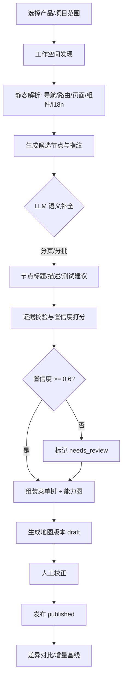
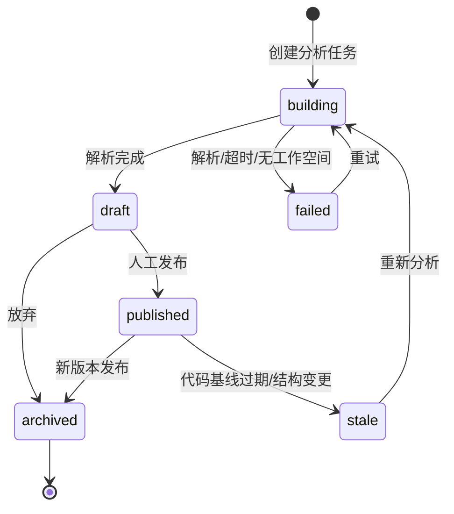
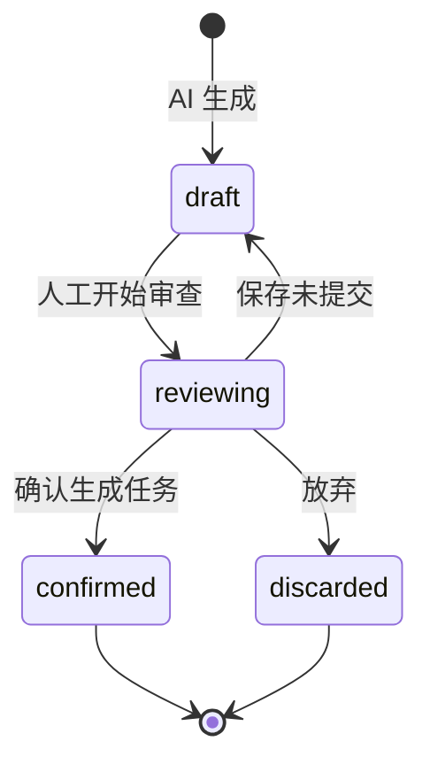
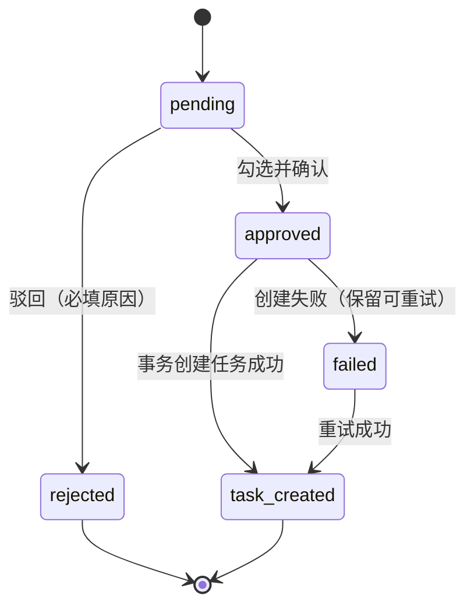
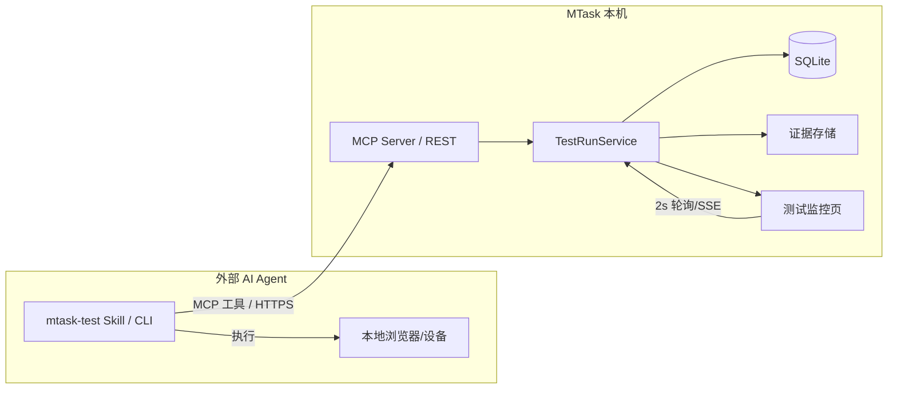
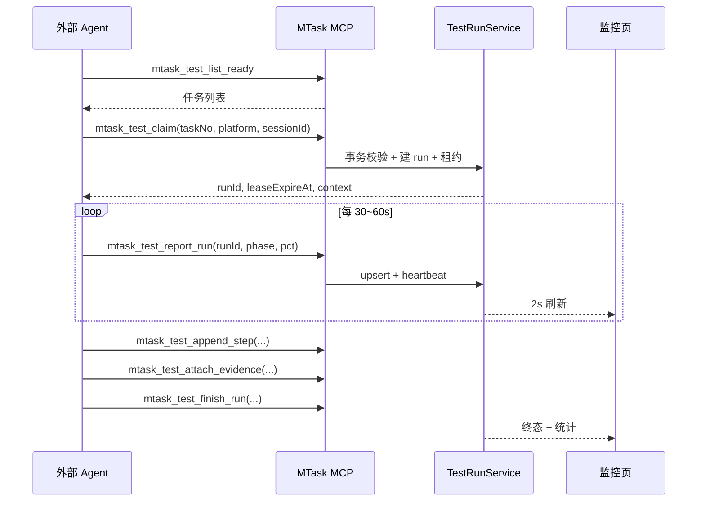
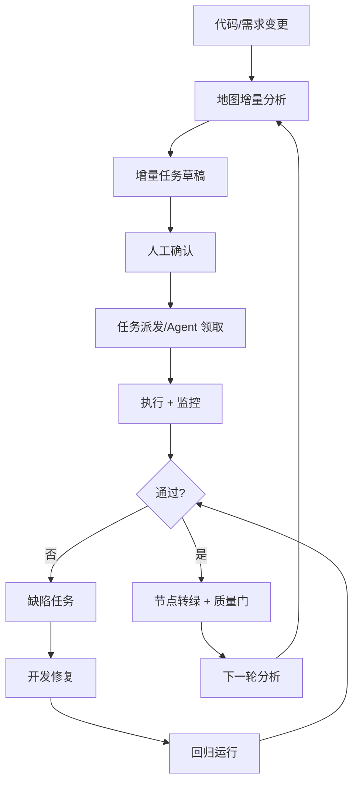
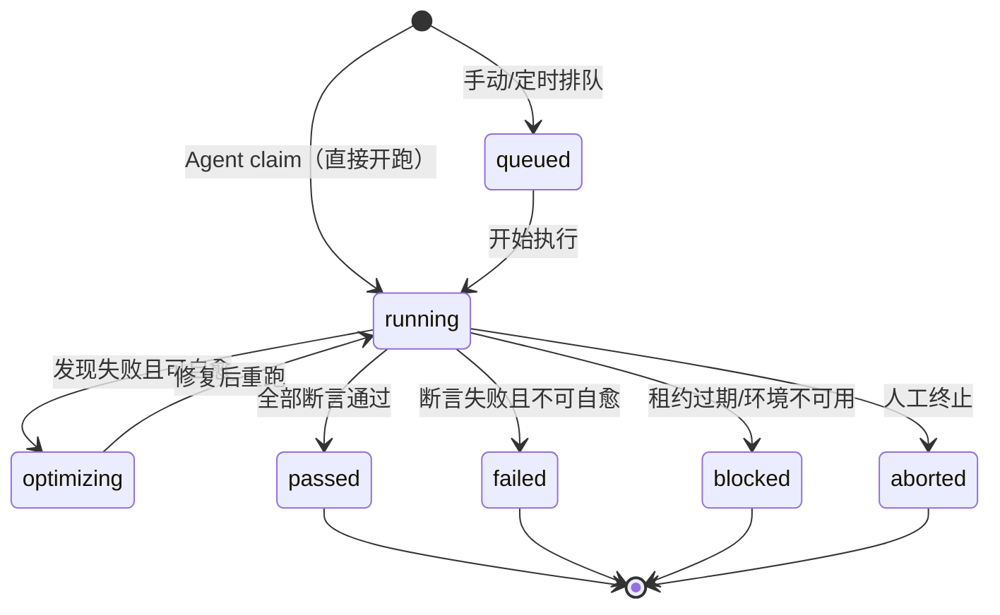
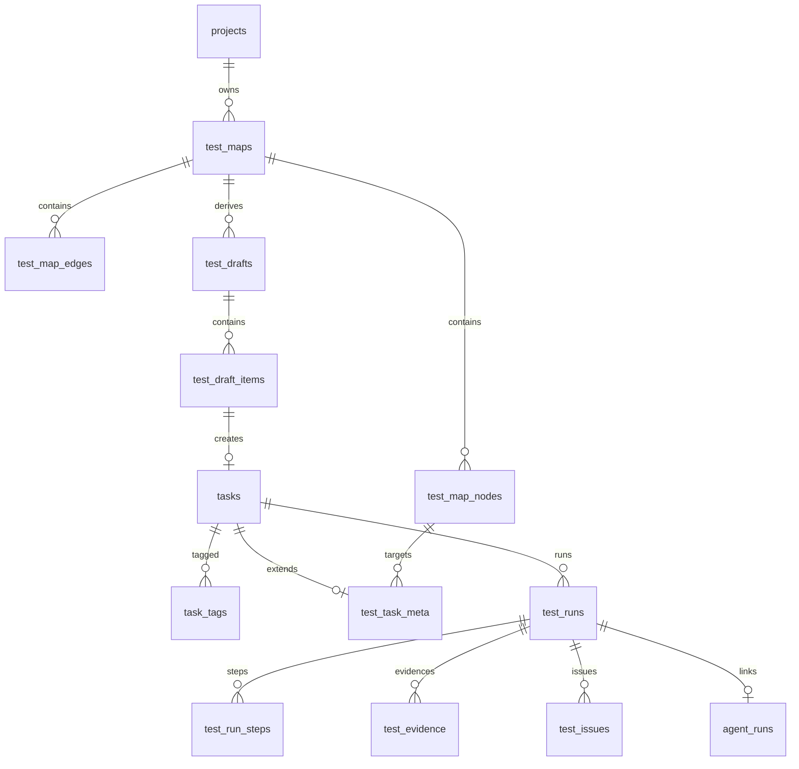

# PRD：MTask「测试」菜单模块（AI 驱动 UI 自动化测试闭环）

> 版本：v1.0 ｜ 日期：2026-11-26 ｜ 状态：待评审 ｜ 作者：产品（AI 辅助） ｜ 任务：T06393
>
> 关联文档：`docs/PRD-测试用例管理.md`（手工用例基线）、`docs/PRD-AI编排大脑监控外部平台持续执行.md`（执行会话与监督器）、`docs/MCP接口文档.md`（MCP 接入规范）
>
> 关联模块：一级导航、任务菜单、项目/计划、AI 控制台（执行会话）、MCP 服务、Skills 技能包

---

## 1. 修订记录

| 版本 | 日期 | 修订人 | 变更说明 | 关联任务 |
|---|---|---|---|---|
| v0.1 | 2026-11-26 | 产品（AI 辅助） | 首版：竞品调研、地图/拆分/监控/协议/数据模型/验收全量初稿 | T06393 |
| v1.0 | 2026-11-26 | 产品（AI 辅助） | 补齐全量/增量判定阈值、KPI 口径、权限矩阵、文件级实施清单，提交评审 | T06393 |

**评审结论记录**

| 评审日期 | 参与角色 | 结论 | 待办 |
|---|---|---|---|
| 待评审 | 产品 / 研发 / 测试 | — | — |

---

## 2. 背景与目标

### 2.1 背景

MTask 已具备「PRD 导入 → 需求跟踪矩阵 → 计划/待办 → 外部 Agent 执行 → 执行会话观测」的完整链路，但**测试侧**仍是断点：

1. **测试资产分散**：手工用例在「测试用例视图」，UI 自动化脚本散落在各仓库，AI 测试任务靠人手写提示词，三者互不关联。
2. **没有产品级测试地图**：系统不知道产品有多少菜单、页面、功能点，哪些已被测试覆盖，哪些从未被验证，覆盖率不可度量。
3. **测试任务拆分靠人**：面对一次版本迭代，人工判断「测哪里、拆多细、派给谁」效率低且不一致，容易漏测。
4. **执行过程是黑盒**：外部 Agent 执行 UI 测试时，进度、阶段、失败步骤、截图证据无法在 MTask 内实时看到。
5. **没有闭环**：测试失败后缺陷登记、修复、回归、再测试依赖人工串联；代码变更后也无法自动判断哪些测试需要重跑。

「测试」菜单要把这条链路补成闭环：**分析地图 → 拆分任务 → 草稿审查 → 派发执行 → 实时监控 → 缺陷闭环 → 增量再拆分**。

### 2.2 本期目标

| 编号 | 目标 | 衡量方式（验收口径） |
|---|---|---|
| G1 | 建立产品级「菜单地图 + 功能地图」双地图，并可重分析、可版本化 | 200 个节点规模下，全量分析 P90 ≤ 3 分钟；人工抽检节点有效率 ≥ 85% |
| G2 | 支持按菜单/页面/功能点三种粒度，生成全量或增量测试任务草稿 | 三种粒度均可生成；草稿确认后 100% 落入指定项目「任务」菜单 |
| G3 | 所有生成的测试任务带「测试」标签，可在任务列表筛选 | 任务列表按标签筛选可命中全部生成任务，标签缺失率 0 |
| G4 | 每个测试任务关联专属监控视图，实时展示进度与统计 | 运行中状态刷新延迟 ≤ 2s；进度、阶段、步骤、断言、证据五类信息齐全 |
| G5 | 外部 Agent 可通过 MTask MCP + Skill 完成任务领取、过程回写、结果回写 | 单任务全流程无需人工介入（审批除外）；协议调用成功率 ≥ 99% |
| G6 | 支持增量分析：代码变更后只派生受影响节点的任务 | 增量命中率 ≥ 80%（人工复核口径）；重复任务率 0 |
| G7 | 形成「失败 → 缺陷 → 修复 → 回归 → 节点转绿」闭环 | 失败运行可一键生成缺陷任务；缺陷关闭后回归通过，节点健康度自动转绿 |

### 2.3 非目标（本期不做）

| 非目标 | 说明 |
|---|---|
| 内置 UI 测试执行引擎 | MTask 不自建 Playwright Runner；执行交给外部 Agent（WorkBuddy / Trae / Claude Code 等），MTask 只做编排、协议与监控 |
| 性能/接口/安全测试 | 本期聚焦 UI E2E；数据模型预留 `test_kind`，后续扩展 |
| 手工用例改造 | 现有 `test_cases` / `case_steps` 保持不变，本期不合并、不迁移 |
| 测试环境管理 | 不负责测试环境部署、账号池、数据准备；由 Agent 侧按上下文自备 |
| CI/CD 深度集成 | 本期仅预留 Webhook / REST 触发；Jenkins/GitHub Actions 双向同步放 P2 |
| 多租户计费 | 单机/小团队自用为主，本期不做套餐与计费 |

### 2.4 竞品调研（GitHub 同类产品）

#### 2.4.1 调研范围与方法

- 检索源：GitHub Search API（仓库名/描述/主题检索），关键词覆盖 `AI UI automation testing`、`e2e-testing + ai`、`playwright mcp`、`browser-use`、`test automation platform`。
- 取样：按 Star 数与近期活跃度选取 7 个代表性项目；Star 数为 **2026-11-26** 抓取快照。
- 阅读材料：各仓库 README、架构说明、工具清单、报告/CLI 文档；不引用未在仓库中公开的能力。
- 商业产品（Testim、mabl、QA Wolf）仅作为体验参照，不作为功能承诺来源。

#### 2.4.2 竞品概览

| 项目 | Star | 语言/许可 | 定位 | 与本模块的关系 |
|---|---:|---|---|---|
| `web-infra-dev/midscene` | 15,769 | TypeScript / MIT | 自然语言 + 视觉驱动的跨端 E2E 测试框架 | **最接近目标形态**：地图→用例→执行→步骤报告 |
| `Skyvern-AI/skyvern` | 23,545 | Python / AGPL-3.0 | LLM + CV 驱动的浏览器工作流自动化 | **执行与观测范式**：任务/工作流、实时视口、结构化输出 |
| `microsoft/playwright-mcp` | 40,151 | TypeScript / 见仓库 | Playwright 的 MCP 服务，向 LLM 暴露浏览器能力 | **Agent 协议范本**：工具粒度、快照、断言、安全边界 |
| `antiwork/shortest` | 5,706 | TypeScript / 见仓库 | 自然语言 E2E 测试框架（Playwright + Claude） | **测试 DSL 与生命周期**：链式用例、钩子、CI |
| `bug0inc/qa-agent` | 1,338 | TypeScript / FSL | AI 浏览器回归测试库（缓存、自愈、多模型断言） | **降本与稳定性**：步骤缓存、自愈留痕、共识断言 |
| `testsigmahq/testsigma` | 1,235 | Java / Apache-2.0 | GenAI 无代码测试平台（5 个 Agent 协作） | **平台化与角色分工**：生成/执行/分析/修复/优化 |
| `TestSprite/testsprite-cli` | 5,229 | TypeScript / 见仓库 | AI 自动化测试 CLI（Playwright 内核） | **CLI + 平台协作**：终端触发、结果回传 |

#### 2.4.3 五维对比（架构 / 技术实现 / UX / 扩展性 / UI）

| 维度 | Midscene | Skyvern | Playwright MCP | Shortest | Bug0 AI | Testsigma |
|---|---|---|---|---|---|---|
| **架构设计** | SDK + YAML 测试框架 + Chrome 扩展 + 多端 Agent；测试项目与 Agent API 分层 | API Server + UI + Worker + 工作流引擎；Playwright 兼容 SDK；Agent 集群 | 单 MCP Server + 浏览器上下文；工具按能力分包（core/vision/testing/storage） | 轻量 CLI + Playwright Test 插件；无平台层 | Playwright 库 + Redis 缓存 + 多模型断言引擎 | 单体平台（Java）+ Agent 编排 + 设备云 + 集成市场 |
| **技术实现** | 截图视觉定位，不依赖 DOM；`aiAct / aiWaitFor / aiAssert`；YAML 用例 + TypeScript Node；步骤级报告 | 视觉 LLM 规划动作；`page.act/extract/validate/prompt`；Task/Workflow 两级编排；支持循环、HTTP、代码块 | 无障碍树（accessibility tree）而非像素；确定性工具调用；`browser_verify_*` 断言；支持快照/录制/追踪 | 自然语言步骤直接驱动 Playwright；支持链式用例、生命周期钩子、API 测试 | 步骤缓存（Redis）+ 失败自愈；Claude/Gemini 共识断言 + 仲裁；视频断言 | Generator/Runner/Analyzer/Healer/Optimizer 五 Agent；自然语言 + 录制器 |
| **客户体验（UX）** | 写完即跑；HTML 报告含截图、元素定位、AI 决策与回放；失败可 `#runner-step` 深链 | 可视化工作流搭建；执行时实时视口直播；可人工接管 | 贴近 IDE/聊天客户端；快照文本可读；无需视觉模型 | 极简：一个函数一行自然语言；CLI 直跑；CI 即插即用 | API 简洁；失败有 AI 摘要；视频断言覆盖瞬时 UI | 无代码、角色分工清晰、30+ 集成；学习成本低但平台重 |
| **功能扩展** | 多端（Web/Android/iOS/HarmonyOS/桌面）、自定义接口、Skills、模型可换 | 凭据管理、2FA、文件下载、MCP、Zapier/n8n | 能力包可插拔（vision/pdf/devtools/storage/network/testing）；可编程连接 | 回调函数、API 测试、GitHub 2FA 登录 | 8 个模型槽位、网关、邮件提取、占位符、遥测 | 插件市场、自定义动作/数据生成器、RBAC、审计 |
| **UI 升级（视觉/性能）** | 报告优先：截图时间线 + 回放 + 汇总 JSON；面向调试 | 工作流画布 + 直播视口；信息密度高 | 以文本快照替代大截图，**token 更省**；CLI+Skills 进一步降上下文 | 终端输出为主，几乎无 UI | 报告顶部 AI 摘要；证据视频化 | 仪表盘/追踪矩阵成熟，但部署重、页面层级深 |

#### 2.4.4 调研结论：12 条设计准则

| # | 准则 | 来源证据 | 本模块落地方式 |
|---|---|---|---|
| P1 | **地图是先验资产**，先有地图再有任务 | Midscene 以用例组织；Testsigma 以需求/UI 生成场景 | 双地图版本化，任务必须挂 `node_id` |
| P2 | **自然语言降低维护成本，但定位必须有证据** | Midscene 步骤报告含元素定位；Bug0 缓存键需可追溯 | 每个步骤强制 `source_refs` / 截图；无证据节点不入图 |
| P3 | **结构化快照与视觉定位双模，按成本路由** | Playwright MCP 用无障碍树；Midscene 用截图 | Agent 协议允许 `snapshot` / `vision` 两种模式，默认快照优先 |
| P4 | **用例/任务与运行分离** | TestRail 式资产模型；Skyvern Task vs Workflow | `test_task_meta`（任务）与 `test_runs`（运行）分表 |
| P5 | **AI 产物必须经草稿审查才能入库** | Testsigma 生成后需确认；MTask 既有 PRD 导入同范式 | 草稿 → 审查 → 确认 → 生成任务，四态状态机 |
| P6 | **增量必须锚定代码/路由指纹**，不能凭语义猜 | Bug0 缓存键、Playwright 定位器 | `fingerprint + base_commit + git diff` 三源判定 |
| P7 | **执行过程必须可观测** | Skyvern 视口直播；Midscene 步骤报告 | 监控视图：心跳、阶段、步骤、截图、视口（可选） |
| P8 | **自愈/缓存要留痕，不能静默改断言** | Bug0 自愈与缓存；Midscene 回放 | `repair` 步骤单列，自愈必须写原因与差异 |
| P9 | **报告是一等公民** | Midscene `summary.json` + HTML；Bug0 视频断言 | 运行报告可导出 Markdown/HTML，步骤级证据可回放 |
| P10 | **CLI + Skill 与 MCP 双通道，控制 token** | Playwright 官方明确 CLI+Skills 对编码 Agent 更省上下文 | 提供 `skills/mtask-test` + `scripts/mtask-test.mjs`，MCP 兜底 |
| P11 | **Agent 是受限主体，权限与审计从第一天就有** | Testsigma RBAC/审计；Playwright MCP 明确“不是安全边界” | Token scope + 租约 + 审计日志 + 不可越权 |
| P12 | **失败要能自动转缺陷并回灌** | Testsigma Analyzer/Healer；Bug0 报告 | `mtask_test_create_issue` + 缺陷任务 + 回归闭环 |

#### 2.4.5 从调研到原始需求（需求池）

| 需求编号 | 原始需求 | 来源 | 优先级 | 本期处置 |
|---|---|---|---|---|
| R1 | 自动分析工作空间，生成菜单树与页面清单 | Midscene/Testsigma | P0 | 采纳（静态解析优先 + AI 补语义） |
| R2 | 生成跨页面「功能能力图」 | Testsigma 需求→场景 | P1 | 采纳（capability 节点 + 边） |
| R3 | 支持全量/增量、三种粒度拆分 | Testsigma Generator | P0 | 采纳 |
| R4 | 草稿预览、勾选、编辑后再入库 | Testsigma/MTask PRD 范式 | P0 | 采纳 |
| R5 | 任务自动带标签、落到指定项目 | Testsigma 项目维度 | P0 | 采纳（`task_tags`） |
| R6 | 每个任务一个实时监控视图 | Skyvern 直播 | P0 | 采纳（运行详情页） |
| R7 | 步骤级截图与断言证据 | Midscene 报告 | P0 | 采纳（`test_run_steps` + 证据表） |
| R8 | 步骤缓存/自愈降本 | Bug0 | P1 | 采纳为 Agent 侧能力，MTask 记录 `repair` 步骤 |
| R9 | 多模型共识断言 | Bug0 | P2 | 暂不强制；协议预留 `model` 与 `confidence` |
| R10 | CLI/Skill 与 MCP 双通道 | Playwright CLI+Skills | P1 | 采纳 |
| R11 | 失败自动诊断与修复建议 | Testsigma Analyzer/Healer | P1 | 采纳为“缺陷任务 + 根因摘要” |
| R12 | RBAC、审计、配额 | Testsigma | P1 | 采纳（轻量 RBAC + 审计） |

### 2.5 成功指标（上线后 1 个版本周期）

| 指标 | 目标值 | 统计口径 |
|---|---|---|
| 地图节点有效率 | ≥ 85% | 人工抽检 50 个节点，标题/归属/路由正确 |
| 任务生成人工改写率 | ≤ 20% | 草稿确认时被编辑/驳回的条目占比 |
| 测试任务按期执行率 | ≥ 90% | 已确认任务在 7 天内至少 1 次运行 |
| 首次通过率（FPR） | ≥ 70% | 首轮运行通过的节点 / 首轮运行节点数 |
| 平均优化轮次 | ≤ 2 轮 | 单任务从开跑到稳定通过的自愈/修复轮次 |
| 增量误报率 | ≤ 20% | 人工驳回的增量条目 / 增量条目总数 |
| 单任务执行成本 | 基线下降 30% | tokens / cost 对比人工脚本方案 |

---

## 3. 用户角色与使用场景

### 3.1 角色定义

MTask 当前以单用户/小团队自用为主，**角色是逻辑角色**：默认 `test.rbacEnabled=0` 时，项目 owner 拥有全部角色；启用 RBAC 后按下表分配。

| 角色 | 核心诉求 | 主要痛点 | 关键权限 |
|---|---|---|---|
| 产品经理（PM） | 知道产品被测了多少、哪里高风险；确认测试范围 | 不知道改版影响面；测试报告看不懂 | 查看地图/统计；发起分析；查看草稿；查看运行 |
| 测试负责人（QA Lead） | 把测试拆得准、派得动、盯得住 | 拆分靠人；进度不可见；失败无闭环 | 全流程：分析、编辑地图、确认草稿、派发、终止、裁决缺陷 |
| 开发工程师（Dev） | 快速知道哪个功能挂了、怎么修 | 失败信息碎；复现难 | 查看本项目地图/运行；接收并修复缺陷任务；提交修复证据 |
| AI Agent（外部） | 拿到明确任务、上下文、回写规范 | 上下文缺失；不知道验收标准；重复领取 | 读取任务上下文；领取已批准任务；回写运行/步骤/证据；创建缺陷；**不可审批/发布** |
| 管理员（Admin） | 系统可控、可审计、可熔断 | 成本失控；Agent 越权 | 配置模型/预算/并发；发布或回滚地图；熔断；删除版本；查看全量审计 |

### 3.2 核心使用场景

#### S1 首次建立产品测试地图（PM/QA Lead）

- **前置**：项目已绑定工作空间（`projects.workspace_path`），代码可读；项目已绑定 `product_key`（跨项目产品级地图需要）。
- **主流程**：进入「测试 → 测试地图」→ 选择产品/项目范围 → 点击「AI 分析」→ 查看分析进度（阶段、已扫描文件、已识别节点）→ 生成草稿地图 → 人工校正（改名/合并/废弃）→ 发布版本。
- **异常**：工作空间不可读 → 提示配置路径；分析超时 → 保留中间结果并可续跑；AI 输出无法解析 → 降级为「仅静态解析」并标注缺口。

#### S2 评审并确认测试任务草稿（QA Lead）

- **前置**：存在已发布地图版本。
- **主流程**：进入「测试任务」→ 新建拆分（全量/增量、菜单/页面/功能点、目标项目）→ AI 生成草稿 → 表格审查（勾选、编辑标题/描述/优先级、驳回并填原因）→ 批量确认 → 系统在目标项目创建待办并打「测试」标签 → 展示任务编号清单。
- **异常**：同名任务已存在 → 按 `dedupe_key` 跳过并标「已存在」；目标项目无权限 → 整批预检失败，不落半批。

#### S3 外部 Agent 执行并回写监控（AI Agent + QA Lead）

- **前置**：任务已确认并处于 `todo`；Agent 持有带 `test:read/write` scope 的 Token。
- **主流程**：Agent 调 `mtask_test_list_ready` → `mtask_test_claim` 领取 → 拉取上下文 → 执行 → 周期上报进度 → 逐步回写步骤/断言/截图 → `mtask_test_finish_run` 收口 → MTask 更新任务状态与监控视图 → QA 在看板查看。
- **异常**：租约到期 → 运行置 `blocked`；重复领取 → 409；证据超限 → 413。

#### S4 版本迭代后的增量派生（PM/QA Lead）

- **前置**：已有发布地图 + 基线 commit；代码已合并到工作空间。
- **主流程**：进入「测试任务」→ 点击「增量分析」→ 系统 diff 出受影响节点 → 生成增量草稿（默认只勾选受影响且无开放任务的节点）→ 审查确认 → 生成任务。
- **异常**：结构变更超过阈值 → 推荐全量并说明原因；用户可强制增量。

#### S5 失败闭环：缺陷 → 修复 → 回归（QA + Dev）

- **前置**：运行失败且存在失败断言。
- **主流程**：监控页点击「生成缺陷」→ 填写严重级别/复现步骤 → 自动在目标项目创建缺陷任务并关联 `test_issues` → 开发修复并回写 → QA 触发回归运行 → 通过后缺陷置 `verified`、节点转绿。
- **异常**：缺陷任务被关闭但回归未跑 → 节点保持红色并提示「待回归」。

#### S6 质量周报（PM）

- **主流程**：测试看板按周聚合：覆盖率、通过率、FPR、失败 Top、Flaky Top、缺陷 MTTR、成本 → 一键导出 Markdown/PDF（复用报表导出能力）。

---

## 4. 功能需求详细说明

### 4.1 功能列表

| 编号 | 功能 | 优先级 | 说明 |
|---|---|---|---|
| FR-MAP-01 | 工作空间发现与静态解析 | P0 | 读取项目 `workspace_path`、嵌套仓库、路由/导航配置、页面目录 |
| FR-MAP-02 | AI 语义补全 | P0 | 为页面/功能点生成人类可读标题、描述、预期；必须带证据 |
| FR-MAP-03 | 双地图生成 | P0 | 菜单维度树（菜单→页面→功能点）+ 功能维度图（capability 节点与边） |
| FR-MAP-04 | 地图版本化 | P0 | 每次分析生成不可变版本；发布一个 active 版本 |
| FR-MAP-05 | 人工校正 | P0 | 改名、合并、拆分、废弃、新增；人工修改优先于后续 AI 结果 |
| FR-MAP-06 | 重分析与差异对比 | P0 | 版本 diff：新增/删除/改名/路由变更 |
| FR-MAP-07 | 地图健康度 | P1 | 节点 `untested/green/red/flaky/stale` 派生 |
| FR-MAP-08 | 地图导出 | P1 | Markdown / JSON / CSV（节点清单） |
| FR-SPLIT-01 | 范围选择 | P0 | 产品级 / 项目级 |
| FR-SPLIT-02 | 全量/增量选择 | P0 | 增量需基线；不满足时禁用并说明 |
| FR-SPLIT-03 | 三种粒度 | P0 | 菜单级 / 页面级 / 功能点级 |
| FR-SPLIT-04 | 草稿生成 | P0 | 生成条目含标题、描述、优先级、目标项目、节点路径 |
| FR-SPLIT-05 | 草稿审查 | P0 | 勾选、全选、反选、编辑、驳回（必填原因） |
| FR-SPLIT-06 | 确认生成任务 | P0 | 事务内创建任务 + 标签 + `test_task_meta`，幂等 |
| FR-SPLIT-07 | 批量操作 | P1 | 批量改优先级/目标项目/删除条目 |
| FR-SPLIT-08 | 去重 | P0 | `dedupe_key` 跨草稿、跨版本防重复 |
| FR-SPLIT-09 | 任务模板 | P0 | 三级粒度各一套模板，支持变量占位 |
| FR-SPLIT-10 | 拆分预检 | P1 | 目标项目权限、同名任务、地图版本过期提示 |
| FR-MON-01 | 运行列表/看板 | P0 | 状态分列卡片；按项目/平台/状态筛选 |
| FR-MON-02 | 任务级监控视图 | P0 | 任务详情内嵌入运行监控 |
| FR-MON-03 | 实时进度 | P0 | 阶段、百分比、当前步骤、心跳、租约 |
| FR-MON-04 | 步骤时间线 | P0 | 动作/断言/观察/修复/产物五类 |
| FR-MON-05 | 证据画廊 | P0 | 截图、录屏、日志、trace 链接 |
| FR-MON-06 | 统计与 KPI | P0 | 通过率、FPR、Flaky、成本、时长 |
| FR-MON-07 | 运行操作 | P0 | 终止、重派、标记通过、导出报告 |
| FR-MON-08 | 测试看板 | P1 | 覆盖率热力图、趋势、Top 失败 |
| FR-PROT-01 | Agent Token 与 scope | P0 | `test:read` / `test:write` / `test:admin` |
| FR-PROT-02 | 任务上下文工具 | P0 | `mtask_test_get_context` |
| FR-PROT-03 | 就绪列表与认领 | P0 | `mtask_test_list_ready` / `mtask_test_claim` |
| FR-PROT-04 | 运行上报 | P0 | `mtask_test_report_run` |
| FR-PROT-05 | 步骤回写 | P0 | `mtask_test_append_step` |
| FR-PROT-06 | 证据回写 | P0 | `mtask_test_attach_evidence` |
| FR-PROT-07 | 运行收口 | P0 | `mtask_test_finish_run` |
| FR-PROT-08 | 缺陷创建 | P1 | `mtask_test_create_issue` |
| FR-PROT-09 | Skill 技能包 | P1 | `skills/mtask-test` + CLI 包装 |
| FR-CLOSE-01 | 缺陷任务联动 | P0 | 失败运行 → 缺陷任务 → 修复 → 回归 |
| FR-CLOSE-02 | 节点健康度回写 | P0 | 运行结果驱动节点颜色 |
| FR-CLOSE-03 | 回归触发 | P1 | 缺陷修复后自动生成回归草稿 |
| FR-CLOSE-04 | 质量门 | P1 | 连续通过/无 P0/P1 才可置健康 |
| FR-CLOSE-05 | 质量周报 | P2 | 按周聚合导出 |
| FR-PERM-01 | 角色权限矩阵 | P0 | 见 §4.10 |
| FR-PERM-02 | 审计日志 | P0 | 关键动作全留痕 |
| FR-PERM-03 | 熔断与预算 | P1 | 分析/执行成本上限 |
| FR-PERM-04 | 敏感信息脱敏 | P0 | Token、Cookie、账号不出现在证据与日志 |

### 4.2 模块定位与信息架构

**定位：新增一级导航「测试」**，位于「项目」与「AI 控制台」之间。

理由：
1. 测试地图是**产品维度**资产（可跨项目聚合），放进项目内二级页签会导致「同一产品多项目各建一份地图」，无法形成产品级覆盖率。
2. 测试任务需要与「任务」菜单双向互通（任务列表可见、项目维度可筛选），一级导航更符合用户「测试是一项独立工作」的心智。
3. 执行会话、监督器已在 AI 控制台，测试运行需要引用会话与 Run，但不应把测试业务塞进 AI 控制台，避免概念混淆。

```
一级导航（PrimaryNav）
├─ 首页：概览 / 收件箱
├─ 任务：任务
├─ 项目：计划 / 需求 / 报表
├─ 测试：测试看板 / 测试地图 / 测试任务 / 测试运行   ← 新增
├─ AI 控制台：队列 / 执行会话 / 提示词 / 模型
└─ 设置：设置
```

**二级页签职责**

| 页签 | key | 职责 | 默认落点 |
|---|---|---|---|
| 测试看板 | `test-dashboard` | 覆盖率、通过率、趋势、Top 失败、成本 | 是 |
| 测试地图 | `test-map` | 双地图浏览/编辑/版本/重分析 | 否 |
| 测试任务 | `test-tasks` | 拆分草稿、审查、确认、任务清单 | 否 |
| 测试运行 | `test-runs` | 运行列表/看板、进入运行详情 | 否 |

运行详情为深链页 `test-run-detail`（不占二级页签）：`/test-runs/:runId` 或 `?runId=`，从任务详情、运行列表、全局搜索均可直达。

每个测试任务另有**专属监控页** `test-task-monitor`（`/test/tasks/:taskNo/monitor`）：汇总该任务全部运行、最新进度、KPI、缺陷与回归记录；任务详情页提供「打开监控视图」按钮，运行列表的任务标题也直达该页。

**与既有模块的数据互通**

| 既有模块 | 互通方式 |
|---|---|
| 任务菜单 | 生成任务写入目标项目；`task_tags` 打「测试」标签；任务详情显示关联地图节点与最近运行 |
| 项目/计划 | 地图节点记录 `project_id`；可选把测试任务挂到计划条目（P2） |
| 需求矩阵 | 可选 `test_task_meta.req_ids` 关联需求编号，形成「需求→测试」追溯 |
| AI 控制台/执行会话 | 运行关联 `exec_sessions` 心跳；可选创建 `agent_runs` 记录执行者/成本；测试步骤以 `test_run_steps` 为准，监控页由 `TestRunService` 提供 |
| 测试用例 | 预留 `test_task_meta.case_ids`，后续把 AI 运行结果回写到手工用例的 `last_result` |

### 4.3 地图生成逻辑

#### 4.3.1 输入与证据优先级

| 优先级 | 输入 | 用途 | 缺失时 |
|---|---|---|---|
| 1 | 导航配置（`primaryNavGroups.ts`、路由表 `tabs.ts` / router） | 菜单树、页面路由的**事实来源** | 降级扫描 `pages/` 目录，标记「结构推测」 |
| 2 | 页面文件与组件导出（AST） | 页面节点、功能点候选 | 该页面只生成页面级节点，不生成功能点 |
| 3 | i18n 文案 / 按钮文字 / 表单 label | 功能点命名与描述 | 用组件名 + 位置兜底 |
| 4 | Git 历史与 PRD 文档 | capability 归并、影响面提示 | 跳过，不影响主流程 |
| 5 | LLM 语义归纳 | 标题润色、功能归类、测试建议 | 保留机械命名，标记 `needs_review` |

**硬规则：AI 不得凭空造页面。** 每个 `page` 节点必须有 `route` 或 `source_refs` 指向真实文件；每个 `function` 节点必须有至少 1 个 `source_ref`（文件 + 符号/选择器/i18n key）。校验不通过直接丢弃，不进入草稿。

**入口标识口径**：MTask 桌面端页面以 `Tab` key 为稳定标识（如 `plan`、`tasks`），不依赖 URL 路由；Web 端可由 `mtaskNavigate` 深链。`route` 字段统一存「Tab key 或 URL path」，`entry` 存人类可读路径（如「项目 → 计划 → PERT 估算」）。

#### 4.3.2 生成流水线



**阶段说明**

1. **工作空间发现**：读取项目 `workspace_path`；若为产品级，聚合同 `product_key` 的全部项目；解析嵌套仓库（复用 `nestedRepos` 逻辑），排除 `node_modules`、`dist`、`release`、`.git`。
2. **静态解析**：
   - 导航：解析 `NAV_GROUPS` 常量（label、tabs、defaultTab），生成 `menu` 节点（一级）与 `menu` 节点（二级页签）。
   - 路由：解析 `TABS` 或 router 配置，生成 `page` 节点；`page.route` 取路由 path，`page.source_refs` 记录页面文件。
   - 功能点：解析页面组件中的交互元素（`button`、`input`、`select`、`dialog` 触发器、菜单项），生成候选 `function` 节点；用 i18n key 或可见文案命名。
3. **指纹计算**：
   ```
   fingerprint = sha1(
     route path + component export name +
     sorted(visible text/i18n keys) +
     sorted(interactive element roles/names) +
     source file content hash
   )
   ```
4. **AI 语义补全**：按页面分批（每批 ≤ 20 个页面），输入**结构化摘要**（路由、标题、元素清单、i18n key），不传整份源码；要求输出 JSON 数组。模型输出必须通过 JSON Schema 校验，失败重试 1 次后降级为机械命名。
5. **能力图归并**：把跨页面的功能点归并为 `capability` 节点（例如「PRD 导入」「工作量评估」「任务派发」），边类型 `covers` 指向页面/功能点；归并要求至少 2 个证据节点，否则不建 capability。
6. **校验与打分**：`confidence` 由证据数量、路由匹配、AI 一致票数加权；< 0.6 标 `needs_review`。
7. **版本落库**：`test_maps` 记录版本、基线 commit、节点统计、覆盖率快照；节点/边写入 `test_map_nodes` / `test_map_edges`。
8. **人工校正**：地图页支持改名、合并、拆分、废弃、手动新增；人工修改写 `origin='manual'`，后续分析以人工值为准（不覆盖，只提示差异）。
9. **发布**：发布后成为 `active` 版本，上一版转 `archived`（只读）；发布动作写审计。

#### 4.3.3 双地图定义

| 地图 | 结构 | 节点层级 | 主要用途 |
|---|---|---|---|
| 菜单维度地图 | 树（`parent_id`） | `menu` → `menu`（二级）→ `page` → `function` | 回答「产品有哪些界面、每个界面有什么功能」；用于覆盖率与菜单级拆分 |
| 功能维度地图 | 图（`test_map_edges`） | `capability` + `function` + `page` | 回答「一个业务能力跨哪些页面」；用于跨页面场景测试与影响面分析 |

节点层级约束：
- `menu` 必须有 `title`，`route` 可空（一级菜单无路由）。
- `page` 必须有 `route` 或 `source_refs`。
- `function` 必须挂在 `page` 下（`parent_id` 指向 page）。
- `capability` 不挂树，只通过 `covers` 边关联 `page/function`。

#### 4.3.4 动态更新机制

| 触发方式 | 说明 | 默认行为 |
|---|---|---|
| 手动重分析 | 地图页「重新分析」 | 生成新版本；与当前 active 版本做 diff |
| 代码变更触发 | 检测到 `git diff` 超过阈值（P1） | 提示「检测到 N 个文件变更，建议增量分析」；不自动发布 |
| 定时分析 | 每日/每周（P2） | 生成 `draft` 版本，通知 QA 审核 |
| 发布后回写 | 运行失败集中的节点 | 标记 `high_risk`，下次拆分优先勾选 |

**地图状态机**



### 4.4 任务拆分规则与模板

#### 4.4.1 范围：产品级 vs 项目级

| 维度 | 产品级 | 项目级 |
|---|---|---|
| 地图范围 | 同 `product_key` 下全部项目工作空间 | 单项目工作空间 |
| 适用 | 跨项目产品验收、版本回归 | 单项目日常迭代、模块自测 |
| 任务落点 | 按节点 `project_id` 落到所属项目；无归属时落 `default_project_id` | 统一落当前项目 |
| 覆盖率口径 | 产品全量节点 | 项目节点子集 |
| 风险 | 工作空间多、分析慢 | 看不到跨项目能力 |

#### 4.4.2 三种拆分粒度

| 粒度 | 一条任务对应 | 覆盖内容 | 预计任务规模（200 节点产品） | 适用节奏 |
|---|---|---|---|---|
| 菜单级 | 1 个一级菜单或二级页签 | 该菜单下全部页面：导航可达、页面渲染、主流程冒烟、空/错状态抽查 | 10~30 条 | 周回归、版本验收 |
| 页面级 | 1 个页面/路由 | 页面渲染、主交互、表单校验、列表筛选、异常提示 | 30~80 条 | 迭代回归、页面改版 |
| 功能点级 | 1 个功能点（按钮/弹窗/表单/筛选器） | 单功能正向 + 反向 + 边界；前置条件与预期结果明确 | 100~300 条 | 精细验收、缺陷复验 |

**粒度选择建议**（UI 引导，不强制）：
- 首次建图 → 菜单级（快速铺开覆盖率）
- 版本迭代 → 页面级（平衡成本与覆盖）
- 高风险模块/缺陷复验 → 功能点级

#### 4.4.3 全量 vs 增量：触发条件判断逻辑

**基线定义**：`test_maps.base_commit`（按仓库记录 JSON）、`workspace_fingerprint`、`published_at`、`node_fingerprints` 快照。

**判定表**

| 条件 | 判定 | 处理 |
|---|---|---|
| 无已发布地图 | 全量 | 强制全量，增量选项禁用 |
| 基线 commit 不存在/不可达（rebase、强制推送） | 全量 | 提示「基线丢失，需全量重建」 |
| 工作空间路径变更 / `product_key` 变更 | 全量 | 提示范围变化 |
| 导航/路由结构变更节点占比 ≥ 10% | 全量（推荐） | 默认全量，用户可强制增量并写原因 |
| 距上次发布 > 30 天且变更文件占比 ≥ 30% | 全量（推荐） | 同上 |
| 有基线且变更文件占比 < 30% | 增量 | 走影响面算法 |
| 用户显式选择 | 以用户为准 | 强制全量/增量均记录审计 |

**增量影响面算法（可执行伪代码）**

```text
输入: baseCommit, headCommit, activeMap, fullThreshold=0.3
1. changedFiles = git diff --name-only baseCommit..headCommit（全部子仓库合并）
2. changedRoutes = 路由表 diff（新增/删除/改 path）
3. changedSymbols = AST diff（导出组件/函数/常量）
4. directNodes = 节点满足任一:
     source_refs 命中 changedFiles
     或 route 命中 changedRoutes
     或 fingerprint 变化
5. affected = directNodes
     ∪ ancestors(directNodes)            // 菜单/页面导航冒烟必须带上
     ∪ sharedComponentDependents(directNodes)  // 共享组件被多个页面引用时全部标记
6. ratio = |affected| / |activeNodes|
7. if navChangedRatio >= 0.10 or ratio >= fullThreshold:
       recommend = FULL，返回原因与受影响节点清单
   else:
       recommend = INCREMENTAL
8. 增量条目过滤:
     仅保留 affected 中 status=active 的节点
     跳过已有开放测试任务（todo/running/waiting）的节点
     跳过 fingerprint 未变且最近 regressionWindow=7 天内已通过的节点
     新节点（status=new）始终保留
9. 输出草稿（默认只勾选前 8 步保留的节点，用户可全选）
```

**增量准确性反馈**：
- 草稿条目被驳回时必填原因（`误报/已覆盖/优先级低/其他`）。
- `误报` 计入增量误报率；`未覆盖但未识别` 由人工手动新增，计入漏报。
- 每次增量提交后写 `test_audit_logs`，供后续调阈值。

#### 4.4.4 去重规则

`dedupe_key = sha1(normalize(node_code) + granularity + target_project_id + map_scope)`

- 同一 `dedupe_key` 在**任意历史草稿**中已确认生成任务，且该任务未归档、未完成 → 新草稿条目标「已存在（Txxxxx）」，默认不勾选。
- 任务已完成但节点 fingerprint 变化 → 允许重新生成，`dedupe_key` 追加 `fingerprint` 短哈希。
- 同一节点在菜单级已建任务，页面级仍可建（粒度不同，`dedupe_key` 不同），但 UI 提示「该节点已有菜单级任务，建议等待其完成」。

#### 4.4.5 任务模板

模板变量：`{产品}`、`{项目}`、`{菜单路径}`、`{页面}`、`{功能点}`、`{地图版本}`、`{验收阈值}`、`{证据要求}`。

**菜单级模板（基准句式，必须包含 T06393 示例语义）**

```markdown
## 测试目标
对「{菜单路径}」菜单页面，进行全面 UI 测试。

## 覆盖范围
- 菜单入口可达：从首页可逐级进入，面包屑/页签正确。
- 页面清单：{页面清单}
- 每个页面至少覆盖：首屏渲染、主操作路径、空数据态、异常提示。

## 执行要求
1. 按页面顺序执行，记录每一步操作、预期、实际与截图。
2. 对生成物进行质量检查：截图完整性、断言有效性、失败原因可定位。
3. 发现问题先登记缺陷，再继续执行，不中断整条任务。
4. 全面优化：对失败步骤做最小修复或给出明确修复建议；优化过程单独记录为「repair」步骤。
5. 循环「执行 → 质量检查 → 优化」直至通过高质量标准。

## 验收标准
- 通过率 ≥ {验收阈值}（默认 95%），无 P0/P1 未闭环缺陷。
- 每个页面至少 1 张关键截图；失败断言必须有实际值/截图。
- 连续 2 轮运行通过（允许 1 轮优化）。

## 回写要求
使用 MTask 测试 MCP 工具回写 run/step/assertion/evidence；结束时提交 summary。
```

**页面级模板**

```markdown
## 测试目标
对「{菜单路径} → {页面}」进行页面级 UI 自动化测试。

## 前置条件
- 已登录测试账号；目标环境 {baseUrl}。
- 依赖数据：{数据准备说明}

## 覆盖范围
1. 页面加载：标题、面包屑、默认 Tab/空态正确。
2. 主流程：{主流程步骤}
3. 表单/筛选：必填校验、边界值、清空/重置。
4. 异常：接口失败/空列表/无权限提示。
5. 视觉：关键元素可见、无遮挡、无溢出（桌面 1280×800 与 1440×900）。

## 验收标准
- 通过率 ≥ {验收阈值}；P0/P1 缺陷 0；关键路径截图齐全。
```

**功能点级模板**

```markdown
## 测试目标
验证功能点「{功能点}」（所属页面：{页面}）。

## 前置条件
{前置条件}

## 测试步骤
1. {步骤 1} → 预期：{预期 1}
2. {步骤 2} → 预期：{预期 2}
3. 反向用例：{反向操作} → 预期：{错误提示/不可提交}
4. 边界用例：{边界值} → 预期：{边界行为}

## 验收标准
- 正向/反向/边界全部执行；断言逐条回写。
- 失败必须附实际结果与截图；修复后回归通过。
```

#### 4.4.6 标题与优先级

- 标题格式：`【测试】{节点标题}·{粒度}｜{产品/项目}｜v{地图版本短号}`
  - 示例：`【测试】PERT 估算·菜单级｜MTask｜v20261126-1`
  - 长度 ≤ 60 字符；超出截断节点标题并保留粒度/版本。
- 优先级映射：
  - 菜单级：默认 `normal`；核心菜单（首页/任务/项目）`high`。
  - 页面级：默认 `normal`；近 30 天有失败/P0 缺陷的页面 `high`。
  - 功能点级：默认 `normal`；失败复验/支付/权限类 `urgent` 或 `high`。
- 复杂度：按节点下功能点数量估算 1~5，落 `test_draft_items.complexity`，供工期参考（不写 `plan_tasks`）。

#### 4.4.7 草稿审查与确认

**草稿状态机**



**条目状态机**



**确认生成任务的事务与幂等**

1. 预检：目标项目存在、当前用户有创建权限、地图版本未归档、条目 `dedupe_key` 未命中开放任务。
2. 逐条事务：`TaskService.create`（标题、描述、优先级、项目、`due_date` 可空）→ 写 `task_tags`（`测试`、`UI自动化`）→ 写 `test_task_meta`（`draft_item_id`、`node_id`、`map_id`、`granularity`、`acceptance_json`）→ 回填 `test_draft_items.task_id`。
3. 全部成功 → `test_drafts.status='confirmed'`，返回任务编号清单；任一条失败 → 该条 `failed`，其余继续，草稿保持 `reviewing` 并展示失败原因，支持重试。
4. 重复点击确认：已 `task_created` 的条目直接跳过（幂等），不重复建任务。
5. 确认后自动把草稿条目对应的地图节点标记 `has_task=1`（派生字段，可由查询计算，也可冗余加速）。

**草稿页交互要求**

- 表格列：勾选、节点路径、标题（可编辑）、粒度、优先级（可改）、目标项目（可改）、复杂度、状态、去重提示、驳回原因。
- 顶部：范围（产品/项目）、地图版本、粒度、全量/增量、目标项目、搜索。
- 底部批量条：已选 N 条、全选/反选、批量优先级、批量项目、确认生成、导出草稿 CSV。
- 空态：无地图 → 引导去「测试地图」；无节点 → 提示调整粒度或全量/增量。
- 危险操作：放弃草稿需二次确认；确认生成需展示「将创建 N 个任务到 X 项目」摘要。

### 4.5 监控视图与统计

#### 4.5.1 入口与层级

| 层级 | 入口 | 内容 |
|---|---|---|
| L1 测试看板 | 测试 → 测试看板 | 全局覆盖率、通过率、趋势、Top 失败、Flaky、成本 |
| L2 运行列表 | 测试 → 测试运行 | 全部 run 的看板/列表；按状态分列 |
| L3 任务监控 | 任务详情「测试运行」区块 / 运行列表点任务 | 专属监控页 `test-task-monitor`：该任务全部 run 概览、最新进度、KPI、缺陷、回归记录 |
| L4 运行详情 | 点击 run | 步骤时间线、断言、证据、缺陷、原始 Run |

#### 4.5.2 监控视图字段定义

**A. 任务头（Task Header）**

| 字段 | 来源 | 说明 |
|---|---|---|
| 任务编号/标题 | `tasks.task_no/title` | 可点击跳任务详情 |
| 标签 | `task_tags.tag` | 「测试」「UI自动化」等 chip |
| 所属项目 | `tasks.project_id` → `projects.name` | 跨项目产品地图时显示项目徽标 |
| 地图节点路径 | `test_map_nodes` 逐级 `title` | 如「项目 / 计划 / PERT 估算」 |
| 地图版本 | `test_task_meta.map_id` → `test_maps.version` | 版本 chip；过期显示琥珀色 |
| 粒度 | `test_task_meta.granularity` | 菜单/页面/功能点 |
| 最近运行状态 | `test_runs.status` | 颜色徽标 |

**B. KPI 卡片（KPI Cards）**

| KPI | 字段/公式 | 展示 |
|---|---|---|
| 通过率 | `passed / (passed + failed)`，blocked/skipped 不计分母 | 百分比 + 环形 |
| 断言数 | `assertions_passed + assertions_failed` | 数字 |
| 失败断言 | `assertions_failed` | 红色数字 |
| 优化轮次 | `optimize_rounds` | 数字 |
| 平均耗时 | `AVG(duration_ms)` 最近 5 次 | 秒 |
| 成本 | `SUM(tokens)`、`SUM(cost)` 最近 5 次 | Token / ¥ |
| 首次通过 | 首次运行即 passed 的 run 占比 | 百分比 |
| 稳定性 | 最近 3 次同指纹运行结果翻转次数 | Flaky 标记 |

**C. 实时运行块（Live Run）**

| 字段 | 来源 | 刷新 |
|---|---|---|
| 运行 ID | `test_runs.id` | 静态 |
| 状态 | `test_runs.status` | 2s |
| 平台/会话 | `platform` / `session_id` | 2s |
| 进度 | `progress`（0~100） | 2s |
| 阶段 | `phase`（如「打开页面」「执行断言」） | 2s |
| 当前步骤 | 最新 `test_run_steps`（status=running） | 2s |
| 心跳 | `heartbeat_at` | 2s；超 60s 标黄，超 180s 标红 |
| 租约剩余 | `lease_expire_at - now` | 2s |
| 实时视口 | `live_url`（可选，白名单域名） | iframe/占位 |
| 操作 | 终止 / 重派 / 标记通过 / 导出 | — |

**D. 步骤时间线（Step Timeline）**

| 字段 | 来源 | 说明 |
|---|---|---|
| 序号 | `seq` | 从 1 递增 |
| 类型 | `kind` | action/assertion/observation/repair/artifact |
| 状态 | `status` | passed/failed/blocked/skipped/running |
| 标题 | `title` | 人类可读动作 |
| 预期 | `expected` | 断言类必填 |
| 实际 | `actual` | 失败类必填 |
| 耗时 | `duration_ms` | 毫秒 |
| 证据 | `screenshot_path` / `evidence_json` | 缩略图可点开 |
| 修复说明 | `repair` 类型的 `actual` | 自愈必须写「改了什么、为什么」 |

**E. 断言明细（Assertions）**

| 字段 | 来源 | 说明 |
|---|---|---|
| 断言文本 | `test_run_steps.title`（kind=assertion） | 自然语言断言 |
| 结果 | `status` | passed/failed/blocked |
| 严重级别 | `test_issues.severity` | 失败转缺陷时写入 |
| 置信度 | `evidence_json.confidence` | 多模型断言时 0~1 |
| 重试次数 | `evidence_json.retries` | 允许 1 次自动重试 |
| 失败分类 | `evidence_json.failure_kind` | 产品缺陷/脚本问题/环境问题/数据问题/Flaky |

**F. 证据画廊（Evidence）**

| 字段 | 来源 | 说明 |
|---|---|---|
| 类型 | `test_evidence.kind` | image/video/log/trace/html |
| 文件 | `path` | 服务端存储，鉴权访问 |
| 说明 | `caption` | 取自步骤标题或人工补充 |
| 大小/格式 | `bytes` / `mime` | 展示与限额 |
| 关联步骤 | `step_id` | 点击定位时间线 |

**G. 缺陷区块（Issues）**

| 字段 | 来源 | 说明 |
|---|---|---|
| 缺陷编号 | `test_issues.id` / `defect_task_id` | 关联任务编号可跳转 |
| 标题 | `title` | — |
| 严重级别 | `severity` | P0~P3 |
| 状态 | `status` | open/fixing/fixed/verified/wontfix |
| 创建/关闭时间 | `created_at` / `closed_at` | 计算 MTTR |
| 回归运行 | `test_issues.regression_run_id`（预留） | 修复后回归 |

#### 4.5.3 KPI 计算口径（服务端单源）

| KPI | 公式 | 分母说明 | 数据窗口 |
|---|---|---|---|
| 菜单覆盖率 | 有已确认测试任务的 active `menu` 节点数 / active `menu` 节点总数 | 不含 archived/deprecated | 当前 active 地图 |
| 页面覆盖率 | 同上，`level=page` | 同上 | 当前 active 地图 |
| 功能覆盖率 | 同上，`level=function` | 同上 | 当前 active 地图 |
| 加权覆盖率 | `0.3×菜单 + 0.4×页面 + 0.3×功能` | 三项均非空才计算 | 当前 active 地图 |
| 执行覆盖率 | 近 7 天有 run 的节点数 / 有测试任务的节点数 | 任务已确认但从未运行不计分子 | 滚动 7 天 |
| 运行通过率 | `passed / (passed + failed)` | blocked/skipped 单列，不进分母 | 单 run / 聚合 |
| 断言通过率 | `assertions_passed / (assertions_passed + assertions_failed)` | 同上 | 单 run / 聚合 |
| 首次通过率 FPR | 任务首次 run 即 passed 的任务数 / 有首次 run 的任务数 | 重跑不算首次 | 任务维度 |
| Flaky 率 | 同任务同节点同指纹最近 3 次运行中结果既 pass 又 fail 的用例数 / 总用例执行次数 | 至少 3 次才计入 | 滚动 3 次 |
| 平均优化轮次 | `SUM(optimize_rounds) / 运行数` | 仅统计有运行的 run | 周期 |
| 缺陷密度 | `open 缺陷数 / 100 个 active function 节点` | P2/P3 也计入 | 当前 |
| 缺陷 MTTR | `AVG(closed_at - created_at)`（仅 verified/wontfix） | 未关闭不计 | 周期 |
| 平均耗时 | `P50(duration_ms)`、`P90(duration_ms)` | 仅成功/失败终态 | 周期 |
| 成本 | `SUM(tokens)`、`SUM(cost)`；每通过用例成本 = cost / passed_cases | 无成本字段则 N/A | 周期 |
| 节点健康度 | 最近 2 次连续 passed 且无 P0/P1 open → green；最近 1 次 failed → red；3 次内翻转 → flaky；无运行 → untested；指纹变化未跑 → stale | — | 节点维度 |

**边界规则**
- 无数据 → 显示 `N/A`，不显示 0%；0/0 不得算 100%。
- 运行被人工终止 → 不计入 FPR 分母；计入成本。
- 同一 run 重试 → 以最终状态为准，重试次数写入 `evidence_json.retries`。
- 跨项目产品聚合 → 先按项目聚合再求和，避免分母重复。

#### 4.5.4 统计看板

- **概览卡**：菜单/页面/功能覆盖率、总体通过率、FPR、Flaky 数、open 缺陷、7 日成本。
- **覆盖率热力图**：按菜单树展示，每个节点颜色 = 健康度；悬浮显示节点路径、任务数、最近运行。
- **趋势图**：近 14 天通过率/FPR/失败数折线；可按项目/平台筛选。
- **Top 失败**：失败断言 Top 10（按节点聚合），带「生成缺陷」快捷入口。
- **Flaky 列表**：最近 7 天翻转的用例，支持「标记为已知不稳定」。
- **成本表**：按平台/模型/节点聚合 tokens 与 cost，支持导出。

### 4.6 Agent 交互协议

#### 4.6.1 总体架构



**双通道设计**
- **MCP 通道**：标准 MCP 工具，适合 Cursor/Claude Desktop/WorkBuddy 等客户端；工具 schema 由服务端单源生成。
- **CLI + Skill 通道**：`skills/mtask-test/SKILL.md` 提供流程规范，`scripts/mtask-test.mjs` 提供薄封装（`context/claim/report/step/finish`），避免长工具 schema 占用上下文（参考 Playwright 官方 CLI+Skills 结论）。

#### 4.6.2 认证与权限

| 项 | 规则 |
|---|---|
| 传输 | 本机 `http://127.0.0.1:39876/mcp`；跨机经 `tunnel-service`，必须 HTTPS |
| 认证 | `X-Access-Token`（`api_tokens`），Token 绑定平台与 scope |
| Scope | `test:read`（读地图/任务上下文）、`test:write`（领取/回写）、`test:admin`（发布/删除/熔断） |
| 默认 | Agent 只发 `test:read` + `test:write`；`test:admin` 永不发给 Agent |
| 审计 | 每次调用写 `test_audit_logs`，记录 token id、平台、动作、目标、结果 |
| 限流 | 单 Token 60 req/min；步骤回写 10 req/s 上限 |

#### 4.6.3 工具清单

| 工具 | 用途 | 关键入参 | 幂等/约束 |
|---|---|---|---|
| `mtask_test_get_context` | 拉取任务上下文（任务、节点、验收、环境、历史失败） | `taskNo` 或 `taskId`；`includeHistory?` | 只读；响应 ≤ 8KB；历史最多 3 条失败 |
| `mtask_test_list_ready` | 列出可领取测试任务 | `platform?`、`projectId?`、`granularity?`、`limit?` | 只读；仅返回已确认、未认领、未归档任务；如关联计划则跳过未就绪依赖 |
| `mtask_test_claim` | 原子领取任务并创建 run | `taskNo`、`platform`、`sessionId`、`leaseMinutes?` | 事务；冲突 409；租约默认 90 分钟 |
| `mtask_test_report_run` | 上报运行状态/阶段/进度/计数 | `runId`、`status`、`phase?`、`pct?`、`counts?`、`model?`、`tokens?`、`cost?` | 按 `runId` upsert；状态只能前进或回退到 failed/blocked |
| `mtask_test_append_step` | 追加步骤/断言/修复记录 | `runId`、`seq`、`kind`、`status`、`title`、`expected?`、`actual?`、`durationMs?`、`screenshotPath?` | `(runId, seq)` 唯一；重复 seq 覆盖同一条（仅允许 running→终态） |
| `mtask_test_attach_evidence` | 挂证据文件 | `runId`、`stepSeq?`、`kind`、`path` 或 `url`、`caption?` | 单文件 ≤ 50MB；路径必须在工作空间/证据目录内 |
| `mtask_test_finish_run` | 运行收口，提交汇总 | `runId`、`status`、`counts`、`optimizeRounds?`、`summary?`、`qualityScore?` | 终态后不可再改；重复调用返回已收口 |
| `mtask_test_create_issue` | 失败转缺陷 | `runId`、`stepSeq`、`title`、`severity`、`detail?`、`createTask?` | 同一 `(runId,stepSeq)` 去重；`createTask=true` 建缺陷任务 |
| `mtask_report_progress`（复用） | 心跳/进度 | `platform`、`sessionId`、`taskId`、`phase?`、`pct?` | 复用既有 `exec_sessions` 心跳链路 |
| `mtask_get_task` / `mtask_update_task_result` / `mtask_write_task_status`（复用） | 任务读取与结论回写 | 既有契约 | 不改动 |

**不新增的工具**：任务 CRUD、项目管理、PRD 导入等继续用现有 `mtask_*` 家族，避免工具爆炸。

#### 4.6.4 数据结构契约

**上下文响应（示例）**

```json
{
  "taskNo": "T06401",
  "task": {
    "title": "【测试】PERT 估算·菜单级｜MTask｜v20261126-1",
    "priority": "high",
    "project": "MTask",
    "tags": ["测试", "UI自动化"]
  },
  "node": {
    "code": "project.plan.pert",
    "path": ["项目", "计划", "PERT 估算"],
    "level": "menu",
    "route": "plan",
    "entry": "项目 → 计划 → PERT 估算",
    "sourceRefs": ["web/src/pages/PlanPage.tsx#PertPanel"]
  },
  "mapVersion": "v20261126-1",
  "acceptance": [
    "通过率 ≥ 95%",
    "无 P0/P1 未闭环缺陷",
    "每个页面至少 1 张关键截图"
  ],
  "env": {
    "baseUrl": "http://localhost:5175",
    "workspace": "D:\\code\\otherProjects\\MTask",
    "browser": "chromium"
  },
  "history": {
    "lastRunId": "RUN-20261125-0031",
    "failures": [
      {"stepSeq": 12, "title": "估算结果表出现", "actual": "显示空表", "failureKind": "product"}
    ]
  },
  "limits": {"maxSteps": 200, "maxEvidenceBytes": 52428800}
}
```

**步骤回写（示例）**

```json
{
  "runId": "RUN-20261126-0007",
  "seq": 12,
  "kind": "assertion",
  "status": "failed",
  "title": "估算结果表出现 3 行数据",
  "expected": "表格显示 3 行，合计与明细一致",
  "actual": "表格为空，控制台报 500",
  "durationMs": 1200,
  "screenshotPath": "test-evidence/RUN-20261126-0007/s12.png",
  "evidence": {"failureKind": "product", "confidence": 0.82, "retries": 1}
}
```

**收口（示例）**

```json
{
  "runId": "RUN-20261126-0007",
  "status": "failed",
  "counts": {"total": 18, "passed": 16, "failed": 2, "blocked": 0, "skipped": 0,
             "assertionsTotal": 24, "assertionsPassed": 22, "assertionsFailed": 2},
  "optimizeRounds": 1,
  "qualityScore": 0.78,
  "summary": "PERT 估算结果表接口 500，已登记缺陷；其余 16 条通过。"
}
```

#### 4.6.5 生命周期与租约



规则：
- 租约到期前 10 分钟，`mtask_test_get_context` 响应带 `leaseWarning`；到期未续 → run `blocked`，任务回 `todo` 并清 `ai_state`。
- 同一任务同时只允许 1 个 `running/optimizing` run（服务层事务保证，SQLite 部分唯一索引兜底）。
- 平台崩溃 → 心跳超时（默认 180s）→ `blocked`；监督器可将任务重新标记 `monitor_ready`。

#### 4.6.6 错误码

| 错误码 | HTTP/MCP | 含义 | Agent 处置 |
|---|---|---|---|
| `TEST_401_TOKEN` | 401 | Token 缺失/失效 | 重新配置 Token，不重试 |
| `TEST_403_SCOPE` | 403 | scope 不足 | 换有权限的 Token |
| `TEST_404_TASK` | 404 | 任务不存在/已归档 | 换任务 |
| `TEST_409_CLAIMED` | 409 | 已被其他会话领取 | 换任务或等待释放 |
| `TEST_409_LEASE` | 409 | 租约已过期 | 重新 claim |
| `TEST_422_STATE` | 422 | 状态非法（如已收口再追加步骤） | 读取最新状态后修正 |
| `TEST_413_EVIDENCE` | 413 | 证据超限 | 压缩/裁剪后重传 |
| `TEST_429_RATE` | 429 | 限流 | 指数退避 |

#### 4.6.7 Skill 包结构

```
skills/mtask-test/
├── SKILL.md                 # 触发条件、流程、工具选择、失败处理
├── references/
│   ├── 1-context.md         # 上下文字段与读取顺序
│   ├── 2-run-protocol.md    # claim/report/step/finish 时序与幂等
│   ├── 3-evidence.md        # 截图/录屏/日志命名、大小、脱敏
│   ├── 4-failure-triage.md  # 失败分类与缺陷创建口径
│   └── 5-security.md        # Token、路径、敏感信息
└── scripts/
    └── mtask-test.mjs       # 薄 CLI：context/claim/report/step/finish
```

`SKILL.md` 触发语示例：「领取 MTask 测试任务并执行」「回写测试运行结果」「处理 T06401 测试任务」。

### 4.7 闭环迭代



**节点健康度回写规则**

| 运行结果 | 节点 `health` | 附加 |
|---|---|---|
| 首次通过 | green | 记录 `last_pass_at` |
| 失败 | red | 自动建缺陷（可选） |
| 连续 2 次通过且无 P0/P1 | healthy（green） | 质量门通过 |
| 近 3 次结果翻转 | flaky | 标记，不阻断发布但需人工确认 |
| 指纹变化未跑 | stale | 排入增量草稿 |
| 无运行 | untested | 覆盖率分母 |

**质量门（P1）**
- 任务可置「通过」：最近 1 次 run `passed` 且 `assertions_failed=0`、无 P0/P1 open。
- 节点可置「健康」：最近 2 次连续 passed、无 open 缺陷、证据完整（关键步骤有截图）。
- 发布门（可选）：核心菜单节点健康度 ≥ 90% 才允许标记「可发布」；不强制阻断，只提示。

### 4.8 状态机汇总

| 实体 | 状态 | 迁移 |
|---|---|---|
| 地图 `test_maps` | building → draft → published → stale → archived；building → failed → building | 见 §4.3.4 |
| 草稿 `test_drafts` | draft → reviewing → confirmed / discarded | 见 §4.4.7 |
| 草稿条目 `test_draft_items` | pending → approved → task_created / failed；pending → rejected | 见 §4.4.7 |
| 测试任务（`tasks` + `test_task_meta`） | `tasks.status`：todo → done；`ai_state`：空 → running → unread/failed；测试结论由 `test_runs.status` 独立承载，避免污染任务状态枚举 | 任务完成需通过质量门；运行失败不自动改任务 status |
| 运行 `test_runs` | queued → running → passed / failed / blocked / aborted；running → optimizing → running | 终态不可回退（除人工重开） |
| 缺陷 `test_issues` | open → fixing → fixed → verified / wontfix；verified → reopen（回归失败） | 见 §4.7 |

**运行状态机**



### 4.9 关键流程图描述

| 流程 | 触发 | 步骤 | 输出 |
|---|---|---|---|
| 全量建图 | 点击「AI 分析」 | 发现工作空间 → 静态解析 → AI 补全 → 校验 → 草稿 → 人工校正 → 发布 | `test_maps` 版本 + 节点/边 |
| 全量拆分 | 已发布地图 + 选全量 | 遍历 active 节点 → 按粒度聚合 → 模板渲染 → 去重 → 草稿 | 草稿条目 |
| 增量拆分 | 代码变更 + 选增量 | diff → 影响面 → 过滤 → 草稿 | 增量条目 |
| 草稿确认 | 勾选 + 确认 | 预检 → 逐条事务 → 标签 → meta → 回填 | 任务编号清单 |
| 运行监控 | Agent claim | 建 run → 心跳 → 步骤 → 证据 → 收口 → 统计 | 监控视图 + 节点健康度 |
| 缺陷闭环 | 运行失败 | 建缺陷 → 修复 → 回归 → verified | 缺陷关闭 + 节点转绿 |

### 4.10 权限与审计

#### 4.10.1 权限矩阵

| 动作 | PM | QA Lead | Dev | AI Agent | Admin |
|---|---|---|---|---|---|
| 查看地图/看板 | ✅ | ✅ | ✅（本项目） | ✅（上下文） | ✅ |
| 发起分析 | ✅ | ✅ | ❌ | ❌ | ✅ |
| 编辑地图节点 | ✅ | ✅ | ❌ | ❌ | ✅ |
| 发布/回滚地图 | ❌（可申请） | ✅ | ❌ | ❌ | ✅ |
| 创建拆分草稿 | ✅ | ✅ | ❌ | ❌ | ✅ |
| 确认草稿/生成任务 | ✅ | ✅ | ❌ | ❌ | ✅ |
| 查看运行监控 | ✅ | ✅ | ✅（本项目） | ✅（自己 run） | ✅ |
| 领取/执行任务 | ❌ | ❌ | ❌ | ✅ | ❌ |
| 终止运行 | ✅ | ✅ | ❌ | ✅（自己 run） | ✅ |
| 重派/改派 | ❌ | ✅ | ❌ | ❌ | ✅ |
| 创建缺陷 | ✅ | ✅ | ✅ | ✅（运行失败时） | ✅ |
| 关闭/验证缺陷 | ❌ | ✅ | ✅（提交修复） | ❌ | ✅ |
| 配置预算/并发/熔断 | ❌ | ❌ | ❌ | ❌ | ✅ |
| 删除地图版本 | ❌ | ❌ | ❌ | ❌ | ✅ |

**降级规则**：`test.rbacEnabled=0`（默认）时，owner 拥有全部 ✅；Agent 仍受 scope 限制，不因单用户模式放大。

#### 4.10.2 审计

- 表：`test_audit_logs`；字段：时间、主体类型（user/agent/system）、主体 ID、动作、目标类型/ID、结果、详情 JSON。
- 必审计动作：分析开始/完成/失败、地图发布/回滚/删除、节点人工编辑、草稿确认/放弃、任务创建/重试、run claim/report/finish、终止/重派、缺陷创建/关闭、权限变更。
- 保留：≥ 365 天；支持按任务/操作者/时间筛选导出。
- 不可篡改：追加写，服务层不提供修改接口；删除仅按保留策略批量归档。

---

## 5. 非功能需求

| 类别 | 要求 | 验证方式 |
|---|---|---|
| 性能-分析 | 200 节点全量分析 P90 ≤ 3 分钟；增量 P90 ≤ 60 秒 | 固定样例仓库压测 |
| 性能-接口 | 地图/任务/运行列表 REST P95 ≤ 300ms；看板聚合 P95 ≤ 800ms | 压测 100 并发 |
| 性能-前端 | 运行中页面 2s 轮询，单次响应 ≤ 200KB；首屏 ≤ 1.5s | Performance 面板 |
| 容量 | 支持 10,000 节点、100,000 run、1,000,000 step；单库 ≤ 5GB | 造数测试 |
| 可靠性 | 分析中断可续跑；证据写入失败不阻断 run 收口（标 `evidence_missing`） | 故障注入 |
| 一致性 | 草稿确认事务逐条可重试；run 终态不可变；节点健康度可重算 | 单测 + 数据核对 |
| 安全-认证 | Agent Token scope 最小化；`test:admin` 不下发；Token 可撤销 | 安全用例 |
| 安全-数据 | 证据路径限制在工作空间/证据目录；禁止 `..` 穿越；URL 白名单 | 路径穿越测试 |
| 安全-脱敏 | 截图/日志中的 Cookie、Authorization、手机号自动打码或提示 | 抽样检查 |
| 安全-Web | 写接口 CSRF 校验；Markdown 渲染 XSS 过滤 | 安全扫描 |
| 兼容 | SQLite 纯增量迁移；Windows/macOS/Electron 可用；移动端只读 | 三端冒烟 |
| 可维护 | 所有枚举服务端单源；前后端共用类型；无硬编码中文枚举 | 代码评审 |
| 可观测 | 分析/运行关键阶段写结构化日志；错误带 traceId | 日志检索 |
| 成本 | 分析 token 预算可配；单次分析超预算中止并提示；运行成本入账 | 预算用例 |
| 国际化 | 界面文案简体中文；时间统一 Asia/Shanghai；导出中文 | 文案检查 |

**数据保留**
- `test_run_steps` / `test_evidence`：默认 180 天，超期归档到冷存储或删除（可配）。
- `test_runs`：默认 365 天。
- `test_audit_logs`：365 天。
- 地图版本：保留最近 10 个 published + 全部 archived 元信息；节点明细可归档。

---

## 6. 数据模型与接口定义

### 6.1 ER 关系



### 6.2 新增表（DDL 摘要）

> 全部使用 `CREATE TABLE IF NOT EXISTS`；老库通过 `ensureColumn` 补列，纯增量；任务标签用 `task_tags` 关联表，不改 `tasks` 结构（见 6.3）。

```sql
-- 地图版本
CREATE TABLE IF NOT EXISTS test_maps (
  id TEXT PRIMARY KEY,
  product_key TEXT NOT NULL DEFAULT '',
  project_id TEXT REFERENCES projects(id) ON DELETE CASCADE,
  scope TEXT NOT NULL CHECK(scope IN ('product','project')),
  scope_key TEXT NOT NULL,                     -- product:{product_key} 或 project:{project_id}，保证唯一
  status TEXT NOT NULL DEFAULT 'building'
    CHECK(status IN ('building','draft','published','stale','failed','archived')),
  version TEXT NOT NULL,
  base_commit TEXT NOT NULL DEFAULT '{}',      -- JSON: {repo: sha}
  workspace_fingerprint TEXT NOT NULL DEFAULT '',
  default_project_id TEXT REFERENCES projects(id) ON DELETE SET NULL,
  node_count INTEGER NOT NULL DEFAULT 0,
  page_count INTEGER NOT NULL DEFAULT 0,
  function_count INTEGER NOT NULL DEFAULT 0,
  capability_count INTEGER NOT NULL DEFAULT 0,
  coverage_json TEXT NOT NULL DEFAULT '{}',
  source_json TEXT NOT NULL DEFAULT '{}',
  error TEXT NOT NULL DEFAULT '',
  created_by TEXT NOT NULL DEFAULT '',
  created_at TEXT NOT NULL,
  updated_at TEXT NOT NULL,
  published_at TEXT
);
CREATE UNIQUE INDEX IF NOT EXISTS idx_test_maps_version
  ON test_maps(scope_key, version);
CREATE INDEX IF NOT EXISTS idx_test_maps_status ON test_maps(status, updated_at DESC);

-- 地图节点
CREATE TABLE IF NOT EXISTS test_map_nodes (
  id TEXT PRIMARY KEY,
  map_id TEXT NOT NULL REFERENCES test_maps(id) ON DELETE CASCADE,
  parent_id TEXT REFERENCES test_map_nodes(id) ON DELETE CASCADE,
  project_id TEXT REFERENCES projects(id) ON DELETE SET NULL,
  level TEXT NOT NULL CHECK(level IN ('menu','page','capability','function')),
  code TEXT NOT NULL,
  title TEXT NOT NULL,
  route TEXT NOT NULL DEFAULT '',
  entry TEXT NOT NULL DEFAULT '',
  description TEXT NOT NULL DEFAULT '',
  source_refs TEXT NOT NULL DEFAULT '[]',      -- JSON: [file#symbol]
  fingerprint TEXT NOT NULL DEFAULT '',
  confidence REAL NOT NULL DEFAULT 0,
  origin TEXT NOT NULL DEFAULT 'auto' CHECK(origin IN ('auto','manual','merged')),
  status TEXT NOT NULL DEFAULT 'active'
    CHECK(status IN ('active','deprecated','new')),
  health TEXT NOT NULL DEFAULT 'untested'
    CHECK(health IN ('untested','green','red','flaky','stale')),
  sort_order INTEGER NOT NULL DEFAULT 0,
  created_at TEXT NOT NULL,
  updated_at TEXT NOT NULL
);
CREATE UNIQUE INDEX IF NOT EXISTS idx_test_map_nodes_code ON test_map_nodes(map_id, code);
CREATE INDEX IF NOT EXISTS idx_test_map_nodes_parent ON test_map_nodes(map_id, parent_id, sort_order);
CREATE INDEX IF NOT EXISTS idx_test_map_nodes_level ON test_map_nodes(map_id, level, status);

-- 地图边（功能能力图）
CREATE TABLE IF NOT EXISTS test_map_edges (
  id TEXT PRIMARY KEY,
  map_id TEXT NOT NULL REFERENCES test_maps(id) ON DELETE CASCADE,
  from_node_id TEXT NOT NULL REFERENCES test_map_nodes(id) ON DELETE CASCADE,
  to_node_id TEXT NOT NULL REFERENCES test_map_nodes(id) ON DELETE CASCADE,
  type TEXT NOT NULL CHECK(type IN ('belongs_to','depends_on','shares_component','covers')),
  created_at TEXT NOT NULL
);
CREATE UNIQUE INDEX IF NOT EXISTS idx_test_map_edges_unique
  ON test_map_edges(map_id, from_node_id, to_node_id, type);

-- 拆分草稿
CREATE TABLE IF NOT EXISTS test_drafts (
  id TEXT PRIMARY KEY,
  map_id TEXT NOT NULL REFERENCES test_maps(id) ON DELETE CASCADE,
  name TEXT NOT NULL,
  scope TEXT NOT NULL CHECK(scope IN ('full','incremental')),
  granularity TEXT NOT NULL CHECK(granularity IN ('menu','page','function')),
  base_version TEXT NOT NULL DEFAULT '',
  baseline_commit TEXT NOT NULL DEFAULT '',
  status TEXT NOT NULL DEFAULT 'draft'
    CHECK(status IN ('draft','reviewing','confirmed','discarded')),
  rules_json TEXT NOT NULL DEFAULT '{}',
  item_count INTEGER NOT NULL DEFAULT 0,
  selected_count INTEGER NOT NULL DEFAULT 0,
  confirmed_at TEXT,
  confirmed_by TEXT NOT NULL DEFAULT '',
  created_at TEXT NOT NULL,
  updated_at TEXT NOT NULL
);
CREATE INDEX IF NOT EXISTS idx_test_drafts_map ON test_drafts(map_id, created_at DESC);
CREATE INDEX IF NOT EXISTS idx_test_drafts_status ON test_drafts(status, updated_at DESC);

-- 草稿条目
CREATE TABLE IF NOT EXISTS test_draft_items (
  id TEXT PRIMARY KEY,
  draft_id TEXT NOT NULL REFERENCES test_drafts(id) ON DELETE CASCADE,
  node_id TEXT NOT NULL REFERENCES test_map_nodes(id) ON DELETE CASCADE,
  node_path TEXT NOT NULL DEFAULT '',
  title TEXT NOT NULL,
  description_md TEXT NOT NULL DEFAULT '',
  priority TEXT NOT NULL DEFAULT 'normal'
    CHECK(priority IN ('low','normal','high','urgent')),
  complexity INTEGER NOT NULL DEFAULT 1 CHECK(complexity BETWEEN 1 AND 5),
  target_project_id TEXT REFERENCES projects(id) ON DELETE SET NULL,
  dedupe_key TEXT NOT NULL,
  selected INTEGER NOT NULL DEFAULT 1,
  status TEXT NOT NULL DEFAULT 'pending'
    CHECK(status IN ('pending','approved','rejected','task_created','failed')),
  reject_reason TEXT NOT NULL DEFAULT '',
  task_id TEXT REFERENCES tasks(id) ON DELETE SET NULL,
  created_at TEXT NOT NULL,
  updated_at TEXT NOT NULL
);
CREATE UNIQUE INDEX IF NOT EXISTS idx_test_draft_items_dedupe
  ON test_draft_items(draft_id, dedupe_key);
CREATE INDEX IF NOT EXISTS idx_test_draft_items_status ON test_draft_items(draft_id, status);

-- 任务标签（通用；不止测试用）
CREATE TABLE IF NOT EXISTS task_tags (
  task_id TEXT NOT NULL REFERENCES tasks(id) ON DELETE CASCADE,
  tag TEXT NOT NULL,
  created_at TEXT NOT NULL,
  PRIMARY KEY (task_id, tag)
);
CREATE INDEX IF NOT EXISTS idx_task_tags_tag ON task_tags(tag, task_id);

-- 测试任务扩展
CREATE TABLE IF NOT EXISTS test_task_meta (
  task_id TEXT PRIMARY KEY REFERENCES tasks(id) ON DELETE CASCADE,
  draft_item_id TEXT REFERENCES test_draft_items(id) ON DELETE SET NULL,
  node_id TEXT REFERENCES test_map_nodes(id) ON DELETE SET NULL,
  map_id TEXT REFERENCES test_maps(id) ON DELETE SET NULL,
  granularity TEXT NOT NULL CHECK(granularity IN ('menu','page','function')),
  test_kind TEXT NOT NULL DEFAULT 'ui_e2e'
    CHECK(test_kind IN ('ui_e2e','ui_a11y','api','regression')),
  run_policy TEXT NOT NULL DEFAULT '{}',        -- JSON: 重试/超时/环境
  acceptance_json TEXT NOT NULL DEFAULT '[]',
  req_ids TEXT NOT NULL DEFAULT '[]',
  case_ids TEXT NOT NULL DEFAULT '[]',
  latest_run_id TEXT,
  last_run_at TEXT,
  pass_rate REAL,
  run_count INTEGER NOT NULL DEFAULT 0,
  optimize_rounds INTEGER NOT NULL DEFAULT 0,
  health TEXT NOT NULL DEFAULT 'untested'
    CHECK(health IN ('untested','green','red','flaky','stale')),
  created_at TEXT NOT NULL,
  updated_at TEXT NOT NULL
);

-- 测试运行
CREATE TABLE IF NOT EXISTS test_runs (
  id TEXT PRIMARY KEY,
  task_id TEXT NOT NULL REFERENCES tasks(id) ON DELETE CASCADE,
  project_id TEXT NOT NULL REFERENCES projects(id) ON DELETE CASCADE,
  node_id TEXT REFERENCES test_map_nodes(id) ON DELETE SET NULL,
  map_id TEXT REFERENCES test_maps(id) ON DELETE SET NULL,
  agent_run_id TEXT REFERENCES agent_runs(id) ON DELETE SET NULL,
  platform TEXT NOT NULL DEFAULT '',
  session_id TEXT NOT NULL DEFAULT '',
  trigger_type TEXT NOT NULL DEFAULT 'manual'
    CHECK(trigger_type IN ('manual','schedule','api','retry','supervisor')),
  mode TEXT NOT NULL DEFAULT 'full' CHECK(mode IN ('full','smoke','regression')),
  status TEXT NOT NULL DEFAULT 'queued'
    CHECK(status IN ('queued','running','optimizing','passed','failed','blocked','aborted')),
  phase TEXT NOT NULL DEFAULT '',
  progress REAL NOT NULL DEFAULT 0 CHECK(progress BETWEEN 0 AND 100),
  heartbeat_at TEXT,
  lease_expire_at TEXT,
  live_url TEXT NOT NULL DEFAULT '',
  started_at TEXT,
  ended_at TEXT,
  duration_ms INTEGER NOT NULL DEFAULT 0,
  total_cases INTEGER NOT NULL DEFAULT 0,
  passed INTEGER NOT NULL DEFAULT 0,
  failed INTEGER NOT NULL DEFAULT 0,
  blocked INTEGER NOT NULL DEFAULT 0,
  skipped INTEGER NOT NULL DEFAULT 0,
  assertions_total INTEGER NOT NULL DEFAULT 0,
  assertions_passed INTEGER NOT NULL DEFAULT 0,
  assertions_failed INTEGER NOT NULL DEFAULT 0,
  optimize_rounds INTEGER NOT NULL DEFAULT 0,
  quality_score REAL,
  tokens INTEGER NOT NULL DEFAULT 0,
  cost REAL NOT NULL DEFAULT 0,
  model TEXT NOT NULL DEFAULT '',
  summary TEXT NOT NULL DEFAULT '',
  error_code TEXT NOT NULL DEFAULT '',
  created_at TEXT NOT NULL,
  updated_at TEXT NOT NULL
);
CREATE INDEX IF NOT EXISTS idx_test_runs_task ON test_runs(task_id, created_at DESC);
CREATE INDEX IF NOT EXISTS idx_test_runs_status ON test_runs(status, heartbeat_at DESC);
CREATE INDEX IF NOT EXISTS idx_test_runs_project ON test_runs(project_id, created_at DESC);
-- 同一任务同时只允许一个活跃 run（queued/running/optimizing）
CREATE UNIQUE INDEX IF NOT EXISTS idx_test_runs_active_task
  ON test_runs(task_id) WHERE status IN ('queued','running','optimizing');

-- 运行步骤
CREATE TABLE IF NOT EXISTS test_run_steps (
  id TEXT PRIMARY KEY,
  run_id TEXT NOT NULL REFERENCES test_runs(id) ON DELETE CASCADE,
  seq INTEGER NOT NULL CHECK(seq >= 1),
  kind TEXT NOT NULL CHECK(kind IN ('action','assertion','observation','repair','artifact')),
  status TEXT NOT NULL DEFAULT 'pending'
    CHECK(status IN ('pending','running','passed','failed','skipped','blocked')),
  title TEXT NOT NULL,
  expected TEXT NOT NULL DEFAULT '',
  actual TEXT NOT NULL DEFAULT '',
  duration_ms INTEGER NOT NULL DEFAULT 0,
  screenshot_path TEXT NOT NULL DEFAULT '',
  evidence_json TEXT NOT NULL DEFAULT '{}',
  created_at TEXT NOT NULL,
  updated_at TEXT NOT NULL
);
CREATE UNIQUE INDEX IF NOT EXISTS idx_test_run_steps_seq ON test_run_steps(run_id, seq);
CREATE INDEX IF NOT EXISTS idx_test_run_steps_status ON test_run_steps(run_id, status);

-- 证据
CREATE TABLE IF NOT EXISTS test_evidence (
  id TEXT PRIMARY KEY,
  run_id TEXT NOT NULL REFERENCES test_runs(id) ON DELETE CASCADE,
  step_id TEXT REFERENCES test_run_steps(id) ON DELETE SET NULL,
  kind TEXT NOT NULL CHECK(kind IN ('image','video','log','trace','html','other')),
  path TEXT NOT NULL DEFAULT '',
  url TEXT NOT NULL DEFAULT '',
  mime TEXT NOT NULL DEFAULT '',
  bytes INTEGER NOT NULL DEFAULT 0,
  caption TEXT NOT NULL DEFAULT '',
  created_at TEXT NOT NULL
);
CREATE INDEX IF NOT EXISTS idx_test_evidence_run ON test_evidence(run_id, created_at);

-- 缺陷
CREATE TABLE IF NOT EXISTS test_issues (
  id TEXT PRIMARY KEY,
  run_id TEXT NOT NULL REFERENCES test_runs(id) ON DELETE CASCADE,
  step_id TEXT REFERENCES test_run_steps(id) ON DELETE SET NULL,
  task_id TEXT REFERENCES tasks(id) ON DELETE SET NULL,       -- 测试任务
  defect_task_id TEXT REFERENCES tasks(id) ON DELETE SET NULL, -- 缺陷任务
  severity TEXT NOT NULL DEFAULT 'P2' CHECK(severity IN ('P0','P1','P2','P3')),
  title TEXT NOT NULL,
  detail TEXT NOT NULL DEFAULT '',
  status TEXT NOT NULL DEFAULT 'open'
    CHECK(status IN ('open','fixing','fixed','verified','wontfix')),
  regression_run_id TEXT REFERENCES test_runs(id) ON DELETE SET NULL,
  created_at TEXT NOT NULL,
  updated_at TEXT NOT NULL,
  closed_at TEXT
);
CREATE INDEX IF NOT EXISTS idx_test_issues_status ON test_issues(status, created_at DESC);
CREATE INDEX IF NOT EXISTS idx_test_issues_run ON test_issues(run_id);

-- 审计
CREATE TABLE IF NOT EXISTS test_audit_logs (
  id TEXT PRIMARY KEY,
  at TEXT NOT NULL,
  actor_type TEXT NOT NULL CHECK(actor_type IN ('user','agent','system')),
  actor_id TEXT NOT NULL DEFAULT '',
  action TEXT NOT NULL,
  target_type TEXT NOT NULL DEFAULT '',
  target_id TEXT NOT NULL DEFAULT '',
  detail_json TEXT NOT NULL DEFAULT '{}',
  result TEXT NOT NULL DEFAULT 'ok',
  created_at TEXT NOT NULL
);
CREATE INDEX IF NOT EXISTS idx_test_audit_at ON test_audit_logs(at DESC);
CREATE INDEX IF NOT EXISTS idx_test_audit_target ON test_audit_logs(target_type, target_id);
```

### 6.3 既有表复用与增量列

| 表 | 改动 | 说明 |
|---|---|---|
| `projects` | 无 | 复用 `workspace_path`、`product_key`、`timezone` |
| `tasks` | 无结构改动 | 标签走 `task_tags`；测试扩展走 `test_task_meta` |
| `agent_runs` / `agent_run_steps` | 无 | `test_runs.agent_run_id` 可选关联，记录执行者/成本；测试步骤不镜像到 Run 表，避免双时间线 |
| `exec_sessions` | 无 | 心跳复用 `mtask_report_progress`，平台会话展示复用 |
| `api_tokens` | `ensureColumn('api_tokens','scopes',"scopes TEXT NOT NULL DEFAULT '[]'")` | JSON 数组；既有 Token 默认 `task:read,task:write` |
| `test_cases` | 无 | 后续通过 `test_task_meta.case_ids` 关联，不强制 |

### 6.4 枚举单源

| 枚举 | 取值 | 位置 |
|---|---|---|
| `TestMapStatus` | building/draft/published/stale/failed/archived | `server/src/domain/testEnums.ts`（新建，前后端共用） |
| `TestNodeLevel` | menu/page/capability/function | 同上 |
| `TestNodeHealth` | untested/green/red/flaky/stale | 同上 |
| `TestDraftStatus` | draft/reviewing/confirmed/discarded | 同上 |
| `TestDraftItemStatus` | pending/approved/rejected/task_created/failed | 同上 |
| `TestRunStatus` | queued/running/optimizing/passed/failed/blocked/aborted | 同上 |
| `TestStepKind` | action/assertion/observation/repair/artifact | 同上 |
| `TestStepStatus` | pending/running/passed/failed/skipped/blocked | 同上 |
| `TestIssueSeverity` | P0/P1/P2/P3 | 同上 |
| `TestScope` | full/incremental | 同上 |
| `TestGranularity` | menu/page/function | 同上 |

> 前后端共用：Web 通过 `import type` 引用服务端导出的类型（现有项目已有跨端类型引用先例）；禁止在 React 组件内硬编码字符串枚举。

### 6.5 REST API

| 方法 | 路径 | 用途 | 权限 |
|---|---|---|---|
| POST | `/api/test/maps/analyze` | 发起分析（异步 job），返回 jobId/streamUrl | PM/QA/Admin |
| GET | `/api/test/maps/analyze/:jobId/stream` | SSE 分析进度 | 同上 |
| GET | `/api/test/maps` | 地图版本列表（按产品/项目/状态） | 只读角色 |
| GET | `/api/test/maps/:id` | 地图详情（统计、覆盖、差异摘要） | 只读 |
| GET | `/api/test/maps/:id/nodes` | 节点树/图（`view=tree\|graph`） | 只读 |
| PATCH | `/api/test/maps/:id/nodes/:nodeId` | 人工编辑节点（改名/合并/废弃） | PM/QA/Admin |
| POST | `/api/test/maps/:id/publish` | 发布版本 | QA/Admin |
| POST | `/api/test/maps/:id/reanalyze` | 基于当前版本重分析 | PM/QA/Admin |
| GET | `/api/test/maps/:id/diff/:baseId` | 版本差异 | 只读 |
| POST | `/api/test/drafts` | 创建拆分草稿（scope/granularity/mapId） | PM/QA/Admin |
| GET | `/api/test/drafts` | 草稿列表 | 只读 |
| GET | `/api/test/drafts/:id` | 草稿详情 + 条目 | 只读 |
| PATCH | `/api/test/drafts/:id` | 保存审查状态/规则 | PM/QA/Admin |
| PATCH | `/api/test/drafts/:id/items/:itemId` | 编辑单条（标题/描述/优先级/项目/勾选/驳回） | PM/QA/Admin |
| POST | `/api/test/drafts/:id/confirm` | 确认生成任务（幂等） | PM/QA/Admin |
| POST | `/api/test/drafts/:id/discard` | 放弃草稿 | PM/QA/Admin |
| GET | `/api/test/tasks` | 测试任务列表（标签=测试 + 地图/粒度/状态） | 只读 |
| GET | `/api/test/tasks/:taskNo` | 测试任务详情（含地图节点、最近 run） | 只读 |
| GET | `/api/test/tasks/:taskNo/monitor` | 任务专属监控页聚合（全部 run + 最新进度 + KPI + 缺陷） | 只读 |
| POST | `/api/test/tasks/:taskNo/runs` | 手动触发运行（指派平台） | QA/Admin |
| GET | `/api/test/runs` | 运行列表（状态/项目/平台/时间） | 只读 |
| GET | `/api/test/runs/:id` | 运行详情（含步骤、证据、缺陷） | 只读 |
| GET | `/api/test/runs/:id/steps` | 步骤分页 | 只读 |
| POST | `/api/test/runs/:id/abort` | 终止运行 | QA/PM/Admin（Agent 仅自己 run） |
| POST | `/api/test/runs/:id/redispatch` | 重新派发 | QA/Admin |
| POST | `/api/test/runs/:id/mark-passed` | 人工标记通过（需原因） | QA/Admin |
| GET | `/api/test/overview` | 看板聚合（周期/项目/产品） | 只读 |
| GET | `/api/test/issues` | 缺陷列表 | 只读 |
| PATCH | `/api/test/issues/:id` | 更新缺陷状态 | QA/Dev/Admin |
| GET | `/api/test/evidence/:id` | 证据文件（鉴权流式） | 只读 |
| GET | `/api/test/export/report` | 导出运行报告（md/html） | 只读 |

**统一响应约定**：复用现有 `{ data, error }` 风格；分页 `limit/offset/total`；错误码 `TEST_*`；写接口带 CSRF 头。

### 6.6 MCP 工具

见 §4.6.3。实现位置：`server/src/mcp/server.ts` 追加 `server.registerTool(...)`；工具 schema 与 REST 共用一个 `TestProtocolService`，禁止两套逻辑。

### 6.7 变更广播

- `ChangeBus` 新增事件：`test:maps`、`test:drafts`、`test:runs`、`test:issues`。
- 前端订阅：地图页/草稿页/监控页在收到事件后局部刷新（防抖 300ms），避免全页重载。
- 轮询兜底：监控页 2s、列表页 15s（隐藏页降频），与 `ExecSessionsPage` 现有策略一致。

### 6.8 数据初始化与迁移

- `server/src/db/schema.ts` 的 `initSchema()` 追加 DDL（`CREATE TABLE IF NOT EXISTS`）。
- `ensureColumn('api_tokens','scopes',...)`；无数据回填。
- 新库/老库一致；不做数据迁移脚本；首次进入「测试」菜单时展示引导页。
- 地图分析产生的临时文件写入 `server/data/test-work/`，按 jobId 隔离，完成后清理；证据写入 `server/data/test-evidence/`。

---

## 7. UI/UX 设计建议

### 7.1 视觉与设计基线

- 沿用 MTask 现有设计令牌：纯白背景、蓝色系强调色、`--surface-2` 分区、`--border` 分隔；不引入新组件库。
- 信息密度：表格行高 36~40px；卡片间距 12px；看板列宽 280~320px。
- 状态语义色统一：通过 `--success`、失败 `--danger`、阻塞/警告 `--warn`、跳过/未测 `--text-muted`、优化中紫色（`--accent` 变体）。
- 图标：一级导航 `FlaskConical`（lucide），页签分别用 `LayoutDashboard` / `Map` / `ListChecks` / `Activity`。
- 动效：状态变化用 150ms 淡入/位移；看板卡片跨列移动复用 `ExecSessionsPage` 的 FLIP 动画；不做过度动画。
- 可访问性：所有图标按钮带 `aria-label`；颜色不作为唯一状态标识（配文字徽标）；键盘可达。

### 7.2 页面布局

**测试看板**

```
┌ 页头：标题 + 范围切换（产品/项目）+ 周期 + 导出 ┐
├ KPI 卡片行（6 个）：覆盖率 / 通过率 / FPR / Flaky / 缺陷 / 成本 ┤
├ 左 60%：覆盖率热力图（菜单树）      右 40%：通过率趋势 ┤
├ 左 60%：Top 失败列表                右 40%：Flaky 列表 ┤
└ 底部：成本表（平台/模型聚合，可折叠） ┘
```

**测试地图（左右分栏，可拖拽）**

```
┌ 工具栏：范围 / 版本选择 / 视图（菜单树|能力图） / 差异 / [AI 分析] [发布] ┐
├ 左 55%：菜单树（展开/折叠、健康度点、任务数徽标）                         ┤
├ 右 45%：节点详情抽屉（标题/路由/证据/置信度/人工编辑）                     ┤
└ 底部状态条：节点总数 / 置信度分布 / 最近分析时间                            ┘
```

能力图视图：以 `capability` 为中心，左侧页面、右侧功能点；支持缩放/平移；节点颜色 = 健康度；点击节点打开同一详情抽屉。

**测试任务**

```
┌ 工具栏：地图版本 / 粒度 / 全量|增量 / 目标项目 / 搜索 / [新建拆分] ┐
├ 草稿列表（左，可折叠 280px）：名称、状态、条目数、创建时间           ┤
├ 条目表格（右）：勾选 | 节点路径 | 标题 | 优先级 | 项目 | 复杂度 | 状态 ┤
└ 底部批量条：已选 N / 全选 / 批量优先级 / 批量项目 / [确认生成]        ┘
```

确认弹窗：展示「将创建 N 个任务 → 项目 X」「标签：测试、UI自动化」「跳过 M 条（已存在）」；需勾选「我已确认拆分范围」。

**测试运行**

- 列表/看板切换：看板按 `queued/running/optimizing/passed/failed/blocked/aborted` 分列；卡片含任务标题、节点路径、平台 Logo、进度条、心跳徽标。
- 运行详情：页头 + KPI 四宫格 + Tab（概览/时间线/断言/证据/缺陷/历史）+ 右侧证据栏（可折叠）。

### 7.3 关键交互

| 场景 | 交互 |
|---|---|
| 分析进行中 | 进度条 + 阶段文案 + 「取消」；允许离开页面，后台继续；回来恢复进度 |
| 节点编辑 | 行内改名；合并需选择目标节点并二次确认；废弃需填原因 |
| 草稿批量勾选 | 表头 checkbox 三态；Shift 连选；勾选变化即时更新底部计数 |
| 确认生成 | 按钮禁用条件：0 选中 / 预检失败 / 无权限；点击后展示进度（逐条创建） |
| 运行监控 | 运行中每 2s 更新；心跳超 60s 琥珀、超 180s 红；「终止」二次确认 |
| 失败断言 | 行内「生成缺陷」按钮，预填标题与复现步骤；创建后显示任务编号 |
| 证据查看 | 缩略图点击开灯箱；视频用原生 `<video>`；日志用只读代码块（虚拟滚动） |
| 空态 | 每页提供一句「下一步」引导 + 主按钮，不显示空白表格 |
| 错误态 | 展示错误码 + 可执行建议 + 「重试」；分析失败展示失败阶段与日志摘要 |

### 7.4 移动端

- 仅只读：看板 KPI、运行状态、任务详情摘要；不提供地图编辑/草稿确认。
- 复用 `web/src/mobile` 现有壳；网络差时降级为静态快照 + 下拉刷新。

### 7.5 文案规范

- 统一使用「测试地图」「测试任务」「测试运行」「缺陷」；不使用「用例集」「测试计划」等易混词。
- 状态文案：进行中 / 优化中 / 已通过 / 失败 / 已阻塞 / 已终止 / 已跳过 / 未测试。
- 空态示例：「还没有测试地图。选择项目后点击『AI 分析』，约 1~3 分钟生成菜单与功能地图。」

---

## 8. 验收标准

> 验收环境：Windows/macOS 桌面端 + 浏览器端；SQLite 新库 + 老库升级各一套；外部 Agent 使用 MCP 与 CLI 各验证一次。

| 编号 | 验收项 | 前置 | 步骤 | 预期 |
|---|---|---|---|---|
| AC-01 | 一级导航新增「测试」 | 已登录 | 打开应用 | 侧栏出现「测试」，位于「项目」与「AI 控制台」之间；4 个二级页签可切换 |
| AC-02 | 全量地图生成 | 项目绑定工作空间 | 测试地图 → AI 分析 | 生成 draft 版本；节点含菜单/页面/功能点；每个 page 有 route 或 source_refs |
| AC-03 | 地图证据校验 | 同上 | 抽查 50 个节点 | 100% page 节点有路由/文件证据；function 节点有 source_refs；无凭空页面 |
| AC-04 | 人工校正与发布 | draft 版本 | 改名/合并/废弃 → 发布 | 修改持久化；发布后 active 版本切换；旧版本只读 |
| AC-05 | 版本差异 | 两个版本 | 查看 diff | 正确列出新增/删除/改名/路由变更节点 |
| AC-06 | 菜单级全量拆分 | 已发布地图 | 新建拆分（菜单级/全量） | 生成草稿，条目数等于 active 菜单节点数（去重后） |
| AC-07 | 页面级拆分 | 同上 | 选择页面级 | 每个 page 节点 1 条；标题/描述符合模板 |
| AC-08 | 功能点级拆分 | 同上 | 选择功能点级 | 每个 active function 节点 1 条；含正向/反向/边界 |
| AC-09 | 草稿审查 | 有草稿 | 勾选/编辑/驳回 | 编辑保存；驳回必须填原因；底部计数正确 |
| AC-10 | 确认生成任务 | 勾选 ≥ 1 | 确认 | 任务创建到目标项目；标签含「测试」；`test_task_meta` 关联正确；返回任务编号 |
| AC-11 | 幂等与去重 | 已生成任务 | 再次生成同节点 | 标「已存在」且默认不勾选；重复确认不产生重复任务 |
| AC-12 | 标签筛选 | 已生成任务 | 任务菜单筛选「测试」 | 命中全部生成任务；非测试任务不出现 |
| AC-13 | 任务详情关联 | 已生成任务 | 打开任务详情 | 显示地图节点路径、地图版本、测试运行区块，并可一键打开专属监控页 |
| AC-13b | 专属监控页 | 已有运行 | 访问 `/test/tasks/:taskNo/monitor` | 展示该任务全部 run、最新进度、KPI、缺陷；实时刷新；无 run 时显示空态引导 |
| AC-14 | Agent 上下文 | 已确认任务 | 调 `mtask_test_get_context` | 返回任务/节点/验收/环境/历史；≤ 8KB；无敏感信息 |
| AC-15 | Agent 领取 | 同上 | 调 `mtask_test_claim` | 创建 run，状态 running，租约生成；重复领取返回 409 |
| AC-16 | 进度回写 | run 运行中 | 调 `mtask_test_report_run` | 监控页 2s 内显示阶段/进度；心跳更新；超时标黄/红 |
| AC-17 | 步骤与证据 | 同上 | 调 `mtask_test_append_step` + `attach_evidence` | 时间线按 seq 展示；截图可打开；证据关联步骤；重复 seq 幂等 |
| AC-18 | 运行收口 | 执行完成 | 调 `mtask_test_finish_run` | run 终态；通过率/计数正确；任务状态更新；节点健康度回写 |
| AC-19 | 失败转缺陷 | 存在失败断言 | 点击生成缺陷 | 创建缺陷任务并关联；严重级别/复现步骤写入；监控页展示 |
| AC-20 | 缺陷回归闭环 | 缺陷任务修复 | 触发回归并通过 | 缺陷 verified；节点 green；看板 Open 缺陷数下降 |
| AC-21 | 增量分析 | 有基线地图 + 代码变更 | 增量拆分 | 只生成受影响节点；导航变更/超阈值时推荐全量；理由可见 |
| AC-22 | 增量误报反馈 | 增量草稿 | 驳回并选「误报」 | 写入审计；看板可统计误报率 |
| AC-23 | KPI 口径 | 有多次运行 | 核对看板 | 通过率/覆盖率/FPR/Flaky 与数据库公式一致；0/0 显示 N/A |
| AC-24 | 权限矩阵 | 启用 RBAC | 分别以 PM/QA/Dev/Agent 操作 | 与 §4.10 矩阵一致；越权返回 403 并审计 |
| AC-25 | 审计日志 | 完成上述操作 | 查看审计 | 关键动作全量记录；可按任务/操作者筛选 |
| AC-26 | 性能 | 200 节点样例 | 全量分析/增量/看板 | 分析 P90 ≤ 3min；增量 ≤ 60s；看板 P95 ≤ 800ms |
| AC-27 | 兼容与迁移 | 老库升级 | 启动 + 打开测试页 | 表自动创建；既有任务/会话/Run 不受影响；移动端只读可用 |
| AC-28 | 安全 | 构造越权/穿越请求 | Token 无 scope、证据路径 `../`、XSS 文案 | 分别 403、拒绝、转义；不泄露 Token/路径 |

**通过标准**：AC-01~AC-20 必须全绿；AC-21~AC-28 可存在「已知限制」但必须有明确记录与后续任务。整体不允许出现 P0 数据错误（重复任务、鉴权绕过、证据丢失）。

---

## 9. 实施计划（文件级改动清单）

### 9.1 里程碑

| 阶段 | 范围 | 预估 | 出口标准 |
|---|---|---|---|
| P0 | 地图静态解析 + 草稿 + 任务生成 + 标签 + 基础运行列表 | 2.5~3 周 | AC-01~AC-13、AC-27 绿 |
| P1 | Agent 协议 + 监控详情 + KPI + 缺陷闭环 + Skill/CLI | 3 周 | AC-14~AC-23 绿 |
| P2 | 增量分析 + 权限 + 自动派发 + 看板导出 + 质量门 | 2~3 周 | AC-21~AC-26、AC-28 绿 |

### 9.2 服务端

| 文件 | 改动 |
|---|---|
| `server/src/db/schema.ts` | 追加 §6.2 DDL；`ensureColumn('api_tokens','scopes',...)` |
| `server/src/domain/testEnums.ts` | 新建：全部枚举与类型（前后端共用） |
| `server/src/services/TestMapAnalyzeService.ts` | 新建：工作空间发现、静态解析、指纹、AI 分批、校验、版本落库 |
| `server/src/services/TestMapService.ts` | 新建：地图 CRUD、发布、节点编辑、diff、健康度 |
| `server/src/services/TestDraftService.ts` | 新建：拆分规则、模板渲染、去重、草稿审查、确认生成任务 |
| `server/src/services/TestRunService.ts` | 新建：claim/report/step/finish/abort/redispatch、租约、健康度 |
| `server/src/services/TestStatsService.ts` | 新建：KPI 计算、看板聚合、Flaky 判定 |
| `server/src/services/TestIssueService.ts` | 新建：缺陷创建/状态机/回归联动 |
| `server/src/services/TestAuditService.ts` | 新建：审计写入与查询 |
| `server/src/services/TaskService.ts` | 增量：创建任务支持 `tags`（写入 `task_tags`）与 `test_meta` 钩子 |
| `server/src/routes/test.ts` | 新建：§6.5 REST 路由 |
| `server/src/routes/index.ts` | 注册 `/api/test` |
| `server/src/mcp/server.ts` | 追加 §4.6.3 的 `mtask_test_*` 工具（schema 与 REST 共用服务） |
| `server/src/services/ChangeBus.ts` | 追加 `test:*` 事件名 |
| `server/src/services/WorkspaceService.ts` / `nestedRepos.ts` | 复用；如缺“路由/导航文件定位”，补只读查询函数 |
| `server/src/services/ExecSessionService.ts` / Run 相关服务 | 无改动；`test_runs.agent_run_id` 可选关联，不改 Run 表 |

### 9.3 前端

| 文件 | 改动 |
|---|---|
| `web/src/ui/tabs.ts` | `Tab` 增加 `test-dashboard` / `test-map` / `test-tasks` / `test-runs` / `test-run-detail` / `test-task-monitor`（后两者为深链页，不进二级页签） |
| `web/src/ui/nav/primaryNavGroups.ts` | `NavGroupKey` 增加 `test`；新增 `test` group（label「测试」，icon `FlaskConical`），插入 project 与 ai 之间 |
| `web/src/pages/TestDashboardPage.tsx` | 新建：KPI、热力图、趋势、Top 失败、Flaky、成本 |
| `web/src/pages/TestMapPage.tsx` | 新建：树/图切换、节点抽屉、分析进度、发布、diff |
| `web/src/pages/TestTasksPage.tsx` | 新建：草稿列表 + 审查表 + 批量条 + 确认弹窗 |
| `web/src/pages/TestRunsPage.tsx` | 新建：看板/列表、筛选、批量操作 |
| `web/src/pages/TestRunDetailPage.tsx` | 新建：运行详情（步骤时间线/断言/证据/缺陷/历史） |
| `web/src/pages/TestTaskMonitorPage.tsx` | 新建：任务专属监控页（全部运行、最新进度、KPI、缺陷、回归） |
| `web/src/components/test/MapTree.tsx` | 新建：树渲染、健康度点、任务数徽标 |
| `web/src/components/test/CapabilityGraph.tsx` | 新建：能力图（SVG/Canvas，轻量实现） |
| `web/src/components/test/DraftTable.tsx` | 新建：审查表格、三态勾选、行内编辑 |
| `web/src/components/test/RunTimeline.tsx` | 新建：步骤时间线 + 证据缩略图 |
| `web/src/components/test/KpiCard.tsx` | 新建：KPI 卡片（趋势/环比） |
| `web/src/stores/testMapStore.ts` / `testRunStore.ts` | 新建：会话级状态保持（仿 `testCaseGenStore`） |
| `web/src/api/client.ts` | 追加 `/test/*` 方法；统一错误码处理 |
| `web/src/pages/TasksPage.tsx` | 增量：标签筛选与 chip 展示（`task_tags`） |
| `web/src/pages/TaskDetail`（现有组件内） | 增量：测试运行区块（最近 run、跳监控） |
| `web/src/pages/ExecSessionsPage.tsx` | 可选增量：从会话跳转到关联 `test_run` |

### 9.4 Skills / 测试 / 文档

| 文件 | 改动 |
|---|---|
| `skills/mtask-test/SKILL.md` + `references/*` + `scripts/mtask-test.mjs` | 新建（§4.6.7） |
| `scripts/tests/verify-t06393-test-map.mts` | 新建：静态解析、指纹、diff 单测 |
| `scripts/tests/verify-t06393-test-draft.mts` | 新建：拆分、去重、确认事务 |
| `scripts/tests/verify-t06393-test-protocol.mts` | 新建：claim/lease/report/step/finish 幂等与错误码 |
| `scripts/tests/verify-t06393-test-stats.mts` | 新建：KPI 公式与 0/0 边界 |
| `docs/用户手册-测试菜单.md` | P1 交付：地图/拆分/监控操作指引 |
| `docs/MCP接口文档.md` | 追加 `mtask_test_*` 工具章节 |

### 9.5 关键实现约束

1. **静态事实优先**：路由/导航/文件是事实来源，LLM 只补语义；禁止让 LLM 生成不存在的 route。
2. **服务端单源**：所有状态机迁移在 `TestRunService` / `TestDraftService` 内完成，前端不得自行推断状态。
3. **不复制 Run 模型**：`test_runs` 只做业务层聚合，步骤一律写 `test_run_steps`；`agent_run_id` 仅用于执行者/成本关联，不镜像步骤，避免双时间线。若后续要统一全局 Run 时间线，另行评估合并方案。
4. **证据不内联 DB**：只存路径/URL；图片预览走鉴权接口；禁止 base64 入库。
5. **AI 调用可中断/可续跑**：分析 job 分段落盘，重试从断点继续；单次调用超时降级。
6. **迁移零破坏**：不改 `tasks` 结构、不改 `test_cases`；老库启动自动建表。

---

## 10. 风险与对策

| 风险 | 影响 | 概率 | 对策 |
|---|---|---|---|
| AI 生成不存在的页面/功能 | 地图失真、任务无效 | 中 | 证据硬校验 + `confidence` + 人工发布门 |
| 地图与代码漂移 | 覆盖率虚高 | 高 | 指纹 + 基线 commit + stale 标记 + 增量分析 |
| 分析上下文超限 | 分析失败/成本高 | 中 | 分页分批 + 结构化摘要 + 预算熔断 |
| 测试 Flaky | 通过率失真、误报缺陷 | 高 | 重试 1 次 + Flaky 判定 + 失败分类（产品/脚本/环境/数据） |
| Agent 失控/重复执行 | 重复 run、成本浪费 | 中 | 租约 + 原子 claim + 并发上限 + 熔断 |
| 证据文件膨胀 | 磁盘/备份压力 | 中 | 大小限额 + 保留 180 天 + 压缩 + 外链 |
| 权限绕过 | 数据泄露/误操作 | 中 | Token scope + 服务层校验 + 审计 + 默认最小权限 |
| 草稿确认产生重复任务 | 任务列表污染 | 中 | `dedupe_key` + 幂等确认 + 预检 |
| 监控页轮询压力 | 前端卡顿/后端负载 | 低 | 2s 增量轮询 + 仅活跃页 + 终态停止轮询 |
| 增量阈值误判 | 漏测/多测 | 中 | 阈值可配 + 人工可强制 + 误报反馈闭环 |
| 单用户模式权限形同虚设 | Agent 越权 | 中 | Agent scope 独立于 RBAC，永不发 admin |
| 地图节点过多导致 UI 卡顿 | 体验差 | 中 | 虚拟滚动 + 分页 + 树懒加载 + 能力图聚合 |

---

## 附录 A：调研来源清单（GitHub）

> Star 数为 2026-11-26 快照；仅用于调研引用，不作为产品承诺。

| # | 仓库 | URL | 关键参考点 |
|---|---|---|---|
| 1 | `web-infra-dev/midscene` | https://github.com/web-infra-dev/midscene | YAML 用例、`aiAct/aiWaitFor/aiAssert`、步骤级报告、多端、Skills |
| 2 | `web-infra-dev/midscene-skills` | https://github.com/web-infra-dev/midscene-skills | Skills 包结构、跨端技能、模型配置 |
| 3 | `Skyvern-AI/skyvern` | https://github.com/Skyvern-AI/skyvern | Task/Workflow、实时视口、`page.act/extract/validate`、MCP |
| 4 | `microsoft/playwright-mcp` | https://github.com/microsoft/playwright-mcp | 无障碍树、确定性工具、`browser_verify_*`、CLI+Skills 取舍 |
| 5 | `antiwork/shortest` | https://github.com/antiwork/shortest | 自然语言用例、生命周期钩子、链式用例、API 测试 |
| 6 | `bug0inc/qa-agent` | https://github.com/bug0inc/qa-agent | 步骤缓存、自愈、多模型共识断言、视频断言、占位符 |
| 7 | `testsigmahq/testsigma` | https://github.com/testsigmahq/testsigma | 五 Agent 分工、无代码、RBAC、30+ 集成 |
| 8 | `TestSprite/testsprite-cli` | https://github.com/TestSprite/testsprite-cli | CLI 触发、AI E2E、结果回传 |

**调研局限**：Star 数只反映热度，不代表质量；部分项目为商业公司开源核心，托管版能力（防封、代理、设备云）不在开源仓库内，本 PRD 不采纳此类私有能力。

## 附录 B：术语表

| 术语 | 定义 |
|---|---|
| 菜单地图 | 由导航/路由构成的树：菜单 → 页面 → 功能点 |
| 功能地图 | 跨页面的业务能力图：capability 节点 + `covers` 边 |
| 节点指纹 | 路由 + 组件导出 + 可见文案 + 交互元素 + 文件哈希的摘要 |
| 草稿 | AI 生成的待审任务条目集合，未入库 |
| 测试任务 | 确认后落入任务菜单的 Todo，带「测试」标签与 `test_task_meta` |
| 运行（Run） | 一次测试执行，含状态、步骤、断言、证据、成本 |
| 节点健康度 | 由最近运行结果派生的颜色状态：untested/green/red/flaky/stale |
| 增量 | 基于基线与代码 diff，只派生受影响节点任务 |
| 租约 | Agent 认领任务后的独占有效期，超时释放 |
| FPR | 首次通过率（First Pass Rate） |
| Flaky | 同指纹多次运行结果不稳定 |

## 附录 C：完整任务模板（可直接落库）

```markdown
# 【测试】{{nodeTitle}}·{{granularityLabel}}｜{{productOrProject}}｜v{{mapVersion}}

## 1. 测试目标
对「{{nodePath}}」进行{{granularityLabel}} UI 自动化测试，验证界面可用、主流程正确、异常可控。

## 2. 覆盖范围
{{#each pages}}
- 页面：{{title}}（{{route}}）
{{/each}}
{{#each functions}}
- 功能点：{{title}} — {{description}}
{{/each}}

## 3. 前置条件
- 环境：{{baseUrl}}
- 账号：{{accountHint}}
- 数据：{{dataHint}}

## 4. 执行要求
1. 逐步执行并回写每一步的操作、预期、实际、截图。
2. 对生成物进行质量检查：截图完整、断言有效、失败可定位。
3. 发现问题先登记缺陷，再继续执行。
4. 全面优化：失败步骤做最小修复或给出修复建议，修复过程记为 `repair` 步骤。
5. 循环「执行 → 质量检查 → 优化」直至通过高质量标准。

## 5. 验收标准
- 通过率 ≥ {{passThreshold}}；无 P0/P1 未闭环缺陷。
- 关键路径均有截图；失败断言必须有实际值与证据。
- 连续 2 轮运行通过（允许 1 轮优化）。

## 6. 回写要求
使用 `mtask_test_*` MCP 工具回写 run/step/assertion/evidence；结束时提交 summary 与 optimizeRounds。
```

---

**文档结束**
