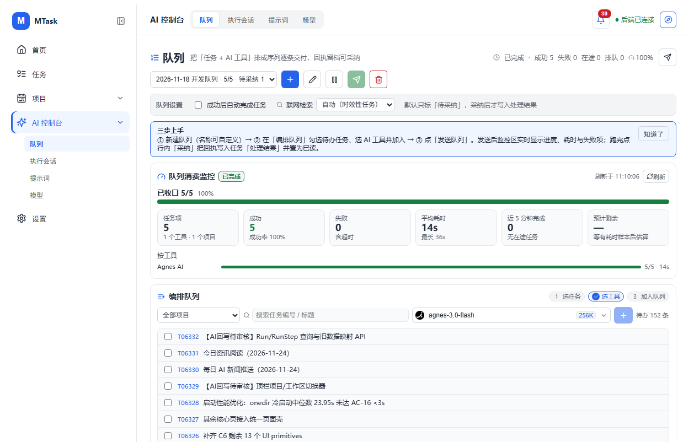
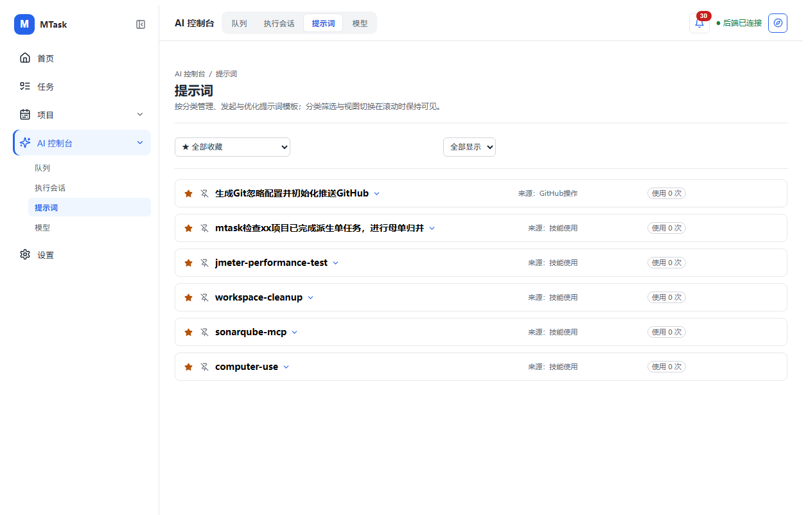

# T06292 视觉降噪走查报告

- 任务：`T06292` / `[PRD] 视觉降噪走查`（priority: high）
- 关联需求：`REQ-014` 规范主操作数量与状态徽标，简化界面视觉干扰项
- 基线：`main` / `13b139ad530b224953ad05c55af0e9fb176aaddf`（T06291 提交）；工作树存在其他并行任务的未提交改动，本报告未修改、未提交这些文件。文中的源码行号与静态计数以**当前工作树**为准，运行态截图基于当前构建产物。
- 走查日期：2026-11-24
- 结论：**C8 视觉降噪未达标（AUDIT FAIL）**。本报告完成走查，不包含布局或交互改动。

## 1. 结论

C8 的六条规则中，**1 条通过、2 条部分通过、3 条未通过**：

| C8 子项 | 判定 | 客观事实 |
|---|---|---|
| 每屏最多 1 个主操作，次操作收进“更多” | **未通过** | `PageHeader` 的 `primaryAction` 声明 **0/10**；仅模型页有 1 个常驻且唯一的明确主操作；任务/计划/需求/提示词 4 页的关键新建入口缺失或藏进悬浮态；队列页同时有 2 个强主操作 |
| 每行最多 2 个状态徽标，重复状态合并 | **未通过** | 执行会话 100/100 张卡片至少叠 3 个标签（项目 + 待上报/进度 + 任务号）；队列步骤条一行 3 个步骤徽标；提示词 6/6 行重复“使用 0 次” |
| 状态色 ≤ 5 | **通过** | `tokens.css` 三主题只定义 `success / danger / warn / info` 4 类语义状态色 |
| 标题层级 ≤ 3 | **部分通过** | 主体为 `h1/h2/h3`，仍有 2 处 `h4`：`TasksPage.tsx:2697`、`AIToolsPage.tsx:1248` |
| 图标尺寸统一 16/20 | **未通过** | 10 个核心页共 **334** 处显式 `size={n}` 字面量，仅 **8** 处为 16/20（2.4%）；出现 10/11/12/13/14/15/16/17/18/20/22/28 共 12 档 |
| 去掉装饰性分割线与重复说明 | **部分通过** | 队列“三步上手”大段说明、提示词逐行“来源：技能使用 / 使用 0 次”、报表 11 张等权卡片属于重复或低信息密度说明；未发现独立装饰性 `
`，结构边框暂不判违规 |

因此，C8 验收项“首屏主行动唯一、徽标不堆叠、状态色一致、视觉走查通过”中，**只有状态色一致通过**；整体不通过。

### 关键数字

- 核心页：**10**
- 使用统一 `PageShell/PageHeader`：**3/10**（概览、任务、提示词）
- 声明页头唯一主操作 `primaryAction`：**0/10**
- 有“常驻、唯一、明确”页面主操作：**1/10**（模型页“新增配置”）
- 关键新建入口缺失或悬浮隐藏：**4 页**（任务、计划、需求、提示词）
- 同屏 2 个强主操作：**1 页**（队列：新建队列 + 发送队列）
- 行内徽标 > 2：**至少 1 页 100 张卡片**（执行会话）
- 显式图标尺寸字面量：**334**；符合 16/20：**8**
- `op-hidden` 悬浮隐藏控件：**49 处**（任务 15、计划 10、提示词 10、需求 9、模型 5）

## 2. 走查范围与方法

**页面范围：** 10 个核心页——概览、任务、计划、需求、报表、队列、执行会话、提示词、模型、设置。

**方法：**

1. 源码审计：检查 `PageShell/PageHeader` 接入、`primaryAction` 声明、主色实底控件、`op-hidden` 入口、`h4`、显式 `size={n}` 图标字面量。
2. 运行态走查：对当前构建做 light 主题首屏截图，核对首屏主操作、行内徽标密度、重复说明；截图统一为 1258×802。
3. 证据交叉：同一 HEAD 的 T06291 三主题截图矩阵作为视觉基线；本轮对 9 页重新实拍，概览页因打包后端 `/today` 返回 404，改用同一 HEAD 的 T06291 概览截图（404 原图一并保留）。
4. 判定口径：只按 C8 六条规则判定，不把 C2 统一页面壳、C6 primitives 的未完成项重复计为 C8 缺陷；但记录其对本报告结论的影响。

**边界：** 本任务只做审计，未改布局结构、未改页面代码、未提交视觉修复。报告中的“建议落点”属于后续整改输入。

## 3. 主操作走查

| # | 页面 | 统一页头 | 声明主操作 | 首屏主操作事实 | 判定 |
|---|---|---|---|---|---|
| 1 | 概览 | 是 | 否 | 只读看板；页头仅“刷新”“项目统计”两个次操作，无提交型主操作 | N/A（只读页） |
| 2 | 任务 | 是 | 否 | 页头无操作；“新建任务”由标题输入框 + 13px 纯图标 `+` 承担，无文字 CTA、无主色 | **不通过**：主操作不可发现 |
| 3 | 计划 | 否 | 否 | 空态有“新建计划任务”；有数据时仅工具栏 `CalendarPlus` 悬浮图标（`PlanPage.tsx:402`），两行工具栏 15+ 控件 | **不通过**：主操作随数据消失 |
| 4 | 需求 | 否 | 否 | 空态提示“暂无分类，请先新建分类”，但“新建分类”藏在 `op-hidden` 悬浮组（`ReqPage.tsx:571-573`） | **不通过**：提示与入口不一致 |
| 5 | 报表 | 否 | 否 | 11 张等权功能卡平铺；右侧 AI 控制台另有“周报 / 开始分析 / AI 周报”3 个主色控件 | **不通过**：无唯一入口层级 |
| 6 | 队列 | 否 | 否 | “新建队列”蓝色实底（`QueuePage.tsx:633-639`）与“发送队列”成功色按钮（`QueuePage.tsx:661-670`）同排；另有删除红框动作 | **不通过**：2 个主操作竞争 |
| 7 | 执行会话 | 否 | 否 | 只读四列看板，无提交型主操作 | N/A（只读页） |
| 8 | 提示词 | 是 | 否 | 页头无操作；“新建提示词”为 `op-hidden` 的 13px 纯图标按钮（`PromptsPage.tsx:989-1000`），首屏不可发现 | **不通过**：主操作悬浮隐藏 |
| 9 | 模型 | 否 | 否 | 正文 `h3`“配置记录（7/7）”旁“+ 新增配置”主色按钮常驻且唯一（`AIToolsPage.tsx:1209-1217`） | **通过**（但未走统一页头） |
| 10 | 设置 | 否 | 否 | 18 个图标快捷入口 + 7 个主色实底状态控件；无提交型主操作 | N/A（配置页）；视觉重心分散 |

**判定汇总：** 通过 1 页，N/A 3 页，未通过 6 页。核心问题不是“所有页面都没有主操作”，而是**有业务主操作的页面普遍没有把主操作放到稳定、唯一、首屏可见的位置**，且 4 页沿用了“默认隐藏、悬浮显示”的旧交互。

任务页证据（新建入口仅为输入框右侧 13px `+`）：

队列页证据（新建与发送同为强色动作，另有删除动作）：

## 4. 状态徽标与重复说明

| 页面 | 行/卡单位 | 观察 | 判定 |
|---|---|---|---|
| 执行会话 | 100 张卡片 | 每卡至少 3 个标签：项目标签 + “待上报”/进度 + 任务号 chip；右侧另有 50 条未读通知流（4/11/1/84 四列） | **不通过**：100/100 张均超 2，且通知流与卡片信息重复 |
| 提示词 | 6 行 | 6/6 行右侧重复“使用 0 次”胶囊；5/6 行重复“来源：技能使用” | **不通过**：重复状态未合并，零值徽标无信息增益 |
| 队列 | 步骤条 1 行 | “1 选任务 / 2 选工具 / 3 加入队列”3 个步骤徽标同排；首屏另有 6 个胶囊状状态/步骤元素 | **不通过**：行内 3 个徽标 |
| 计划 | 29 行表格 | 每行 1 个“已完成”状态徽标；部分父行另带批次徽标，最多 2 个 | 通过（但“进度 100% + 已完成”双编码冗余） |
| 模型 | 7 行表格 | 每行 1 个接入类型徽标（国际直连/国内直连/国内聚合/聚合路由） | 通过 |
| 任务 | 3 行 | 首行任务号 + 派生来源，1-2 个 chip | 通过 |
| 报表 | 11 张卡 | 无状态徽标；主要噪声是 11 张等权功能卡 | 通过（徽标口径） |
| 概览 / 需求 / 设置 | — | 无状态徽标堆叠 | 通过 |

执行会话证据（每卡项目标签 + 待上报 + 任务号，右侧 50 条通知）：

提示词证据（6 行重复“使用 0 次”）：

## 5. 图标与标题层级

### 5.1 图标尺寸

| 页面 | 显式 `size={n}` | 16/20 | 非 16/20 | 主要档位 |
|---|---:|---:|---:|---|
| 任务 | 110 | 0 | 110 | 13:67、14:24、12:13、10:3、11:3 |
| 计划 | 48 | 0 | 48 | 13:30、14:10、12:4、11:2、15:1、18:1 |
| 提示词 | 32 | 0 | 32 | 13:27、14:3、11:1、12:1 |
| 模型 | 30 | 0 | 30 | 13:25、11:3、12:1、28:1 |
| 设置 | 30 | 6 | 24 | 13:17、16:6、14:5、15:2 |
| 需求 | 29 | 0 | 29 | 13:25、12:2、14:2 |
| 报表 | 29 | 1 | 28 | 12:9、14:8、13:5、15:4、11:2、20:1 |
| 队列 | 12 | 1 | 11 | 15:5、12:2、13:2、14:1、16:1、17:1 |
| 执行会话 | 8 | 0 | 8 | 11/12/13/14/15/22/28 各档 |
| 概览 | 6 | 0 | 6 | 14:6 |
| **合计** | **334** | **8** | **326** | 12 档尺寸 |

结论：C8“图标尺寸统一 16/20”**未通过**。13px 是绝对主力，说明当前图标体系仍以“工具栏紧凑”优先，而不是 C8 的 16/20 双档规范。统计含少量 Logo/头像尺寸（如 22/28），用于判断统一性，不把每个 28 都算作图标违规。

### 5.2 标题层级

- 2 处 `h4`：任务页看板分组列标题（`TasksPage.tsx:2697`）、模型页“厂商预制”（`AIToolsPage.tsx:1248`）。
- 模型页还用 `h3` 充当页面标题（`AIToolsPage.tsx:1209`），与统一页头 `h1` 不一致。
- 其余页面的可见结构主要为 `h1/h2/h3`，无更深层级。

结论：C8“标题层级 ≤3”**部分通过**；需要把 2 处 `h4` 降级，并把模型页页面标题收回 `PageHeader` 的 `h1`。

## 6. 问题清单

| ID | 级别 | 页面 | 问题 | 证据 | 建议 |
|---|---|---|---|---|---|
| C8-01 | P0 | 全局 | `PageHeader` 的 `primaryAction` 声明为 0/10，7 页仍自建页头；主操作没有统一语义槽位 | `PageShell.tsx:27,68`；3/10 使用 PageShell；`DeclaredPrimary=false` | 归入 T06327“其余核心页接入统一页面壳”，验收增加“每页最多 1 个 primaryAction” |
| C8-02 | P0 | 任务 | “新建任务”是输入框右侧 13px 纯图标 `+`，无文字、无主色、无页头 CTA | `TasksPage.tsx:4953-4955`；截图任务页 | 改为页头 `primaryAction`“新建任务”，输入区保留快捷录入 |
| C8-03 | P0 | 计划 | 有数据时主操作只剩工具栏悬浮 `CalendarPlus`；空态 CTA 在有数据后消失 | `PlanPage.tsx:402`；`PlanPage.tsx:3131`；截图计划页 | 页头固定“新建计划任务”；导入/导出收进“更多” |
| C8-04 | P0 | 需求 | 空态提示“请先新建分类”，但入口在 `op-hidden` 悬浮组，首屏不可见 | `ReqPage.tsx:66`；`ReqPage.tsx:571-573`；截图需求页 | 空态内置“新建分类”主按钮，工具栏仅保留次操作 |
| C8-05 | P0 | 提示词 | “新建提示词”为悬浮才显示的 13px 图标，页头无主操作 | `PromptsPage.tsx:989-1000`；截图提示词页 | 页头常驻“新建提示词”，悬浮图标取消 |
| C8-06 | P0 | 队列 | “新建队列”和“发送队列”同为强色动作；删除红框同排，3 个高权重动作抢注意力 | `QueuePage.tsx:633-639`；`QueuePage.tsx:661-670`；截图队列页 | 页面主操作固定为“发送队列”；“新建队列”降为次操作，删除进“更多” |
| C8-07 | P1 | 报表 | 11 张等权功能卡，无首屏入口层级；AI 控制台另有 3 个主色控件 | 截图报表页；11 张卡片 | 高频 3-4 项置顶，其余分组/折叠；AI 控制台只保留 1 个开始动作 |
| C8-08 | P1 | 执行会话 | 100 张卡每卡至少 3 个标签，右侧 50 条通知重复会话信息；行内徽标上限 2 被稳定突破 | `ExecSessionsPage.tsx:590,656,664`；截图执行会话页 | 项目标签并入标题行/悬浮提示；“待上报”并入进度；“任务号”保留 1 个；通知流改摘要计数 |
| C8-09 | P1 | 提示词 | 6/6 行重复“使用 0 次”，5/6 行重复“来源：技能使用” | `PromptsPage.tsx:1193-1195`；截图提示词页 | 零值不展示徽标；来源合并进标题/详情；“使用次数”只在 >0 或排序时展示 |
| C8-10 | P1 | 全局 | 334 处显式尺寸中仅 8 处为 16/20，13px 为主力，12 档混用 | `evidence/audit-static.csv` | 归入 T06326 primitives，统一 IconButton/图标档位为 16/20；13px 仅限表格行内 |
| C8-11 | P2 | 队列 | “三步上手”80px 高说明卡 + 按钮 hint + 队列设置说明重复讲同一流程 | 截图队列页；`QueuePage.tsx:731` | 收为 1 行提示或首次引导，去掉常驻大卡 |
| C8-12 | P2 | 任务 / 模型 | 2 处 `h4`，模型页 `h3` 充当页面标题 | `TasksPage.tsx:2697`；`AIToolsPage.tsx:1248,1209` | 降为 `h3`/`h2`，页面标题统一 `h1` |
| C8-13 | P2 | 设置 | 18 个图标快捷入口 + 7 个主色实底状态控件同屏；无提交型主操作，视觉重心分散 | 截图设置页；`SettingsPage.tsx` | 快捷入口分组/折叠；主色只保留当前选中态，避免 7 个同权重实底 |

## 7. 根因判断

1. **统一页面壳尚未覆盖全量核心页。** 只有 3/10 接入 `PageShell/PageHeader`，其余 7 页仍保留自建标题行和工具栏；C8 主操作规则没有统一落点，和未完成的 T06327 直接相关。
2. **旧交互把“默认隐藏、悬浮显示”当成降噪。** 5 个页面共 49 处 `op-hidden`。对次操作有效，但当主操作也落入其中时，首屏等于没有主操作；计划/需求/提示词三页均如此。
3. **状态信息按来源堆叠，而不是按用户决策合并。** 执行会话把项目、进度、任务号三层信息都做成标签；提示词把“使用 0 次”当成每行必显状态。数据模型上的多维信息被直接映射成视觉徽标。
4. **图标尺寸缺少组件级约束。** 13px 图标在工具栏和表格行内大量复用，说明图标尺寸仍由各页面手写决定，尚未收口到 primitives 的 16/20 双档。

## 8. 后续整改建议

本轮不改布局，建议按现有任务落点推进，避免新建重复单：

1. **T06327“其余核心页接入统一页面壳”**：把 7 页接入 `PageShell/PageHeader`，并把每页唯一主操作放进 `primaryAction`；验收新增 C8-01~C8-06。
2. **T06326“补齐 C6 剩余 13 个 UI primitives”**：优先收口 `IconButton`/`Badge`/`Toolbar`，落地 16/20 图标档位与“每行最多 2 徽标”的组件约束；验收新增 C8-08~C8-10。
3. **执行会话/提示词专项**：作为 C8 后续治理的最小闭环，先做不改变布局的两件事——执行会话卡片标签合并、提示词零值徽标隐藏；可通过现有页面局部调整完成。
4. **报表与设置**：属于信息架构层，不建议在 C8 里直接改布局；等 C2/C3 页面模板落地后再重排。

## 9. 证据索引

| 证据 | 路径 | 说明 |
|---|---|---|
| 页面走查矩阵 | `01-页面走查矩阵.csv` | 10 页主操作、徽标、图标、h4 与截图索引 |
| 问题清单 | `02-问题清单.csv` | 13 条问题、级别、证据、建议 |
| 截图索引 | `03-截图索引.csv` | 10 页首屏截图 + 概览 404 留证 |
| 图标静态扫描 | `evidence/audit-static.csv` | 逐页 `size={n}` 分布、16/20 合规数、h4 |
| 图标静态扫描 JSON | `evidence/audit-static.json` | 同上，结构化 |
| 指标摘要 | `04-指标摘要.csv` | PageShell/声明主操作/主色控件/徽标计数/h4 |
| 首屏截图 | `evidence/screens/audit-light-<page>.png` | 10 页 1258×802；概览取 T06291 同 HEAD |
| 概览 404 留证 | `evidence/screens/audit-light-dashboard-http404.png` | 当前打包后端 `/today` 404，说明概览未采用本轮实拍的原因 |
| 复现脚本 | `scripts/tests/audit-t06292-noise.mjs` | 静态扫描 + 运行态截图；`T06292_STATIC_ONLY=1` 只跑静态扫描 |

**环境注记：** 本轮运行态审计通过本地代理对接打包后端 `39882`。概览页 `/today` 在当前“打包后端 + 仓库 web dist”组合下返回 HTTP 404；该问题不属于 C8 视觉规范，不作为本报告缺陷计入，但已保留原图，避免把 404 空态当作正常首屏。
