# MTask 产品介绍

**AI 驱动的任务开发管理平台 —— 让每一条任务都走到「可验证、可追溯、可交付」**

版本 0.1.1029 ｜ 文档日期 2026-10-30

---

## 一、产品简介

MTask 是一款面向开发者的 **AI 任务开发管理工具**。它以「项目维度 + AI 梳理 + 队列分发」替代基于 txt、聊天记录和零散表格的粗糙任务管理方式：任务按项目组织，内容可由 AI 自动梳理，多个 AI 开发工具可统一配置并按队列批量派发，处理结论回写到任务本身，最终与 Git 提交、质量扫描结果串成一条完整的证据链。

它不是又一个待办清单，而是把 **任务 → 代码 → 结论 → 交付** 四件事放进同一条流水线，让人和 AI 在同一个任务主键上协作。

### 1.1 它解决什么问题

| 常见痛点 | 具体表现 | MTask 的做法 |
|---|---|---|
| 任务散落 | 需求在群里、计划在表格、进度在脑子里 | 项目维度的统一任务池，待办 / 已完成 / 搁置三态 + 分类 + 优先级 |
| AI 结论无处安放 | AI 给了一大段建议，复制到哪儿都找不到上下文 | 处理结论直接回写任务，保留多次修改的结果历史，可与上一版对比 |
| 代码与任务对不上 | 想知道「这条任务改了哪些文件」，只能翻 Git 日志靠猜 | 任务与 Git 提交双向绑定，抽屉内直接看 diff 与文件统计 |
| 计划与执行脱节 | 甘特图是画给人看的，改了代码没人回头更新计划 | 需求跟踪矩阵把需求、计划、待办、用例、PRD 串起来，进度自动汇算 |
| AI 用量不透明 | 不知道哪个工具在跑、花了多少、失败率多高 | 统一 AI 用量统计：按天、按工具、按卡片维度统计调用、耗时与输出量 |

### 1.2 面向谁

| 角色 | 关注点 | 在 MTask 中做什么 |
|---|---|---|
| 研发负责人 / 项目经理 | 全局进度、风险、投入产出 | 看计划视图与需求矩阵，用报表和 AI 洞察做周会材料 |
| 一线开发 | 今天做什么、改了什么、有没有漏 | 待办列表按项目与优先级排列，任务内直接看关联提交与处理结论 |
| 测试 / 质量 | 需求有没有被覆盖、缺陷有没有复发 | 需求跟踪矩阵 + 测试用例 + 完成前的「已验证」标记 |
| AI 重度使用者 | 让自建的 Agent 参与真实开发 | 队列分发 + MCP 接口，外部 Agent 读写同一套任务数据 |

---

## 二、核心功能

### 2.1 任务管理：一个入口管全局

任务列表按项目聚合，顶部切换「待办 / 已完成 / 搁置」，可叠加「仅未验证」筛选，右侧按默认、优先级、更新时间等维度排序。每条任务显示编号、标题、分类、优先级，行内即可展开描述与时间线，无需跳页。

- **结构化字段**：分类、优先级（紧急 / 高 / 中 / 低）、状态、验证标记、置顶、自定义字段、截图附件
- **层级与排序**：父子两级（epic → task）、拖拽排序，长清单也不乱
- **批量能力**：CSV 导入、任务导出、批量归档与还原

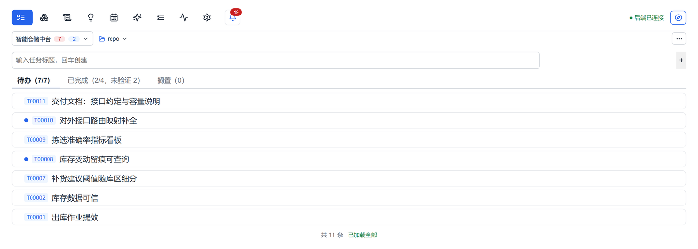

### 2.2 任务详情抽屉：描述、结论、时间线同屏

点击任务右侧的展开按钮打开详情抽屉，八个页签覆盖一条任务的完整生命周期：描述、处理结果、AI 摘要、时间线、关联计划、Git、阻塞关系、自定义字段。左侧列表保持可见，逐条浏览时不丢上下文。

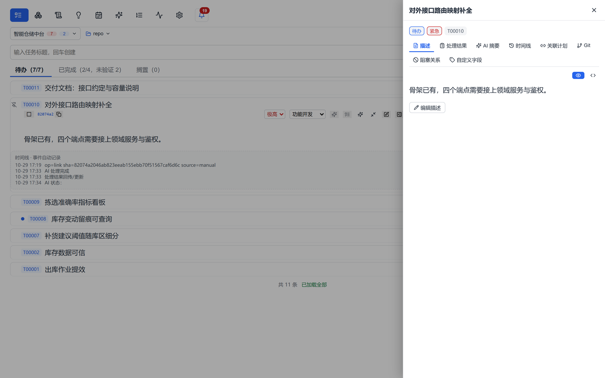

### 2.3 代码关联：任务与 Git 提交双向绑定

一条任务可绑定一个或多个提交，支持手动绑定与 AI 智能关联推荐。抽屉的 Git 页签展示主提交、绑定来源、提交人、时间、提交信息、增删行数与变更文件清单，并可「站内查看」跳转到完整 diff，或直接解绑。

这让「这条任务到底改了什么」从翻日志变成一次点击——评审、回溯、交接都不再依赖个人记忆。

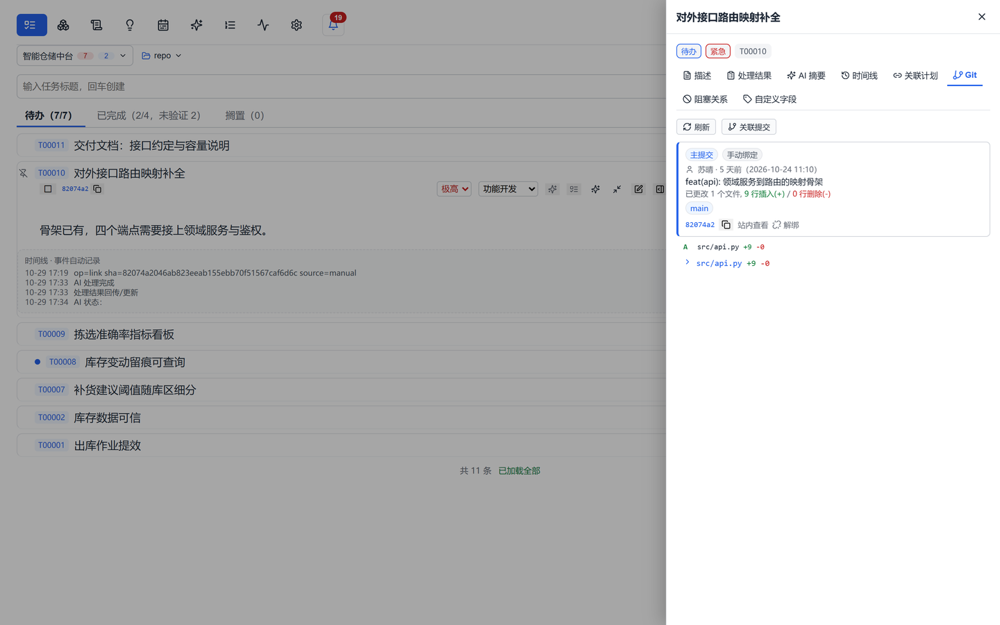

### 2.4 处理结论回写：结论留在任务里

AI 处理完成后，结论以 Markdown 形式回写到任务的「处理结果」页签：范围、改动清单、验证方式、遗留风险一目了然。每次回写都会留存一版，可随时与上一版对比，避免「改着改着把好结论改没了」。

> 设计原则：AI 输出只作为文本留存，**由人确认后再入库**，不自动改写任务数据。

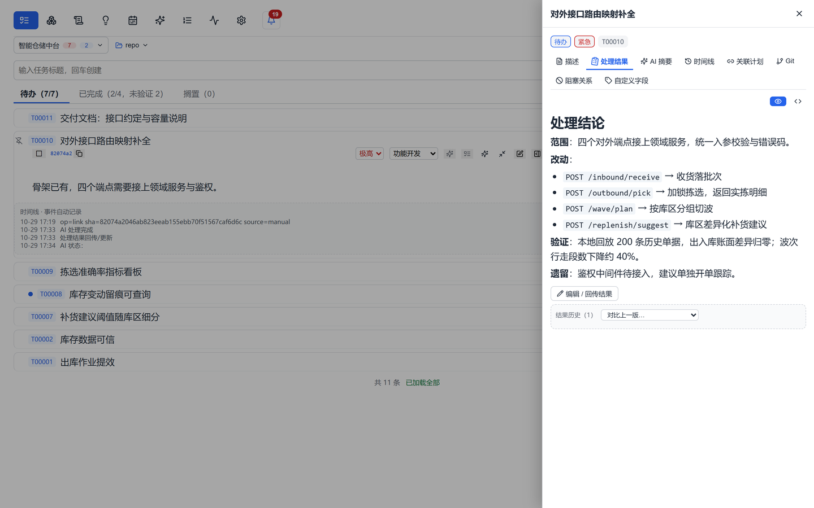

### 2.5 完成验证：做完 ≠ 做对

任务完成后进入「已完成」列表，但真正关闭还需要「已验证」标记。列表支持「仅未验证」筛选，负责人可以在周会前一次性清点所有「已做完但没人验过」的任务。

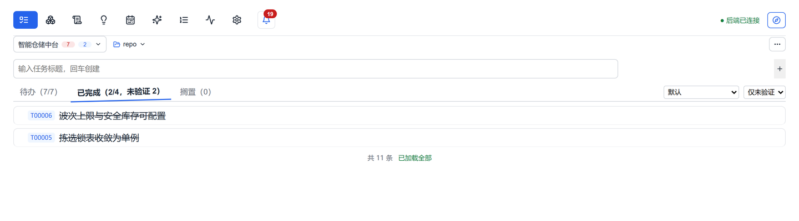

### 2.6 检索：命令面板直达

`Ctrl + K` 唤出命令面板，支持按页面、项目、任务三类目标检索，也支持结构化语法（`status:` / `priority:` / `project:`，以及 `AND` / `OR` 组合）。回车即跳转，并自动定位到目标任务或页面区块。

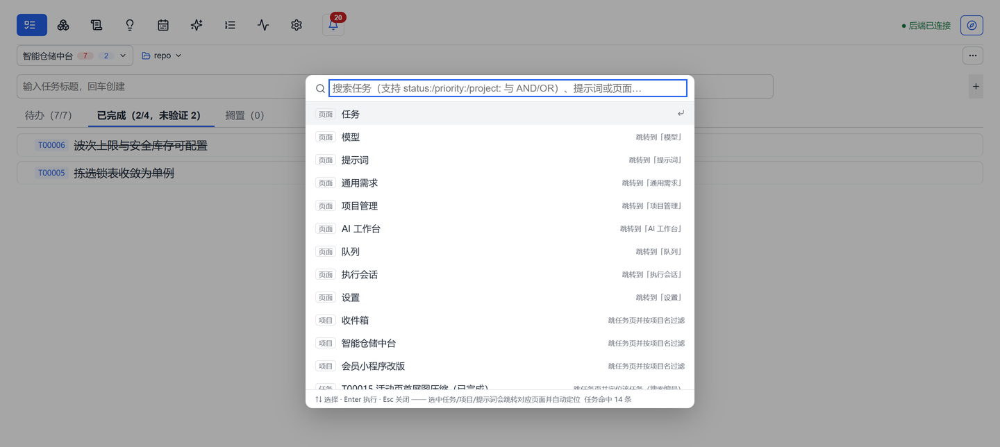

### 2.7 项目与计划：从 WBS 到甘特

项目管理页提供三种视图：列表（WBS）、甘特、时间线。WBS 支持父子行、依赖设置、工期与进度、负责人与待办联动，里程碑自动汇算子项工作量；顶部汇总项目周期、工作量、任务数、完成率、里程碑数与预测基准日。

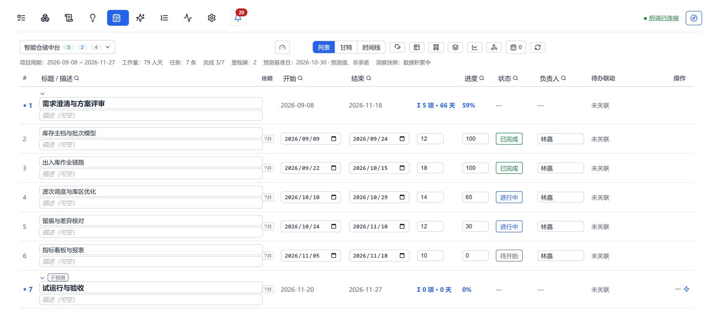

甘特图按天渲染，区分待开始 / 进行中 / 已完成 / 受阻四种状态，周末与节假日有底色标记，今天有一条贯穿的基准线；拖拽条体可平移计划，拖拽两端可改工期。

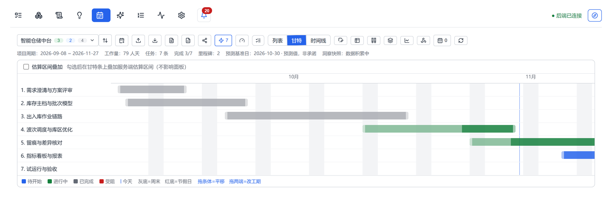

### 2.8 需求跟踪矩阵：需求不落地就不算完

需求跟踪矩阵把「需求编号 → 需求标题 → 状态 → 关联计划 → 用例覆盖 → 关联 PRD → 关联待办」放在一张表里。需求可手工新增，也可由 PRD 一键导入；任何一条需求都能顺着链看到它落到哪个计划、哪条待办、哪份 PRD 文档。

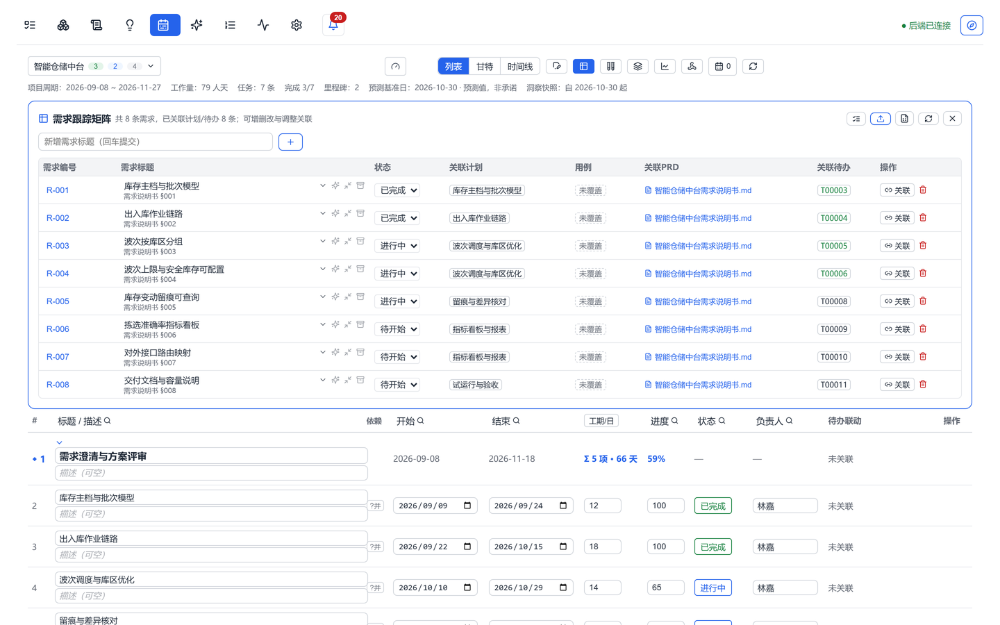

### 2.9 AI 工作台：把重复的文档活交出去

AI 工作台把「围绕项目写文档」的常见场景收成卡片式入口：AI 项目计划导入、离线周报生成、AI 周报生成、原始需求生成 PRD、从 PRD 导入项目计划、从 PRD 生成测试用例、启动会 PPT、阶段总结 PPT、代码评审讲稿、Git 增量资产提取、Sonar 质量扫描。每张卡片都明确标注输入、输出与是否需要联网，右侧 AI 控制台实时滚动生成过程。

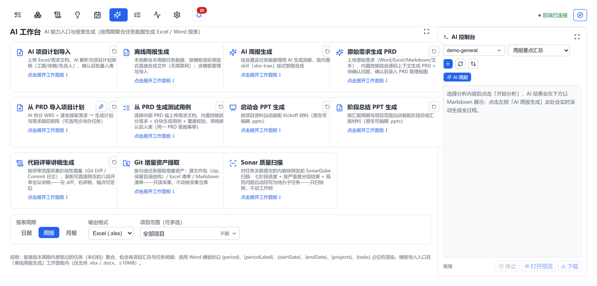

### 2.10 队列分发：把今天的任务批量交给 AI

队列用于把一批任务连同指定 AI 工具一起派发出去。任务项按顺序进入状态机：排队 → 发送中 → 成功 / 失败 / 超时，回执与错误原因逐条落库，可展开审阅、重试失败项、重置整批。顶部同时显示运行中数量与并发上限，避免一把梭把上游打满。

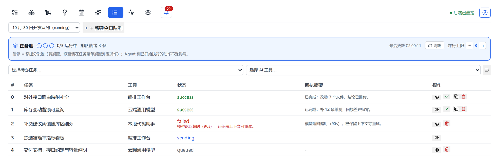

### 2.11 提示词仓库：把好用的提示词存下来

按分类管理提示词模板，支持正文预览、复制、置顶、排序与一键发起。模板里用 `{{变量}}` 占位，复用时只需替换变量，避免每次从零描述。

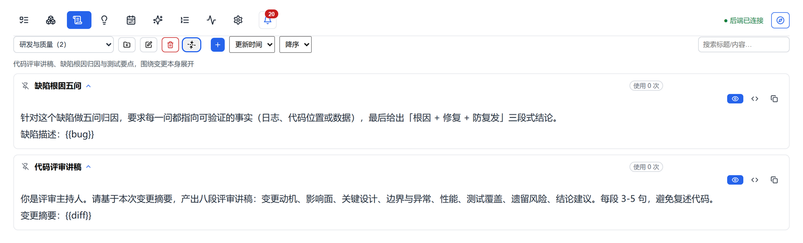

### 2.12 AI 用量与治理：谁在跑、跑了多少、坏在哪

模型配置页统一管理各类 AI 工具（OpenAI 兼容 / Claude / Ollama / WorkBuddy），API Key 加密落库、界面脱敏显示，可一键连通性探测。下方的用量统计按天、按工具、按调用类型给出调用次数、成功率、平均耗时与输出字符量，性能与成本问题不必再靠猜。

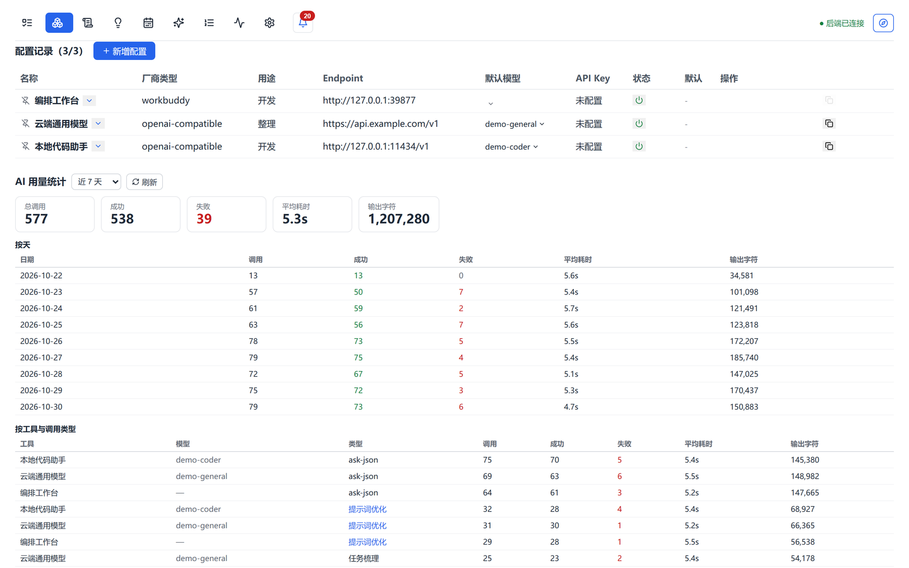

### 2.13 多端与开放接口

- **桌面端**：Electron 打包，主进程内嵌本地服务，开箱即用，数据留在本机
- **移动 Web**：待办概览、随手记、离线草稿，左滑完成、右滑看详情，通勤路上也能推进
- **MCP 接口**：向外部 AI Agent 暴露 `mtask_*` 工具集，Agent 可读写同一套任务、计划与需求数据

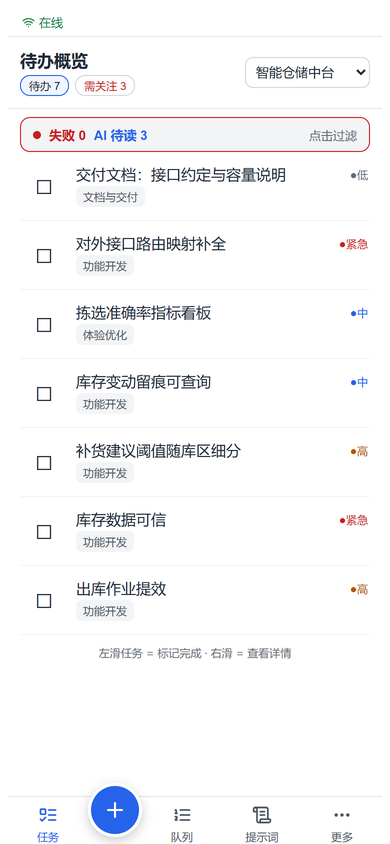

---

## 三、典型应用场景

**场景一：版本迭代的日常推进**
每天从待办列表开始，按优先级处理；完成后把改动对应的提交绑到任务上，处理结论写回「处理结果」；周会前用「仅未验证」筛出待验任务，验收后打标。整条链路的证据都在任务里，交接时不用再问「这个当时是怎么做的」。

**场景二：把重复的文档工作交给 AI**
启动会前用「启动会 PPT 生成」拉出骨架，周会前用「AI 周报生成」按周期聚合任务流水，评审前用「代码评审讲稿生成」把变更整理成八段讲稿。生成结果先落为草稿，人确认后再引用。

**场景三：让自建 Agent 参与真实开发**
通过 MCP 接口把任务队列交给自建的 Agent 处理：Agent 读取待办、领取任务、上报进度、回写结论；人只负责裁决与验收。MTask 负责留存过程，不替人做决定。

---

## 四、技术架构与安全

| 层 | 选型 | 说明 |
|---|---|---|
| 桌面壳 | Electron 33 | 主进程内嵌本地 HTTP 服务并加载前端产物 |
| 前端 | React 18 + Vite 6 + TypeScript | SPA，tab 状态路由，含移动端外壳 |
| 后端 | Express 4 + TypeScript | 本地 API 服务，UI 与数据层解耦 |
| 数据库 | SQLite（better-sqlite3，WAL） | 同步 API、零配置、单文件可移植 |
| AI 接入 | `@modelcontextprotocol/sdk` + 自研适配器 | OpenAI 兼容 / Claude / Ollama / WorkBuddy 四类协议 |
| 报表 | exceljs / docx / pptxgenjs / pdfkit | Worker 线程内合成，不阻塞主循环 |
| 加密 | Node `crypto` AES-256-GCM | API Key / 更新 Token 加密落库 |

**数据与安全**

- 数据默认存在本机：桌面版位于用户数据目录下的单个 SQLite 文件，不经过任何第三方服务器
- 敏感字段（AI 工具 API Key、更新 Token）使用 AES-256-GCM 加密落库，界面仅显示脱敏值
- AI 输出只作为文本留存，人工确认后才入库，不会被自动写入任务
- 开启内网穿透时可配置访问令牌，所有 `/api` 数据接口需携带 `X-Access-Token`

---

## 五、快速开始

1. 下载并安装 Windows 安装包（NSIS），首次启动自动建库
2. 新建项目，在项目设置中绑定代码仓库的工作空间路径（用于 Git 关联）
3. 在「模型配置」中添加至少一个 AI 工具并完成连通性探测
4. 录入任务或由 PRD 导入计划，开始第一条任务的推进
5. 需要外部 Agent 协作时，在客户端配置 MCP 服务地址，即可读写同一套数据

---

## 附录：截图说明

- 本文档中的 14 张截图均取自 MTask 桌面端真实运行界面，按 1440×900 渲染后截取（移动端为 390×844）。
- 截图中的项目、任务、成员、提交记录与 AI 用量数据均为 **演示用的虚构数据**，与任何真实客户或团队无关。
- 界面以 0.1.1029 安装包为准；功能与文案可能随版本迭代调整。
