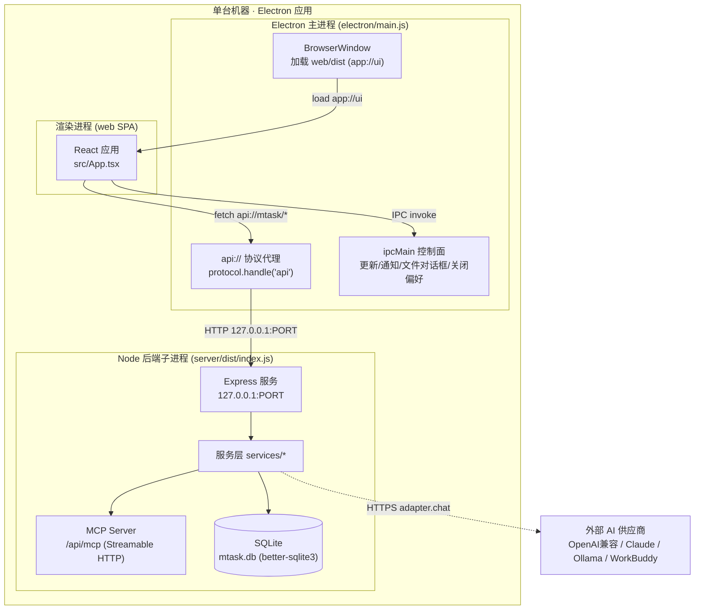
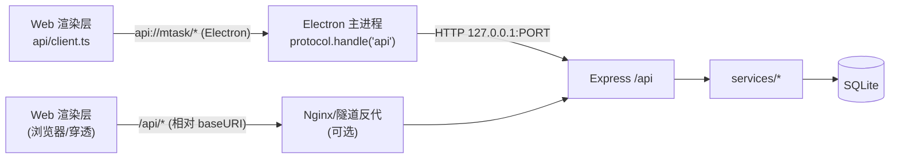
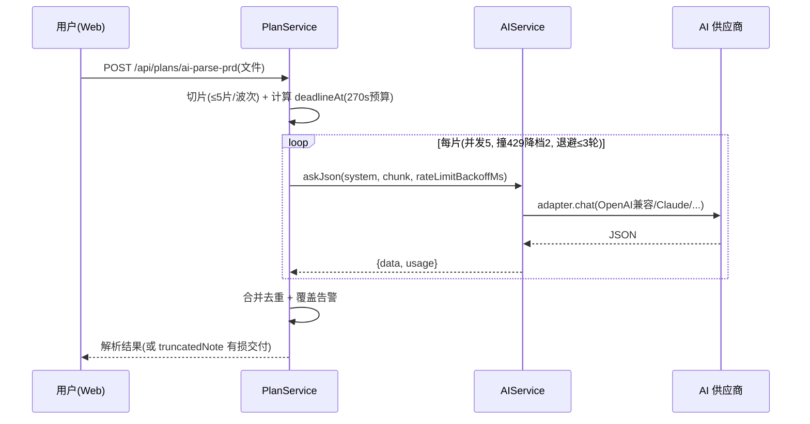
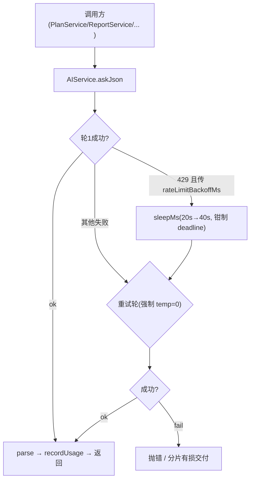
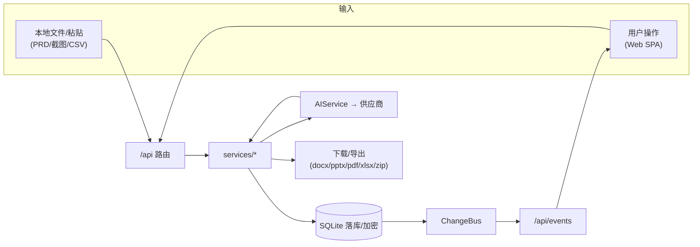
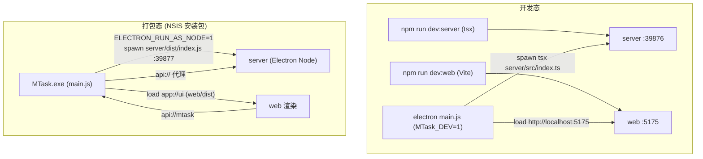

# MTask 系统架构设计文档

> 本文档基于 `D:/code/otherProjects/26_MTask` 工作区当前源代码逐文件核实编写（编写时间 2026-11-02），所有架构描述均可在源码中定位，未引入任何代码之外的假设组件。
> 与 `docs/概要设计.md`（212 行高层大纲）的关系：本文档是其**权威、完整的架构设计补充**——大纲覆盖定位/技术栈/进程概述，本文档补齐模块内部设计、数据流、技术选型与部署拓扑，并在多处交叉引用以消除不一致。两份文档同时保留，请勿将本文档内容反向删减回大纲。

---

## 1. 引言与系统概述

### 1.1 业务背景

MTask 是一款**桌面端 AI 任务开发管理工具**，目标是用结构化桌面应用替代基于纯文本的粗糙任务管理方式。核心能力围绕「任务 / 项目计划 / PRD / AI 工作台」四条主线展开：把任务管理、WBS 计划、需求跟踪、AI 辅助（任务梳理、PRD 解析、PPT 大纲、报告、代码问答、测试用例生成等）收敛到一个本地优先（local-first）的桌面应用内。

### 1.2 核心目标与约束

- **本地优先**：数据存于用户本机 SQLite，无强制联网；AI 能力按需调用外部模型供应商。
- **桌面形态**：Web + 桌面壳（Electron）的技术栈，单一可执行安装包（NSIS）分发。
- **敏感字段加密**：第三方服务密钥（AI 工具 API Key、Webhook 密钥、Sonar/更新 Token）以 AES-256-GCM 字段级加密落库，明文仅在运行时内存中解密。
- **可扩展的 AI 编排**：通过 OpenAI 兼容 / Claude / Ollama / WorkBuddy 等多适配器接入不同模型，并支持经 MCP（Model Context Protocol）协议对外暴露任务操作能力。

### 1.3 读者与范围

本文面向架构评审、新成员 onboarding、以及后续子系统设计。范围覆盖：Electron 壳、Node/Express 后端、本地 SQLite 存储、Web 前端、AI 集成层、MCP 服务、构建与部署拓扑。不包含具体业务规则的实现细节（见各 `services/*` 源文件与 `docs/概要设计.md`）。

---

## 2. 总体架构

### 2.1 架构分层总览

MTask 采用**三层本地进程模型**：Electron 主进程作为协调者，内嵌一个 Node 后端子进程（Express 服务 + SQLite）与一个 React 渲染进程（Web SPA）。三者在单台机器内通过回环地址（loopback）HTTP 与 Electron IPC 协作，无独立网关或远程服务依赖（除可选的 AI 供应商与内网穿透隧道）。

### 2.2 进程与端口拓扑（关键事实）

| 项 | 开发态 | 打包态 |
|---|---|---|
| 后端进程 | `tsx server/src/index.ts`（由 Electron 或独立脚本拉起） | `ELECTRON_RUN_AS_NODE=1` 跑 `server/dist/index.js`（Electron 自带 Node） |
| 后端端口 `MTask_PORT` | `39876` | `39877`（冲突时回退 `39882–39885`） |
| 绑定地址 | `127.0.0.1`（仅回环，规避公网暴露） | 同左 |
| Web UI | Vite dev server `http://127.0.0.1:5175`（`MTask_DEV=1`） | `app://ui/index.html`（Electron 主进程从 `web/dist` 读取） |
| 数据目录 `MTask_DATA_DIR` | `server/data` | `%APPDATA%/MTask/data` |
| 渲染层 API 基址 | Vite 代理 `/api → 127.0.0.1:39876` | `api://mtask`（经主进程协议代理） |

> 端口发现机制：主进程把 `MTask_PORT` 经环境变量注入后端子进程，自身记住该值用于 `api://` 代理与健康检查；`api://` 协议句柄把 `api://mtask/<path>` 重写为 `http://127.0.0.1:<PORT>/api/<path>` 转发（含 OPTIONS 预检与 502 JSON 兜底）。

---

## 3. 模块详细设计

### 3.1 Electron 桌面壳（`electron/`）

**职责**：应用生命周期、后端子进程管理、渲染窗口、原生能力桥接、自研更新器、系统托盘/通知。

| 文件 | 职责 |
|---|---|
| `main.js`（CommonJS） | 启动序列 `bootstrapApp()`：`setupApiProxy`/`setupWebProtocol`/`setupAppMenu`/`createSplash`/`ensureBackend`；单实例锁 `requestSingleInstanceLock`；`before-quit` 优雅 kill 后端子进程 |
| `preload.js` | `contextBridge.exposeInMainWorld('mtaskDesktop', …)` 暴露受限白名单 API（文件对话框、更新下载/安装、通知开关、关闭偏好、导航事件），`contextIsolation:true`/`nodeIntegration:false` |
| `update-state.js` | 更新续传/回执/启动对账纯函数内核 |
| `close-prefs.js` | 关闭交互决策内核（最小化到托盘 / 直接关闭 / 记住选择）+ 原子写 `close-prefs.json` |
| `splash.html` | 启动窗进度 UI |
| `nsis-kill-process.nsh` | NSIS 安装前后 `taskkill /F /IM MTask.exe`（刻意不加 `/T`，避免误杀安装器自身） |

**后端子进程拉起**（`main.js` `startServer()`）：打包态用 `spawn(process.execPath, [server/dist/index.js], {env:{…ELECTRON_RUN_AS_NODE:'1'}})`；开发态用 `tsx` 跑 TS 源码。子进程日志落盘到 `userData/server-startup.log`。

**IPC 控制面 vs 数据面**：渲染层**数据请求走 `api://` HTTP 代理**到本地后端（不是 IPC）；仅原生能力/更新/通知/关闭偏好走 `ipcMain.handle`（如 `dialog:open-directory`、`update:download`、`notify:get-enabled`、`close:get-prefs` 等）。

### 3.2 后端服务（`server/src`）

**框架**：`express@4`。入口 `src/index.ts`，挂载主聚合路由 `Router()` 于 `/api`，并叠加 `accessTokenGuard` + `csrfGuard` 两道横切守卫（MCP 端点只叠加 `accessTokenGuard`，不叠加 CSRF，因为是机对机调用）。

**中间件链（`index.ts`）**：
1. `express.json({limit:'30mb'})`（支持截图 base64 粘贴）。
2. 手工 CORS（`Access-Control-Allow-Origin:*` + 允许 `Authorization,X-Access-Token,mcp-session-id` 头）。
3. GZIP（仅对 ≥1024 字节的 `application/json` 200 响应压缩，排除 SSE/流式）。
4. 慢请求日志（≥100ms 打印）。
5. `accessTokenGuard`（`X-Access-Token`，未配置则整体放行；`api_tokens` 表支持具名只读凭据 `scope=read`）。
6. `csrfGuard`（`MTASK_CSRF_MODE=off|header|strict`，默认 `header`；自定义头即事实防御）。
7. 隧道路径前缀剥离（按 `loadTunnelConfig().pathPrefix` 还原 `/xxx/api` → `/api`）。
8. 静态伺服 `web/dist`（`MTASK_STATIC_DIR` 可覆盖；含 SPA 兜底；`assets/` 长缓存、`index.html`/`sw.js` 不缓存）。
9. 统一错误兜底（`entity.too.large → 413` 中文提示）。

**SSE 变更总线**：`GET /api/events` 基于 `ChangeBus` 发布/订阅，后端数据变更实时推送给前端。

**主要路由模块（`src/routes/`）**：

| 模块 | 前缀 | 职责 |
|---|---|---|
| `index.ts`（主聚合） | `/api` | 项目、任务、提示词、通用需求、AI 工具配置、队列、控制台任务、AI 用量、设置、报告、备份、工作空间问答、PRD 生成、测试用例生成、SSE 心跳、更新检查 |
| `plans.ts` | `/api/plans` | 计划任务（瀑布/迭代/里程碑）、启动会 PPT、总结 PPT、代码评审讲稿、复杂度、脱敏快照 |
| `iterations.ts` | `/projects…/iterations` | 迭代与燃尽 |
| `estimates.ts` | `/api/estimates` | 三点估算、PERT、工作量导出 |
| `supervisor.ts` | `/api/supervisor` | AI 编排监督器（熔断/中继/tick/审计） |
| `webhooks.ts` | `/api/webhooks` | 项目级出站 Webhook 配置/测试/投递日志 |
| `gitLinks.ts` / `gitExtract.ts` | `/git/*` | 任务↔提交关联、Git 增量资产提取 |
| `sonarSettings.ts` / `sonarScan.ts` | `/settings/sonar*` `/sonar/scan*` | SonarQube 设置与七阶段扫描引擎 |
| `taskSuggest.ts` | `/api`（独立挂载） | AI 分类/优先级建议（只读不落库） |
| `dbadmin.ts` / `tunnel.ts` | `/api/dbadmin` `/api/tunnel` | 数据库管理；内网穿透管理（仅本机） |

> 路由采用「瘦路由 + 胖服务」：路由仅做参数解析与授权，业务逻辑全部下沉到 `services/*`，服务直接 `getDb()` 写 SQL。

### 3.3 数据访问层与存储（`server/src/db`、`server/src/util/crypto.ts`）

**驱动**：`better-sqlite3@12`（同步 API）。单例 `getDb()`（`db/connection.ts`）：优先 `journal_mode=WAL` + `synchronous=NORMAL`（失败重试 3 次），仍失败回退 `DELETE` 日志模式，保证「后端必然能启动」；开启 `foreign_keys=ON`、`busy_timeout=5000`，启动后 `wal_checkpoint(TRUNCATE)`。

**Schema 与迁移**：`db/schema.ts` 的 `initSchema()` 一次性 `CREATE TABLE IF NOT EXISTS` 建全部表（约 50+ 张，如 `projects`/`tasks`/`plan_tasks`/`prd_requirements`/`ai_tools`/`ai_usage`/`ai_tokens`/`exec_sessions`/`webhooks`/`sonar_*`/`estimate_*`/`metric_*` 等）；迁移即幂等补列 `ensureColumn(table,col,ddl)`（用 `PRAGMA table_info` 探测后 `ALTER TABLE ADD COLUMN`），并含外键级联重建、PRD 需求编号唯一化等迁移函数；种子数据 `seedPromptCategories()`、`seedInboxProject()`（`sys-inbox` 固定 id 收件箱）。

**字段级加密（AES-256-GCM）**：`util/crypto.ts` `encrypt/decrypt/maskSecret`，主密钥取自 `process.env.MTask_MASTER_KEY`，缺失则退化为 `platform + COMPUTERNAME` 指纹派生。被加密的列（均为第三方密钥，存 `*_enc` 密文）：
- `ai_tools.api_key_enc`（`ConfigService` 存取加解密，出参永远 `maskSecret` 脱敏）；
- `webhooks.secret_enc`（`WebhookService`）；
- Sonar Token、更新检查 Token（存于 `app_settings` 表的 `TOKEN_ENC_KEY`/`TOKEN_KEY`）；
- 设置导入导出中的 API Key。

> 注意：`api_tokens.token` 为明文随机 UUID（用于 `X-Access-Token` 比对），**不加密**；加密只针对第三方密钥，无全库 KMS。

### 3.4 服务层（`server/src/services/`）

按功能归类的核心服务（均为单例对象或带方法的类，无 DI 容器）：

- **核心业务**：`TaskService`（CRUD、编号 `Txxxx`、父子进度回写、AI 状态、派生溯源、裁决、running 超时兜底）、`PlanService`（计划/依赖解析/迭代归属/归档物理删除/启动对账 `reconcileLinkedPlanStatuses`）、`IterationService`、`ReqService`、`FieldService`（项目级自定义字段）、`TaskCategoryService`/`TaskExportService`/`TaskImageService`、`ArchiveService`。
- **估算/度量/汇报**：`Estimate*`（`EstimateService`/`estimate-engine`/`EstimateDerive`/`estimateCopy`/`EstimateParamLog`/`estimateExport{Pdf,Xlsx}`）、`MetricSnapshotService`/`OverdueRateService`/`MilestoneForecastService`/`PlanForecastService`/`PlanComplexity`/`milestoneProgress`、`ReportService`（报告生成/下载令牌/临时文件回收）、`summaryPpt*`/`kickoff*`/`lecture*`（启动会/总结/评审讲稿与 PPT 流式生成）。
- **AI 能力**：`AIService`（编排/轮询/用量/诊断）、`ConfigService`（AI 工具配置与连接测试）、`PrdGenService`/`TestCaseGenService`/`WorkspaceService`（`workspaceQa`）、`AiCardStats`/`AiGenJournal`/`AiJobStats`/`AiReadinessService`/`aiArtifactService`/`aiCardProvenance`。
- **后台/调度/运维**：`QueueService`/`ConcurrencyPool`/`RecurringService`（循环任务 + `TokenService`）/`BackupService`（每日自动备份）/`EventRetention`（task_events 90 天保留）/`Supervisor*`（`SupervisorService`/`SupervisorExecutor`/`SupervisorGuard`/`SupervisorAudit`）/`ExecSessionService`/`RelayDispatchService`/`WebhookService`/`PushService`/`ConsoleJobService`/`LogService`/`ChangeBus`/`SystemEvent`/`SettingsService`/`AppSettings`/`UpdateService`/`FsBrowseService`/`ShareSnapshotService`/`ProjectTimeZone`/`MaterialTimingService`/`reqStatusSync`。

### 3.5 AI 集成层

**编排主层 `AIService.askJson`（结构化输出）**：每任务最多 2 轮（首轮基础 `temperature`，重试轮强制 `temperature:0` 并改用精简 `retrySystem` 提示词）；超时/外部中止不重试；超 `max_tokens` 在**同一轮内**回退到 `minMaxTokens` 重打（不占重试轮）；用量 `mergeUsage` 累加所有尝试的 token。

**限流退避（T03700）**：`util/rateLimit.ts` `isRateLimitError`（命中 `429|rate limit|too many requests|限流`）、`rateLimitBackoffMs(round, deadlineAt?)`（指数 `20s→40s→60s…`，有 `deadlineAt` 时钳制到 `剩余预算−30s`）、`sleepMs(ms,signal)`（可中断）；分片解析首轮 429 先退避再重试，并把后续波次并发降到 2。

**适配器注册表 `adapters/index.ts`**：`openai-compatible` / `claude` / `ollama` / `workbuddy`，统一接口 `AIAdapter { testConnection / listModels / chat / chatStream / send }`。
- **Base URL 规则**：`openaiCompat` 仅当 URL **无版本段**时才补 `/v1`（智谱 `/api/paas/v4` 等不再补，否则 404）；Claude 固定 `/v1/messages`，Ollama 本地 `/api/chat`。
- **凭据**：`ai_tools.api_key_enc` 落库加密，`getRuntimeConfig` 运行时解密注入（注释明确「绝不写日志」），出参 `maskSecret`。
- **流式**：`chatStream` 增量回调 `onDelta`；`finish_reason=length/content_filter` 等一律 `ok:false` 并带 `partial` 供长文逐条复核（PRD 流式生成为主场景）。

**用量计量与卡片归因**：`ai_usage` 表（`tool_id/model/kind/ok/duration_ms/content_chars/error/card_key`）；`util/aiUsageRecord.recordUsage` 单写入；`util/aiCards.ts` 16 张卡注册表，`KIND_TO_CARD` 仅收录与 `kind` 一对一的卡，通用通道（`ask`/`ask-json`/`stream`）需调用方显式传 `cardKey`，否则落 `unknown`。

### 3.6 MCP 服务器（`server/src/mcp/`）

内置 MCP 服务（`server.ts` + `http.ts`），Streamable HTTP 挂载 `/api/mcp`（复用 `X-Access-Token` 鉴权），按 `mcp-session-id` 多会话隔离。设计原则是「复用现有 service，不产生第二套业务实现」——`mtask_*` 工具（`mtask_list_tasks`/`create_task`/`update_task_result`/`import_prd`/`create_plans`/`list_matrix`/`report_progress`/`link_git_commit` 等，覆盖任务/计划/PRD/矩阵/用例/裁决/提示词/报告/估算/项目/监督）直接调用 `TaskService`/`PlanService`/`ReportService` 等，与 Web 端完全一致的数据校验、加密、导入导出。

### 3.7 Web 前端（`web/src`）

**技术栈**（验证事实）：React 18 + TypeScript + Vite 6；**未使用** Redux/Zustand/Jotai/MobX、**未使用** react-router、**未使用** antd/MUI。导航是自研 `Tab` 状态（`ui/tabs.ts` + `App.tsx` 条件渲染）；UI 为 lucide 图标 + 自研组件 + 内联 `style`。

**API 客户端 `api/client.ts`**：轻量自研 `fetch` 封装（无 axios）。`apiBase` 推导——Electron 壳（`location.protocol` 非 http(s)）→ `api://mtask`；浏览器 → `new URL('api', document.baseURI)`（不写死 `/api`，以兼容内网穿透 pathPrefix）。访问令牌 `X-Access-Token` 存 `localStorage`；`getBinary`/`postBinary`（`AbortSignal` 可中断）/ SSE `openChangeStream`。

**一级导航（`ui/tabs.ts` 的 `TABS`）**：任务 `tasks`、模型 `aitools`、提示词 `prompts`、通用需求 `req`、项目管理 `plan`、AI 工作台 `report`、队列 `queue`、执行会话 `exec-sessions`、设置 `settings`。设置子页定义在 `ui/settingsTabs.ts`（`SETTINGS_GROUPS`，含通用/分类/自定义字段/循环任务/历史/归档/数据迁移/API Token/SonarQube/监督审计/内网穿透/日志等）。

**状态与数据流**：服务端状态无 react-query，各页面自行 `api.get/post` + `useState/useEffect`；跨页长任务用**模块级外部 store + `useSyncExternalStore`**（如 `stores/aiImportStore.ts`、`reportStream.ts`），状态常驻模块并持久化 `sessionStorage`，切页不中断；实时刷新经 `openChangeStream` 订阅 `/events` SSE。

**主题与样式机制（已核实 `web/src` 无任何 `.css` 文件）**：`settings.tsx` 的 `themeCss`（TS 模板字符串，`<style>` 注入一次）定义 `:root[data-theme='light']` 与 `[data-theme='dark']` 两套 CSS 变量（`--app-bg`/`--accent`/`--danger`/`--diff-*` 等）；`useEffect` 把偏好落到 `document.documentElement.dataset.theme`（`light|dark|auto`，auto 用 `matchMedia` 解析）、`--font-family`、`--fs-*`（三档字号令牌）、自定义 `--accent`（用 `ui/contrast.ts` 算对比度安全色）。`index.html` `<head>` 内联脚本在 React 挂载前同步写同样的变量防首帧闪烁（同源，有 CI 门禁比对）。Markdown 作用域样式 `ui/Markdown.tsx` 的 `scopedCss` 在应用根注入一次。

---

## 4. 数据架构与数据流分析

### 4.1 数据架构

- **存储引擎**：SQLite（`better-sqlite3`），单库 `mtask.db`，WAL 优先 + DELETE 兜底。
- **分域模型（高层）**：项目（`projects`）→ 任务（`tasks`，含 `Txxxx` 编号、父子、AI 状态、派生溯源）→ 计划（`plan_tasks`，瀑布/迭代/里程碑，`deps` 表达 serial/parallel/child 边）→ 通用需求（`req_categories`/`req_entries`）+ PRD 矩阵（`prd_requirements`/`prd_docs`/`prd_issues`）→ AI 配置与用量（`ai_tools`/`ai_usage`/`ai_cards`/`ai_card_provenance`）→ 集成（`webhooks`/`api_tokens`/`task_git_links`/`sonar_*`）→ 运维（`exec_sessions`/`console_jobs`/`queue_jobs`/`estimate_*`/`metric_*`/`app_settings`）。
- **缓存策略**：SQLite `stmt-cache`（`util/stmt-cache.ts`，连接重建时失效）；Web 端无独立缓存层，依赖 SSE 实时刷新 + 组件级 `useState`。
- **加密边界**：仅第三方密钥列加密（见 3.3），业务数据明文存储（本地优先、单用户桌面场景）。

### 4.2 核心业务数据流

**A. 请求/响应拓扑（渲染层 → 后端）**

**B. PRD 导入（分片解析）**

**C. AI 调用统一编排（含限流退避）**

**D. 实时变更通知（SSE）**

后端 `ChangeBus` 在任务/计划/队列变更时发布 → `GET /api/events` 推送前端 → 各页面/store 增量刷新（如 AI 工作台 Tab 旋转指示由 `rs.streaming` 驱动）。

### 4.3 数据流向图（端到端）

---

## 5. 技术选型

| 层 | 技术 | 版本/证据 | 选型说明 |
|---|---|---|---|
| 包管理/单体仓库 | npm workspaces | 根 `package.json` `workspaces:[server,web,electron]` | 依赖提升至根 `node_modules`，构建脚本复用 |
| 后端框架 | Express | `^4.21.2` | 轻量、生态成熟；仅绑回环地址 |
| 后端语言 | Node + TypeScript | `target ES2022, module CommonJS` | `tsc` 直编 `server/dist`（无打包器） |
| 数据库 | better-sqlite3 | `^12` | 同步 API，本地单文件，WAL 提升并发 |
| 前端框架 | React | `^18.3.1` | SPA，桌面 + 浏览器双形态 |
| 前端构建 | Vite | `^6.0.7` | `dev` 开发态、`tsc --noEmit && vite build` 产物 `web/dist` |
| 桌面壳 | Electron | `^33.2.0` | 主进程协调 + 子进程后端 + 渲染窗口 |
| 桌面打包 | electron-builder | `^25.1.8` | `asar:true` + `asarUnpack`（better-sqlite3）+ NSIS |
| AI 适配器 | OpenAI 兼容 / Claude / Ollama / WorkBuddy | `@modelcontextprotocol/sdk ^1.30`、`undici ^7` | 多供应商统一 `AIAdapter` 接口 |
| 协议对外 | MCP (Streamable HTTP) | `@modelcontextprotocol/sdk` | `mtask_*` 工具复用 service 层 |
| 文档生成 | docx / pptxgenjs / pdfkit / exceljs | — | 报告/PPT/估算导出 |
| 推送 | web-push | — | Web Push 通知 |

**明确不适用的技术（避免假设）**：无 Docker / Kubernetes（桌面应用，部署即 NSIS 安装包，见 §6）；无独立 API 网关 / 反向代理（仅可选内网穿透隧道）；前端无状态管理库 / 路由库 / UI 组件库（自研）；无 DI 容器（服务为单例）。

---

## 6. 部署与运维架构

### 6.1 构建流水线

一键脚本 `scripts/build_pack_run.bat`（7 步）：依赖检查 → Electron 二进制检查 → HEAD 自洽性预检（`head-precheck.mjs`）→ 后端 `tsc` typecheck + build → 前端 `vite build` → `electron-builder --win` 打包（含 `bump-version.js` 写版本、`abi-cli switch electron` 切换原生模块 ABI、`afterPack: trim-locales.js`、`nsis-kill-process.nsh` 注入）。也可经 `npm run dist`（`scripts/dist.js`）/ `npm run dist:dir` 走 Node 版打包（`打包.mjs` 共用 `scripts/lib/abi-switch.mjs`）。

**原生模块（better-sqlite3）打包要点**：`npmRebuild:false`（electron-builder 不重编译），打包前把工作区 `.node` 切到 `build/native/electron/` 的 Electron-ABI 缓存（`switchAbi`），打包后按字节还原 dev 版本（`restoreWorkspaceAbi`），再由 `asarUnpack:["node_modules/better-sqlite3/**/*"]` 把原生模块解包到 `app.asar.unpacked`。

> 关于 asar 热补丁：本仓构建脚本**不包含** `asar extract/pack` 自动化流程；项目实践中存在「安装版单文件热修」的操作性手法（asar 解包 → 精确替换 → `asar pack --unpack-dir 'node_modules\better-sqlite3'`），属于对已发布构建的手动维护性补丁，非自动构建步骤。

### 6.2 部署拓扑（开发态 vs 打包态）

- **安装**：NSIS 安装器（`oneClick:false`，允许改安装目录），安装/卸载前 `taskkill /F /IM MTask.exe`（不加 `/T`）。
- **数据位置**：开发态 `server/data`；打包态 `%APPDATA%/MTask/data`（`MTask_DATA_DIR` 统一控制）。
- **单实例**：`app.requestSingleInstanceLock()` 防多实例并发写同一 SQLite 库（避免 `SQLITE_IOERR_TRUNCATE`）。
- **端口冲突**：打包态默认 `39877` 被占时回退 `39882–39885`。

### 6.3 更新与运维

- **自研更新器**（无 `electron-updater`）：后端 `/api/update/check`（`UpdateService`）解析下载地址 → 主进程 `downloadUpdatePackage` 流式写入下载目录（支持 Range 断点续传、瞬时错误退避重试 1/2/4/8s、可取消保留 `.part`）→ `installUpdatePackage` `spawn(detached, ['/S','--force-run'])` 拉起 NSIS 静默安装 → 下次启动 `reconcilePendingUpdateOnLaunch` 按版本号对账。触发：菜单「帮助 → 检查在线更新」或启动 12s 后自动检测。
- **通知**：主进程 30s 轮询 `/api/notify/pending`，与 `notifySeen` 快照 diff 后发 OS 通知；点击经 `notify:navigate` 定位任务。
- **系统托盘**：`ensureTray()` 懒建，右键菜单显隐/退出。
- **关闭守卫**：`confirmExitWithRunningTasks()` 汇总运行任务弹确认（避免误关丢失 AI 长任务）。
- **备份**：`BackupService` 每日自动备份 SQLite；`EventRetention` 清理 90 天前 `task_events`。

### 6.4 安全设计（横切）

- **传输**：后端仅绑 `127.0.0.1`，默认不暴露公网；公网访问须经内网穿透隧道（其 `accessToken` 为 `/api` 数据面核心开关）。
- **认证**：`X-Access-Token`（配置后强制；`api_tokens` 表支持只读 `scope=read`）；SSE/图片用 `?token=`（`EventSource`/`` 无法自定义头）。
- **CSRF**：自定义头即事实防御，`MTASK_CSRF_MODE=off|header|strict`。
- **凭据加密**：第三方密钥 AES-256-GCM 字段级加密（见 3.3），明文密钥绝不写日志。
- **代码完整性**：`head-precheck.mjs` 防不可复现提交；`MTASK_SKIP_HEAD_CHECK` 仅临时包可用。

---

## 7. 文档导航（相关设计文档）

- `docs/概要设计.md` —— 高层大纲（定位/技术栈/进程/存储/关键流程/接口总览/安全）。
- `docs/技术设计.md`、`docs/详细设计/` —— 子系统详细设计。
- `docs/概要设计-七期增量-项目管理与AI工作台优化.md`、`docs/概要设计-八期增量-Git徽标与Sonar回写.md` —— 增量迭代设计。
- `docs/方案设计-AI监控外部AI平台持续执行.md` —— AI 监控编排方案。
- `docs/产品技术方案_AI合并功能_T01115.md`、`docs/技术方案-项目启动会PPT生成.md` —— 专项技术方案。

---

> **编写与一致性声明**：本文档所有模块名、文件路径、端口、表/列、技术版本均来自对 `D:/code/otherProjects/26_MTask` 源码的实地核实（另见 `docs/概要设计.md` 第 6 节存储设计、第 11 节模块依赖）。如发现与运行实例不符，以源码为准并回报修订。
