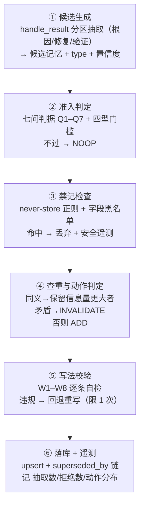

# 记忆提取技能规则规范（MTask 长期记忆）

> 文档类型：可落地规范（规则 + 提示词模板）
> 归属任务：T04114（派生自 T04113 评估）
> 关联文档：`docs/评估报告-工作空间隔离AI长期记忆-T04113.md`（下称「评估报告」）
> 编写时间：2026-11-03
> 调研范围：mem0（GitHub 源码）、Zep / Graphiti（论文 + 官方文档）、Anthropic（Claude Code memory 文档、Memory Tool 协议）、Letta / MemGPT（官方博客 + 架构说明）、以及多家公开的长期记忆保留策略文章
> 约束：本文只定义**规则**，不含实现代码（实施按评估报告 §5 路线图另建派生单）

---

## 0. 本规范解决什么问题

评估报告 §3.2 描述了记忆提取的**机械流程**（任务回传 → 触发抽取 → LLM 抽取 → upsert），但没有回答一个更本质的问题：**抽出来的东西，怎么判断它是一条"好记忆"？**

这在 MTask 场景里不是学术问题，而是成本问题：

| 环节 | 成本 |
|---|---|
| 抽取 | 每条结论一次 LLM 调用（`AIService.askJson`） |
| 存储 | SQLite 行，一条记忆一行 |
| **检索注入** | **每次开工都要付**——记忆进 prompt，占用任务上下文预算 |
| 过期 | 陈旧记忆不仅浪费预算，还会**误导**后续 Agent（它会相信一条已经过时的结论） |

行业共识是同一个：**记忆系统的质量由召回决定，不由存量决定**（mem0 官方文档原话："A clean index of fewer facts beats a noisy index of many"；JetBrains 同义："a small, well-ranked set beats a large one"）。而"少而准"完全取决于写入侧的规则——**写入侧规则是整个记忆系统的地基**。

因此本规范定义记忆的**六类判据**：

| 判据类 | 回答的问题 | 落在哪 |
|---|---|---|
| **准入** | 什么值得记下来 | §3 |
| **动作** | 候选与既有记忆冲突时，新增/更新/失效/丢弃 | §4 |
| **写法** | 一条记忆怎么写才够具体、自足、可复用 | §5 |
| **禁记** | 什么绝对不能记（且必须由代码拦住） | §6 |
| **维护** | 何时过期、何时衰减、何时淘汰 | §7 |
| **验收** | 怎么量化"提取质量"好不好 | §10 |

---

## 1. 基准来源与采纳对照

| 来源 | 核心机制 | 出处 | 我方采纳方式 |
|---|---|---|---|
| **mem0**（GitHub `mem0/configs/prompts.py`） | 写入侧四动作 `ADD / UPDATE / DELETE / NONE`；"同义则保留**信息量更大**的那条"；`linked_memory_ids` 关联既有记忆；抽取提示词的完整性规则族（No Fabrication / No Implicit Attribute Inference / No Echo Extraction / No Meta-Extraction / No Detail Contamination / No Within-Response Duplication）；"上下文丰富而非原子碎片"；专名·数字·版本必须保真；相对时间必须锚定到绝对日期；输出严格 JSON + 逐字段说明 | `mem0ai/mem0` 源码 `prompts.py`（`DEFAULT_UPDATE_MEMORY_PROMPT` / `ADDITIVE_EXTRACTION_PROMPT` / `FACT_RETRIEVAL_PROMPT`） | **直接采纳**动作四分类与大部分完整性规则；**改造**写法判据（见 §12.1） |
| **Zep / Graphiti** | 实体与事实**分离**抽取；事实必须落在**两个不同实体之间**；`relation_type` 用全大写；事实须与既有事实做**重复合并 / 矛盾失效**（而非并存）；**schema 即推理边界**（schema 里没有的关系类型，抽取模型就不会凭空造）；**反思（reflexion）补漏循环**——抽取后回检"有没有漏掉的事实"并重跑 | Zep v4 官方文档「How Graph Creation Works」；Graphiti 论文 arXiv:2501.13956 附录 §6.1.1/§6.1.3/§6.1.4；DeepWiki「Prompt Library」 | **直接采纳** schema-as-boundary 与矛盾失效；**改造**实体/事实二元结构为 MTask 的四型记忆（§12.2）；**采纳**反思补漏作为 Phase 2 增强项 |
| **Anthropic Claude Code**（官方 memory 文档） | **CLAUDE.md（人写规则）vs auto memory（Agent 自记学习）** 两套机制分层；auto memory 索引 `MEMORY.md` **仅前 200 行 / 25KB** 加载，细节进 topic 文件按需读；写入触发条件是**重复犯错 / 同一句纠正第二次出现 / review 暴露了本该知道的事 / 新人要靠它才能上手**；规则写法是**规则 + 理由 + 错例**；多份记忆文件冲突时**显式暴露冲突**而非默默取最新 | `docs.anthropic.com/en/docs/claude-code/memory` | **直接采纳**"重复触发才写"与"规则+理由+错例"格式；**改造**分层方式（MTask 不做 CLAUDE.md 式人写层，只做自动层 + 人工审查页）；**采纳**注入预算截断思路 |
| **Anthropic Memory Tool**（`memory_20250818`） | 客户端执行文件操作（`view/create/str_replace/insert/delete/rename`）；路径必须做**目录穿越防护**、限制在记忆根目录内；系统自动注入 `ALWAYS VIEW YOUR MEMORY DIRECTORY BEFORE DOING ANYTHING ELSE` 与 `ASSUME INTERRUPTION`（上下文随时可能被重置） | `platform.claude.com/docs/en/agents-and-tools/tool-use/memory-tool` | **直接采纳**路径/作用域约束思想；**改造**为产品维度作用域（§12.3）；**采纳**"上下文会被重置"→记忆必须在开工前就注入 |
| **Letta / MemGPT** | **三层**：core memory（常驻上下文的可编辑块，默认单块 2000 字符上限） / recall memory（全量历史可检索档案） / archival memory（显式写入的长期冷存储）；**自编辑**记忆用精确串替换（`core_memory_append` / `core_memory_replace`）；块可设为**只读**（仅开发者可改）；sleep-time compute 空闲期整理记忆 | Letta 官方博客「Memory Blocks」；Letta/MemGPT 架构说明 | **直接采纳**"常驻层有硬上限"与"自编辑用精确替换而非整体重写"；**改造**三层为 MTask 的"产品级共享 + 项目级特有"两层（§12.3） |
| **长期记忆保留策略（多家共识）** | 准入测试："**未来的会话知道它会有何不同**"；只记**稳定 + 可复用 + 不可秒查推导**的事实（1 秒内能从源系统查到的不要记）；决策必须带**理由**；派生结论是**最易过期**的一类，要带日期与"需重新验证"标记；**冲突用 supersede 而非覆盖**（保留审计轨迹）；**never-store 清单必须由代码强制**，不能只靠提示词（模型自检不可靠）；**写入限流**（一次会话突然写 200 条 = 坏了或被攻击）；召回的记忆是**不可信输入**，须独立标记成参考块，不得拼进指令块 | JetBrains《What Is Long-Term Memory in AI Agents?》；TechInsights《Agent Memory Needs a Retention Policy》；Qora《Giving AI Agents Memory》 | **直接采纳**全部；其中"代码强制"与"注入隔离"两项是安全硬要求（§6、§9） |

---

## 2. 规则总览

| 判据 | 核心问题 | 关键规则 | 违反后果 | 强制层 |
|---|---|---|---|---|
| 准入 | 值不值得记 | 七问判据（§3.1）+ 四型门槛（§3.2） | 记忆库膨胀、召回精度下降 | 提示词 + 服务端阈值 |
| 动作 | 与旧记忆冲突怎么办 | ADD / UPDATE / INVALIDATE / NOOP（§4） | 重复堆积、矛盾并存 | 提示词（判）+ 服务层（执行） |
| 写法 | 怎么写 | 八条硬性要求（§5.1） | 召回不到、注入浪费、误导 | 提示词 + 写入前校验 |
| 禁记 | 什么不能记 | never-store 清单（§6.1） | **密钥泄露** | **必须代码拦** |
| 维护 | 何时失效 | 分型保留期 + 访问衰减 + 淘汰（§7） | 陈旧记忆误导后续 Agent | 定时任务 + 管理页 |
| 验收 | 质量好不好 | 精度/召回抽样 + 注入预算 + 污染率（§10） | 无法判断改进是否有效 | 门脚本 + 人工评审 |

---

## 3. 准入判据：什么值得记

### 3.1 七问判据（Q1–Q7）

一条候选记忆必须**全部通过**才允许落库；任一否决即 `NOOP`。

| 编号 | 判据 | 问法 | 不通过的典型 | 出处 |
|---|---|---|---|---|
| **Q1** | 行为改变 | 未来的会话**知道它会有何不同**？ | "本次任务用了 Node 18"（本来就写在 `package.json`） | JetBrains；TechInsights |
| **Q2** | 仍真仍有用 | 它**现在还成立**，且**下次用到时还有用**吗？ | "本次跑测试耗时 42s"（一次性） | JetBrains；mem0docs |
| **Q3** | 不可秒查 | 能否 1 秒内从源系统查到？ | "项目用 better-sqlite3"（`package.json` 一查就有） | Qora |
| **Q4** | 具体可执行 | 含专名 / 数字 / 版本 / 路径 / 命令等**可定位信息**吗？ | "前端有个渲染 bug"（不可定位） | mem0「Preserve Specific Details」 |
| **Q5** | 带理由 | 是**决策**吗？决策是否带**为什么**？ | "改用 pnpm"（无理由 → 下次会被推翻） | JetBrains；TypeFire「Write decisions down with the reason」 |
| **Q6** | 稳定/有期 | 稳定性如何？若易变，是否已标**过期条件**？ | "本周在赶 PRD"（无过期条件 → 永远污染） | Qora 分型 TTL |
| **Q7** | 安全可存 | 是否触碰 never-store 清单？是否含未脱敏敏感信息？ | `API_KEY=sk-xxx` | TechInsights；Qora |

> **与行业默认的取舍**：mem0 的抽取提示词明写 *"When in doubt, extract"*（宁多勿漏）；另有社区实践主张 *"Prefer NOOP — memory pollution is worse than missing a minor fact"*。MTask 取**保守侧**（宁缺勿滥），理由是 MTask 的记忆是**产品级共享**的——一条低价值记忆会跨项目、跨任务、长期反复占用注入预算，代价远高于漏记一条。折中做法：默认置信度阈值 **0.7**，低于则不入库但计入遥测（便于后续调参与人工补录）。

### 3.2 四型记忆的准入门槛与保留期

四型沿用 Claude 的 `user / feedback / project / reference`（评估报告 §3.1 已对齐），此处补齐**每型的准入判据、典型内容、反例与保留期**。

| 型 | 语义 | 准入门槛（额外条件） | 典型 | 反例 | 保留期 |
|---|---|---|---|---|---|
| `user` | 用户角色与稳定偏好 | Q1–Q4 全过 + **跨项目稳定**（换项目仍成立） | "用户偏好用 pnpm 而非 npm"、"输出用简体中文" | "用户今天很累" | 长期（至用户显式改写） |
| `feedback` | 用户对做法的纠正与确认 | Q1–Q5 全过 + **必须是纠正/确认**（有"不要再这样/以后要那样"语义） | "不要在结论里写未验证的推测"、"commit message 用中文" | "用户表扬了一句" | 长期（同 `user`） |
| `project` | 项目内不可从代码/git 推导的决策与状态 | Q1–Q6 全过 + **不可由仓库推导**（Q3） | "PRD 解析要串行多轮，总预算 270s"、"该仓库的构建产物在 release/ 而非 dist/" | "任务在 T04114"（状态字段里就有） | **中长**（默认 180 天），到期需重新确认 |
| `reference` | 项目外的信息源与外部事实 | Q1–Q7 全过 + **有稳定出处**（URL / 文档 / 系统名） | "SonarQube 项目过滤用 projects= 参数，projectKeys 会被静默忽略" | "业界最佳实践是……"（无出处） | 长期 |

> **`project` 型为什么必须"不可从代码/git 推导"**：这是 Q3 的直接落地。若一条结论可以从 `git log`、代码或 `package.json` 直接查到，存进记忆只会制造过期风险（代码变了、记忆没变）——这正是 Claude 官方文档区分 `CLAUDE.md`（"facts Claude should hold in every session"）与 auto memory（"learnings and patterns Claude can't derive from the code"）的那条线。

### 3.3 MTask 场景适配：抽取源是 `handle_result`，不是对话

外部实现的抽取源是**多轮对话**（需要区分 user/assistant、多说话人、增量事实、上下文窗口），MTask 的抽取源是**一段 Markdown 处理结论**（`tasks.handle_result`，由外部 AI Agent 在排查后回传）。以下四类规则**不适用**，须替换：

| 外部规则 | 为何不适用 | MTask 替代 |
|---|---|---|
| 分别从 user / assistant 消息抽取 | 结论是单篇文档，无角色之分 | 按**结论段落语义**分区抽取（见下） |
| 抽取请求里的附带事实（incidental facts） | 结论不是提问 | 从**根因/方案/验证**三段中识别隐含事实 |
| 相对时间锚定到 Observation Date | 结论里若写"昨天"，锚点应是**任务完成时间**而非今天 | 抽取时注入 `now()`（任务完成时刻）为唯一时间锚 |
| 增量事实抽取 + `linked_memory_ids` | 结论是一次性快照 | 直接与既有记忆做四动作判定（§4） |

**`handle_result` 的分区抽取映射**（本规范新增，依据评估报告 §6 的回传文档结构约定）：

| 结论段落 | 抽取意图 | 典型 type |
|---|---|---|
| `## 根因` | 隐蔽的机理、触发条件、错误判据（**代码里查不到的那部分**） | `project` |
| `## 修复` | 约定与做法（"以后要 X 不要 Y"） | `feedback` |
| `## 验证` | 验证口径与命令（可复用的操作约定） | `project` / `reference` |
| `## 下一步建议` | **默认不抽取**（是待办不是记忆） | — |
| 全篇 | 用户层面的偏好/纠正 | `user` / `feedback` |

---

## 4. 动作判据：ADD / UPDATE / INVALIDATE / NOOP

### 4.1 决策顺序

候选记忆产生后，按**固定顺序**判定（顺序本身是规则——顺序不同结果不同）：

```
1. 准入判定（§3）—— 不过 → NOOP（丢弃，不入库、不记遥测）
2. 禁记检查（§6）—— 命中 → NOOP（丢弃 + 安全遥测告警）
3. 同义查重：与既有记忆是否表达同一事实？
      ├─ 是，且候选信息量更大 → UPDATE（合并后 UPDATE）
      ├─ 是，且既有信息量更大 → NOOP
      └─ 否 → 4
4. 矛盾检查：候选是否与既有记忆冲突？
      ├─ 是 → INVALIDATE（既有记忆标失效 + 写候选 + 留 supersede 指针）
      └─ 否 → 5
5. 作用域检查：是否已有同作用域同主题的旧版本需要失效？
      └─ 是 → 旧记忆 INVALIDATE + 候选 ADD
      └─ 否 → ADD
```

### 4.2 决策表

| 与既有记忆的关系 | 动作 | 落库效果 | 出处 |
|---|---|---|---|
| 无相关既有记忆 | **ADD** | 新增一行 | mem0 |
| 表达同一事实，候选信息量**更大** | **UPDATE** | **沿用既有行的 id**（不新建行），内容替换为信息量更大版 | mem0 |
| 表达同一事实，既有信息量**更大或相等** | **NOOP** | 不变（**不新建平行副本**） | mem0 + Qora「Duplicates are the largest single driver of retrieval degradation」 |
| 表达同一事实，候选**补充**了既有记忆 | **UPDATE** | 合并：既有内容 + 候选增量 | mem0 |
| **矛盾**（新事实否证旧事实） | **INVALIDATE** | 旧行置失效（`invalidated_at` + `superseded_by`），新行 ADD；**旧内容保留**不物理删除 | Graphiti「contradictions invalidate older facts rather than leaving conflicting truths side by side」；Qora「Resolve conflicts by supersession, never by overwrite」 |
| 候选已存在且无新信息 | **NOOP** | 不变 | mem0 |
| 不通过 §3 准入 / §6 禁记 | **NOOP** | 不变 | 本规范 |

> **为何把 mem0 的 `DELETE` 改成 `INVALIDATE`**：mem0 用物理删除，但 MTask 的记忆是**产品级共享**的——物理删除会让同期其他项目正在引用的记忆凭空消失。失效（软标记）保留审计轨迹：能回答"这条结论是什么时候被哪条新结论取代的"，这对"用户到底改主意了，还是抽取器抽错了"这类问题只有保留历史才能回答。物理清理由管理页的显式删除动作提供，不在自动流程内发生。

### 4.3 「信息量更大」的判定

UPDATE 的判定不能靠模型感觉，需给死规则（否则每次 UPDATE 都在随机重写）：

> **信息量更大** = 在保持同一事实陈述的前提下，新增了下列**任一**：
> ① 具体的专名 / 数字 / 版本 / 路径 / 命令；② 触发条件或适用范围；③ 决策的理由；④ 失效边界或例外。
>
> 若候选只与既有记忆**措辞不同**而五项均无新增 → **NOOP**（不是 UPDATE）。

---

## 5. 写法判据：怎么写一条好记忆

### 5.1 八条硬性要求

| # | 要求 | 规则 | 出处 |
|---|---|---|---|
| **W1** | 一事一条 | 一条记忆只陈述一个事实。多个事实拆多条 | 本规范（依据 Qora「Atomic Facts」+ mem0 拆条规则） |
| **W2** | 自足 | 代词换成具体名词；不依赖上下文即可读懂 | mem0「Self-Contained」 |
| **W3** | 保真具体 | 专名、数字、版本、路径、命令**原样保留**，不得泛化 | mem0「Preserve Specific Details」（其正反例见 §5.2） |
| **W4** | 时间锚定 | 相对时间（"昨天/上周"）转**绝对日期**；绝对时间**不得**转模糊 | mem0「Temporally Grounded」 |
| **W5** | 数值精确 | "416 页"不写成"约 400 页"；"3 个"不写成"几个" | mem0「Numerically Precise」 |
| **W6** | 语义精确 | 不改变命题方向（"没睡到 2 点" ≠ "睡到 2 点"；"不再喜欢" ≠ "喜欢"） | mem0「Meaning-Preserving」 |
| **W7** | 变更留痕 | 状态迁移必须写清**从什么变成什么**（含"暂时/试用了"这类标记） | mem0「Contextually Rich, Not Atomic」中的 transition 段 |
| **W8** | 长度有界 | 15–80 词（中文约 30–120 字）；细节多则拆多条，**不得为凑字数丢专名/日期/数字** | mem0「Concise but Complete」 |

### 5.2 正反例对照（直接取自 mem0 官方提示词的保真清单，适配 MTask 场景）

| 弱写法（❌） | 强写法（✅） | 违反 |
|---|---|---|
| "前端有个渲染 bug" | "TasksPage 勾选全选后未过滤已归档行，导致列表出现已归档任务（`TasksPage.tsx` 渲染前未套 `archived=0` 过滤）" | W3 |
| "改用 pnpm" | "该仓库统一用 pnpm 而非 npm：`pnpm-lock.yaml` 已在库且 `package.json` 无 `packageManager` 冲突，CI 也按 pnpm 跑" | W3 / Q5 |
| "构建产物在 dist" | "打包产物在 `release/`（`asar` 打包 + NSIS），`dist/` 只是 Electron 临时目录" | W3 |
| "项目用 better-sqlite3" | （**不入库**——`package.json` 一查就有） | Q3 |
| "PRD 解析要串行" | "PRD 解析为多轮 AI 串行，总预算 270s（桌面壳代理超时上限约 300s），同类『多轮 AI 串行 > 300s』场景适用同一预算" | W7 |
| "测试跑得慢" | "该仓库 `npm test` 单次约 42s，超过 30s 需用 `run_in_background`" | W4 / W5 |
| "上次打包失败是因为路径" | "2026-10-25 安装版打包失败根因是 app.asar 内 `--unpack` glob 对绝对路径不命中（Windows），改用 `--unpack-dir` 反斜杠字面前缀后修复" | W4 / W7 |

### 5.3 结构约定

单条记忆的字段沿用评估报告 §3.1 的 `memories` 表；本规范只补充**取值规则**：

| 字段 | 取值规则 |
|---|---|
| `title` | 事实的**压缩名词短语**（≤20 字），不是句子；用于列表展示与检索命中 |
| `content` | 完整自足陈述句，满足 W1–W8 |
| `type` | 四型之一（§3.2） |
| `tags` | 便于人工检索的关键词数组（≤5 个）；**不得**把整句塞进 tags |
| `source_task_id` | 抽取来源任务号（可空=人工创建） |
| `source_kind` | `auto`（自动抽取）/ `manual`（人工录入）/ `user_said`（用户明确要求记住）/ `tool_output`（工具产出）/ `inferred`（模型推断）——**溯源标记，检索时据此加权**（§6.3） |
| `product_key` | 产品标签（归一化），评估报告 v3 §3.1 |
| `project_id` | 为空 = 全产品共享；非空 = 仅该期特有 |

---

## 6. 禁记清单与代码强制点

### 6.1 never-store 清单（绝对不记）

| 类别 | 具体 | 强制方式 |
|---|---|---|
| 凭据 | API Key / Token / 密码 / 私钥 / Cookie / `Bearer` 头 | 正则 + 字段名黑名单，**写入前拦截** |
| 连接串 | 带账号密码的数据库/Redis/MQ 连接串 | 正则 |
| 密钥库路径与密文 | `api_key_enc` / `secret_enc` 的**密文本身**（可解密的等价凭据） | 字段名黑名单 |
| 个人敏感 | 身份证 / 手机号 / 银行卡 / 住址 | 敏感模式识别 + 人工确认 |
| 大块原文 | 整段 PRD 原文、完整日志、完整 diff | 长度上限 + 段落级剥离（只留事实，不留原文） |

> **原则**：never-store 必须由**代码**强制，不能只写进提示词——模型的自检不可靠（TechInsights 原文：*"Models are inconsistent at self-censoring; a deterministic check is not"*）。提示词里的禁止项只是第一道，代码拦截才是最后一道。

### 6.2 必须在代码里做的四件事

| # | 强制项 | 理由 |
|---|---|---|
| **C1** | 写入前跑 never-store 正则 + 字段名黑名单，命中则丢弃并记安全遥测 | 模型自检不可靠 |
| **C2** | **写入限流**：单任务回传最多落 N 条（建议 5），单会话/单产品每小时上限 | 一次会话突然写 200 条 = 抽取器坏了或被投毒（Qora） |
| **C3** | **置信度阈值**：低于 0.7 不入库（记遥测，不记记忆） | 保守侧取舍（§3.1） |
| **C4** | **作用域强制**：查询必须带 `product_key`，禁止无作用域全局检索 | 评估报告 §4.2 隔离硬约束 |

### 6.3 记忆投毒防御

记忆是**写进未来 prompt 的路径**，天然是攻击面（Qora「Memory poisoning via injected content」）。四道防线：

| 防线 | 规则 |
|---|---|
| **只存声明式事实，不存原文** | 存"PRD 解析超时有 270s 预算"，不存原始日志原文；祈使句/指令句不得成为记忆行 |
| **溯源标记 + 检索加权** | 每条记忆带 `source_kind`；`user_said` > `auto` > `inferred` > `tool_output`；外部内容不得压过用户陈述 |
| **注入隔离** | 召回的记忆以**独立标记的参考块**注入（如 `<memory-context>` 段），**不得拼进指令块**、不得拥有指令权限 |
| **写前限流 + 人工审查** | C2 限流；管理页可逐条改删（评估报告 §3.4） |

---

## 7. 维护判据：过期、衰减、淘汰

### 7.1 分型保留期（TTL）

沿用 Qora 的"按型分 TTL，不用全局值"：

| 型 | 默认保留 | 何时刷新 | 何时失效 |
|---|---|---|---|
| `user` / `feedback` | 无固定 TTL | 用户再次确认时 | 用户显式改写或删除 |
| `project` | 180 天 | 被新记忆 UPDATE/INVALIDATE 时 | 到期未确认 → 标"需复核"（仍可召回但降权） |
| `reference` | 无固定 TTL | 出处变更时 | 出处失效时 |
| 通用（"任务状态"类） | 30 天 | — | 到期即失效 |

### 7.2 访问衰减

未被告警的"陈旧记忆"降权而非删除（mem0「Memory Decay」：近期访问得分 ×1.5，长期未访问降至 ×0.3；本质是 Bjork 的"存储强度 vs 提取强度"之分）。MTask 落地：记录 `access_count` / `last_accessed_at`，检索排序时按未访问时长降权。

### 7.3 淘汰与整理

| 机制 | 规则 | 出处 |
|---|---|---|
| 容量上限 | 单产品记忆上限（评估报告 §4.1：200 条）；超限按 `access_count` 最低 / `updated_at` 最旧淘汰 | 评估报告 |
| 月度整理 | 归档已完结任务导出的记忆、合并近重复、删除无人遵守的规则 | TypeFire「Prune once a month」；Claude Code 官方建议 |
| 陈旧优于无 | **陈旧记忆比没有记忆更糟**——Agent 会信任它；故到期项要么失效要么降权，不留"看起来还在"的僵尸条目 | TypeFire |

---

## 8. 提取流程（六段）



> 与评估报告 §3.2 原 6 步流程的差异：原流程只有「判重 → askJson → upsert」，**缺准入判定（②）、禁记检查（③）、写法校验（⑤）**——这正是本规范补齐的部分。落地时 §3.2 的时序图应按本节六段重画。

---

## 9. 抽取提示词模板（中文，可直接落地）

> 用途：`MemoryService.extract()` 的 system prompt 常量。输入为 `{candidates}`、`{existing}`、`{now}`；输出严格 JSON。
> 标注：`【直接采纳】`= 来自外部实现的原规则；`【改造】`= 依 MTask 场景调整；`【本规范】`= 我方新增。

```
你是 MTask 记忆提取器。输入是一份技术任务处理结论（Markdown）与既有记忆列表，
输出应当被长期记住的结构化记忆。

# 输入
- candidates：从结论中抽取的候选记忆（每条含 title/content/type/tags/confidence/source_kind）
- existing：当前产品下已有记忆（每条含 id/title/content/type/project_id/scope）
- now：本次结论的完成时间（唯一时间锚点）

# 第一步：准入判定（逐条独立判定，任一否决即丢弃）
Q1 行为改变：未来的会话知道它会有何不同？不改变行为的丢弃。
Q2 仍真仍有用：现在还成立，且下次用到时还有用吗？一次性状态丢弃。
Q3 不可秒查：1 秒内能从仓库/配置/系统直接查到的丢弃。
Q4 具体可执行：含专名/数字/版本/路径/命令等可定位信息吗？没有的丢弃。
Q5 带理由：决策类必须含"为什么"，否则丢弃。
Q6 稳定或有期：易变内容必须写明过期条件，否则丢弃。
Q7 安全可存：含凭据、连接串密钥、个人敏感信息吗？有的丢弃。

# 第二步：动作判定（对通过准入的候选，逐条与 existing 比较）
- ADD：与既有记忆无同义、无矛盾。
- UPDATE：与既有记忆表达同一事实，且本候选新增了下列任一项——
  专名/数字/版本/路径/命令；触发条件或适用范围；决策理由；失效边界或例外。
  输出时必须沿用既有记忆的 id，不得新建平行副本。
  若候选与既有仅措辞不同、五项均无新增 → NOOP。
- INVALIDATE：候选与既有记忆矛盾（新的否证旧的）。输出 invalidated_ids 列出被否证的
  既有记忆 id，并在新记忆里写明"取代了什么"，不得物理删除旧记忆。
- NOOP：已被覆盖、或不值得记。

# 第三步：写法规则（逐条自检，违规则重写，仍不合则丢弃）
W1 一事一条：一条只讲一个事实。
W2 自足：代词换成具体名词，脱离上下文也能读懂。
W3 保真具体：专名、数字、版本、路径、命令原样保留，不泛化。
W4 时间锚定：相对时间换成基于 now 的绝对日期；绝对日期不得改模糊。
W5 数值精确："416 页"不写成"约 400 页"，"3 个"不写成"几个"。
W6 语义精确：不得改变命题方向（"没睡到 2 点"不等于"睡到 2 点"）。
W7 变更留痕：状态迁移写清从什么变成什么；若为暂定/试用，一并注明。
W8 长度有界：15-80 词（中文 30-120 字）；细节过多则拆成多条，不得为凑字数丢专名/日期/数字。

# 第四步：禁止项
- 不得凭空编造任何未在输入中出现的细节。
- 不得推断未明说的属性（如从名字推断性别、年龄、职级）。
- 不得把"用户要求做 X"这类请求本身抽成记忆，只抽其中隐含的事实。
- 不得从既有记忆搬运细节到新记忆（除非本条明确提到了）。
- 同一份输出中不得出现两条语义等价的内容（保留信息量更大的那条）。
- 不得输出解释性文字，只输出 JSON。

# 输出格式（严格 JSON，无 Markdown 包裹）
{
  "memories": [
    {
      "action": "ADD | UPDATE | NOOP",
      "id": "UPDATE 时必填：既有记忆的 id",
      "invalidated_ids": ["与本条矛盾的既有记忆 id"],
      "title": "压缩名词短语，≤20 字",
      "content": "完整自足陈述句，满足 W1-W8",
      "type": "user | feedback | project | reference",
      "tags": ["关键词", "≤5 个"],
      "confidence": 0.0,
      "source_kind": "auto | manual | user_said | tool_output | inferred",
      "project_id": "仅本阶段特有时填，否则为 null"
    }
  ],
  "dropped": [{"title": "被丢弃的候选", "reason": "Q1-Q7 编号或禁止项名称"}]
}
```

> **注意 `dropped` 字段**：外部实现普遍只输出命中的记忆，不输出被丢弃的理由。但对 MTask 而言**"为什么没记"比"记了什么"更重要**——它既是调参依据（哪个判据拒杀率过高），也是人工补录的线索。故要求显式回报丢弃原因。

---

## 10. 质量度量与验收

### 10.1 指标

| 指标 | 定义 | 目标 | 出处 |
|---|---|---|---|
| **精度** | 抽样人工评审中判为"值得记"的占比 | ≥ 80% | Qora「label whether each injected memory was relevant」 |
| **召回** | 人工认为该记但未被抽取的占比 | ≤ 15% | JetBrains |
| **注入预算** | 每次任务注入的 token 占用 | ≤ 2k token（评估报告 §4.1） | 评估报告；Letta「core memory 每块 2000 字符上限」同源思想 |
| **污染率** | 含 never-store 内容的记忆行数 | **= 0**（C1 代码强制） | TechInsights |
| **矛盾率** | 同一 `product_key` 下同时存在互斥且都未失效的记忆 | **= 0**（INVALIDATE 生效） | Graphiti |
| **陈旧率** | 已过保留期却仍在被召回的记忆占比 | ≤ 10% | §7.1 |

### 10.2 抽样评审规程

1. 每批抽取后，**随机抽 20 条**（不抽 TOP，避免只看"看起来好的"）由人判定：值得记 / 不值得记 / 写得不好。
2. 判定"不值得记"时**必须记下命中的判据编号**（Q1–Q7 / W1–W8 / 禁记项），用于定位规则缺陷而非只记结论。
3. 评审结果进入规则迭代：**连续两批同一判据拒杀率 > 40% → 该判据需重写**（而不是靠放宽阈值掩盖）。
4. 评审样本与标注结论留档，作为回归基线（对应 §12.4 的门脚本断言）。

### 10.3 门脚本断言点（可自动化）

| 断言 | 形式 |
|---|---|
| never-store 生效 | 构造含 `sk-`、`password=`、`Bearer ` 的候选 → 断言落库 0 条 + 遥测有安全告警 |
| C2 限流生效 | 单次回传 20 条候选 → 断言入库 ≤ 5 条 |
| C3 阈值生效 | 构造 confidence=0.5 的候选 → 断言不入库、`dropped` 有该条 |
| ADD/UPDATE/NOOP 判定 | 同一事实的"信息量更小"版本 → 断言 NOOP 且行数不变；"信息量更大"版本 → 断言 UPDATE 且**行 id 不变** |
| INVALIDATE 生效 | 矛盾候选 → 断言旧行 `invalidated_at` 非空、仍物理存在、新行含 `superseded_by` |
| C4 作用域强制 | 无 `product_key` 的查询 → 断言报错而非返回全量 |

---

## 11. 与 MTask 的落点对照

| 规范条目 | 落点 | 备注 |
|---|---|---|
| §3 准入判据 | `MemoryService.extract()` 的提示词常量 | 提示词模板见 §9 |
| §4 动作判定 | `MemoryService.applyAction()` | 执行 ADD/UPDATE/INVALIDATE/NOOP |
| §5 写法规则 | 同提示词；W1–W8 自检失败重写（限 1 次） | 重写次数需限，防死循环 |
| §6.1 never-store | `server/src/util/memoryGuard.ts`（新增，中性工具模块） | 与 `util/planDeps.ts` 同类定位 |
| §6.2 C1–C4 | `MemoryService` 写路径 / 查询路径 | C1、C2、C3 在写路径，C4 在查询路径 |
| §6.3 投毒防御 | `source_kind` 列 + `queryForContext()` 的注入块渲染 | 注入块独立标记，不拼进指令 |
| §7 维护 | `scripts/` 定时整理脚本 + 记忆管理页 | 沿用 `ai_usage` / `ai_card_provenance` 的遥测范式 |
| §10.3 门断言 | `scripts/verify-t04114-memory-rules.mts` | 门脚本需接 `scripts/lib/gate-boot.mts` |

> 本表与评估报告 §2.2「具体改动点」互补：评估报告给**数据模型与接口**，本规范给**行为判据**。两者需一并评审。

---

## 12. 与外部实现的差异说明（改造点汇总）

### 12.1 写法判据：原子 vs 上下文丰富

- **mem0 官方**：主张 *"Contextually Rich, Not Atomic"*——把事实与其背景融进**一条**记忆（其反例是 "User has a dog"，正例是 "User has a dog named Poppy and their morning walks together are the highlight of their day"）。
- **社区实践（totalreclaw 等）**：主张 *"Atomic Facts Only"*——一条记忆一个事实。
- **MTask 取舍**：取 **W1 一事一条 + W3 保真具体 + W7 变更留痕** 的组合。
  - **理由**：mem0 的"上下文丰富"是针对**聊天人格记忆**的——主语是"用户"，背景是这个人是谁，因而需要把人和事绑在一起才检索得到。而 MTask 的主语是**技术结论**，检索场景是"这次任务要不要绕开某个坑"，多语句的叙事性记忆会稀释可定位信息（W3），降低召回精度。
  - **但采纳 mem0 的 transition 规则**（W7）：状态迁移必须写清"从什么变成什么"——这在技术场景恰恰是高价值信息（"打包路径从 dist 改为 release"），只是要以**紧凑句**表达而非铺陈叙事。
- **保留的借鉴**：若未来 MTask 引入"用户画像"型记忆（如跨项目的沟通偏好），可对 `user` 型单独放宽为"上下文丰富"。

### 12.2 实体/事实二元结构 → 四型记忆

- **Zep/Graphiti**：分实体（节点）与事实（边）两层，事实必须落在**两个不同实体之间**，`relation_type` 用全大写。
- **MTask 取舍**：不引入图结构，采用**四型扁平记忆**（`user`/`feedback`/`project`/`reference`）。
  - **理由**：图结构收益在"跨实体多跳推理"，而 MTask 的检索模式是**单条事实的关键词/语义命中**；引入图会显著抬高 Phase 1 成本而收益不确定。
  - **采纳的部分**：schema-as-boundary（§4 准入即边界）、矛盾失效（§4.2）、以及 Phase 2 的**反思补漏**（抽取后回检漏抽并重跑）。
  - **延后项**：若未来出现"这个产品的整体架构是什么"这类需要跨多条记忆聚合的问题，再评估图化。

### 12.3 三层记忆 → 产品两层 + 人工审查页

- **Letta/MemGPT**：core（常驻，2000 字符/块） / recall（全历史） / archival（显式写入的冷存储）。
- **MTask 取舍**：
  - 常驻层 → **产品级共享记忆**（`project_id IS NULL`），并用**注入预算**代替"字符上限"（Letta 用字符，MTask 用 token，因为注入的是 LLM 上下文）；
  - recall 层 → MTask 无需（`task_result_history` 已留档，且记忆才是提炼后的产物）；
  - archival 层 → **项目级特有记忆**（`project_id = 当前项目`）；
  - Letta 的**自编辑**（精确串替换）→ MTask 中由**抽取器**做 UPDATE/INVALIDATE（等价于"精确串替换"语义，但执行者不同，避免 Agent 自己改自己记忆带来的污染风险）。

### 12.4 冲突消解：物理删除 → 失效 + 指针

- **mem0** 用物理 `DELETE`；**Graphiti / Qora** 用 supersede + `invalid_at` 保留审计轨迹。
- **MTask 取舍**：采用后者（§4.2）。理由：产品级共享记忆被同期项目引用，物理删除会造成"别人的引用凭空失效"。物理删除只由用户在管理页显式触发。

---

> **一致性声明**：本规范的每条核心规则均标注了来源机制（§1 表），并区分「直接采纳 / 改造 / 本规范新增」。§3.3 的抽取源适配、§5.1 的八条写法要求、§6.2 的四项代码强制点、§10.3 的门断言为**结合 MTask 现状新增**的部分，已逐条说明理由。文中未出现任何未经调研的实现细节；所有外部机制均来自 §1 列出的来源。
