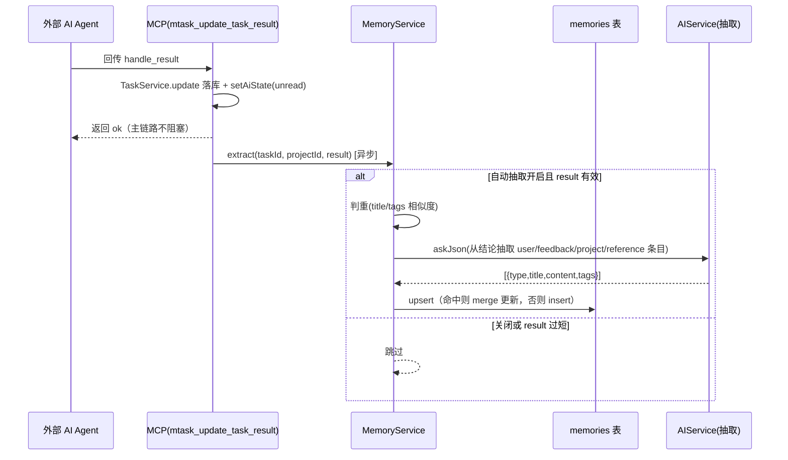
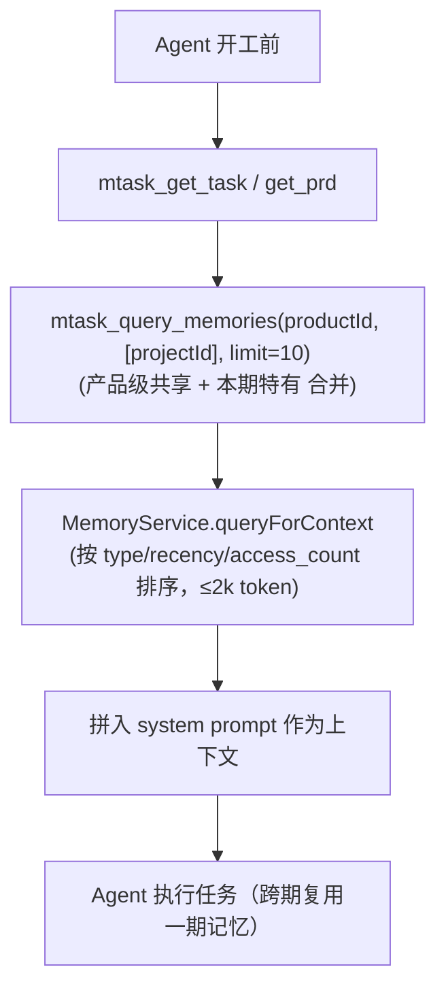

# 技术评估报告：引入「工作空间隔离的 AI 长期记忆」功能

> 评估对象：MTask（桌面端 AI 任务开发管理工具，Electron + Express + SQLite + React）
> 任务编号：T04113 ｜ 编写时间：2026-11-03
> 评估依据：对 `server/src`、`web/src`、`electron/`、`scripts/`、`package.json` 的逐文件源码核查，以及对 Claude 长期记忆公开机制的对照。所有架构结论均可在源码中定位，未引入任何虚构组件。
>
> **v2 修订（2026-11-03）**：根据实测场景反馈补充**产品（product）维度**。原方案以 `project_id` 为隔离单元，会导致同一产品多期项目（如 wiki 一期/二期/三期，各自是独立 `projects` 行）无法复用已固化记忆。现改为以 `product_id` 为记忆的**隔离与共享单元**，多期项目归属同一产品即可跨期共享记忆，跨产品仍严格隔离。下文 §2.1/§3.1/§3.3/§3.4/§4/§5/附 均据此更新。

---

## 1. 结论摘要

**建议：有条件引入（Conditional Yes）。**

核心理由：

1. **需求真实且有清晰落点**：当前外部 AI Agent（如经 mtask Skill + MCP 处理任务的 WorkBuddy）每次开工都只能拿到「任务字段 + PRD + 截图 + 摘要」四类上下文（源码核查：`server/src/mcp/server.ts` 的 `mtask_get_task` / `mtask_get_task_images` / `mtask_get_prd` / `mtask_summarize_task`），**全仓无任何长期记忆逻辑**。让 Agent 跨任务积累经验（如「该用户偏好 pnpm 而非 npm」「此项目 PRD 解析常撞 429 需退避」）价值明确。
2. **架构改动可控制在增量、非侵入范围**：记忆提取可挂在 `mtask_update_task_result` 处理器内（落库之后、`return ok` 之前），记忆查询作为 Agent 开工前的可选 MCP 调用，二者都不破坏既有 `handle_result` 落库、unread 驱动、派生单归并等逻辑。
3. **关键约束必须先澄清**：MTask **没有「多工作空间」实体**——"workspace" 仅是项目绑定的本地目录路径（`projects.workspace_path`），唯一真实的顶层组织单元是 `projects`。**原方案以 `project_id` 为记忆隔离单元存在缺陷**：同一产品多期项目（如 wiki 一期/二期/三期）是各自独立的 `projects` 行，若记忆只挂在 `project_id` 上，一期固化的记忆在二期无法复用、造成浪费。因此引入**产品（product）维度**：`product_id` 作为记忆的**隔离与共享单元**，多期项目归属同一产品即可跨期共享记忆；跨产品仍严格隔离。记忆表以 `product_id` 为主外键，并保留可选的 `project_id` 子作用域（仅某期特有的记忆）。

**条件（必须同时满足才建议开工）**：
- 记忆提取必须是**异步、非阻塞**的（不能拖慢任务回传完成）；
- 注入上下文必须设**令牌上限**（防止记忆膨胀挤占任务提示词窗口）；
- 提供**用户可审查/编辑/删除**的管理页与明确的隔离作用域，杜绝跨项目泄露。

---

## 2. 架构影响分析

### 2.1 现状关键事实（决定方案形态）

| 维度 | 现状（源码实证） | 对记忆功能的影响 |
|---|---|---|
| 工作空间模型 | 无 workspace 表；`projects.workspace_path` 仅是路径字符串；唯一顶层组织单元是 `projects`；单 SQLite、单机、单用户、本地优先 | 记忆隔离键本应取 `project_id`，但见下「产品维度」行的缺口 |
| 产品维度（现状缺口） | **无「产品」实体**：同产品多期项目（如 wiki 一期/二期/三期）是各自独立的 `projects` 行，互相无关联；`projects` 表无产品归属列 | 纯 `project_id` 隔离会导致一期固化的记忆在二期无法复用；需新增 `products` 表 + `projects.product_id`，记忆以 `product_id` 为**隔离与共享单元**，多期项目共享同一产品记忆 |
| Agent 任务后环节 | `mtask_update_task_result`→`TaskService.update({handle_result})`→`setAiState('unread')`（`server.ts:1060-1062`）；派生单归并在 `1063-1093` | 提取钩子插入 `1060` 之后、`1094 return ok` 之前，纯增量 |
| Agent 任务前上下文 | 仅 `get_task`+`get_task_images`+`get_prd`+`summarize_task`；全仓无 memory 检索 | 新增 `mtask_query_memories` 作为开工前可选调用 |
| 现有近似表 | `workspace_symbols`（代码符号索引，按 project_id）、`ai_card_provenance`（滚动 30 份溯源）、`task_result_history`（覆盖留档）、`exec_sessions`（编排遥测） | 均非持久语义记忆；可借鉴 `workspace_symbols` 的「project_id 隔离 + mtime 增量」范式，但不复用 |
| 配置落点 | `app_settings`（全局 KV，无用户维度）；`projects` 表列（项目级） | 记忆开关可置于 `projects` 列（项目级）或 `app_settings`（全局） |
| 前端设置结构 | `web/src/ui/settingsTabs.ts` 的 `SETTINGS_GROUPS`（preference/data/ops 三组）；记录型 CRUD 范式见 `ApiTokensTab` | 新增「记忆管理」子页，复用 `ApiTokensTab` 列表/增/删/改范式 |
| MCP 注册范式 | `server.registerTool('mtask_xxx', {title,description,inputSchema(zod)}, async(a)=>ok/err)`；工具全局操作，靠 `projectId/projectName` 参数定位作用域 | 新增 `mtask_*_memory` 工具，沿用同层注册 + 复用 `MemoryService` |

### 2.2 具体改动点

- **数据库层**：新增 `products` 表与 `memories` 表（见 §3.1）；`projects` 表增量补 `product_id` 列（`schema.ts` 的 `ensureColumn` 向后兼容，可空）；`memories.product_id` 外键 `ON DELETE CASCADE`、`memories.project_id` 外键 `ON DELETE SET NULL`；加 `idx_memories_product`、`idx_memories_product_type`、`idx_memories_project` 三个索引。新表均在 `schema.ts` 的 `initSchema` 内 `CREATE TABLE IF NOT EXISTS` 以保证老库兼容。
- **服务层**：新增 `MemoryService`（建/查/改/删 + `extract()` 提取 + `queryForContext()` 上下文装配），仿 `TokenService` 的 `list/create/update/remove` 单例结构。
- **API 层**：`routes/index.ts` 增 `GET/POST/PUT/DELETE /memories`（委托 `MemoryService`）；并在 `SettingsService.EXPORT_TABLES` 白名单加入 `'memories'`，使其随 `/settings/export|import` 与 MCP `mtask_export_data`/`mtask_import_data` 迁移（否则换机恢复丢数据）。
- **MCP 层**：`server.ts` 增 `mtask_save_memory` / `mtask_query_memories` / `mtask_list_memories` / `mtask_update_memory` / `mtask_delete_memory`，复用具名 `ok/err/json` 与 `resolveProjectIdOf`。
- **AI Agent 交互层**：① 任务后 → `mtask_update_task_result` 内行 1060 之后触发 `MemoryService.extract`（**异步 fire-and-forget，不入主链路**，按当前项目的 `product_id` 落库）；② 任务前 → Agent 在 `get_task` 之后调用 `mtask_query_memories(productId, [projectId])` 取回「产品级共享 + 本期特有」记忆，拼入 system prompt。
- **前端**：`settingsTabs.ts` 加 `'memory'` 键 + `data` 组 tab；`SettingsPage.tsx` 渲染 `<MemoryTab/>`；新建 `MemoryTab.tsx`（仿 `ApiTokensTab`）。

---

## 3. 详细设计方案

### 3.1 记忆数据模型（SQLite）

```sql
-- 产品：记忆的隔离与共享顶层单元；同产品多期项目（一期/二期/三期）共享其记忆
CREATE TABLE IF NOT EXISTS products (
  id          TEXT PRIMARY KEY,
  name        TEXT NOT NULL,          -- 产品标签/名，如 "Wiki"
  description TEXT,
  created_at  TEXT NOT NULL,
  updated_at  TEXT NOT NULL
);

-- projects 增量补列（向后兼容老库，可空表示未归入产品）：
-- ALTER TABLE projects ADD COLUMN product_id TEXT REFERENCES products(id) ON DELETE SET NULL;

CREATE TABLE IF NOT EXISTS memories (
  id              TEXT PRIMARY KEY,
  product_id      TEXT NOT NULL,       -- 隔离/共享单元（必填）
  project_id      TEXT,               -- 可选子作用域：仅某期项目特有的记忆；NULL 表示全产品共享
  type            TEXT NOT NULL CHECK(type IN ('user','feedback','project','reference')),
  title           TEXT NOT NULL,
  content         TEXT NOT NULL,
  tags            TEXT,            -- JSON 数组，如 ["PRD","429","限流"]
  source_task_id  TEXT,            -- 溯源：来自哪条任务（可空，手动创建时无）
  source_kind     TEXT NOT NULL DEFAULT 'auto',  -- auto(自动抽取) / manual(手动)
  access_count    INTEGER NOT NULL DEFAULT 0,
  last_accessed_at TEXT,
  created_at      TEXT NOT NULL,
  updated_at      TEXT NOT NULL,
  FOREIGN KEY (product_id) REFERENCES products(id) ON DELETE CASCADE,
  FOREIGN KEY (project_id) REFERENCES projects(id) ON DELETE SET NULL
);
CREATE INDEX idx_memories_product      ON memories(product_id);
CREATE INDEX idx_memories_product_type ON memories(product_id, type);
CREATE INDEX idx_memories_project      ON memories(project_id);
```

> **隔离与共享语义**：查询时以 `product_id` 为作用域，并合并「产品级共享记忆（`project_id IS NULL`）」与「本阶段项目特有记忆（`project_id = 当前项目`）」——即 wiki 二期能读到一期固化的产品记忆，同时不串入其他产品；删除产品级联清空其全部记忆，删除某期项目则记忆回退为产品级共享（不丢失）。
> 类型对齐 Claude 的四类记忆：`user`（用户角色/偏好）、`feedback`（纠正与确认的做法）、`project`（进行中工作/决策，代码与 git 不可派生的部分）、`reference`（项目外的信息源如 issue tracker）。这与 Claude 的 `type` 字段（`user/feedback/project/reference`）一一对应。

### 3.2 记忆提取与存储流程图解





### 3.3 MCP 接口字段定义示例

**保存 / 更新记忆**（`mtask_save_memory`）

| 字段 | 类型 | 说明 |
|---|---|---|
| `productId` | string? | 所属**产品**（隔离/共享单元），与 `productName` 二选一；缺失时按 `projectId` 回溯其 `product_id`（仍缺失则拒绝，强制产品作用域） |
| `productName` | string? | 按名解析产品（同名取当前） |
| `projectId` | string? | 可选**子作用域**：仅某期项目特有记忆；置空表示全产品共享 |
| `projectName` | string? | 按名解析项目（用于回溯 `product_id`） |
| `type` | enum | `user`/`feedback`/`project`/`reference` |
| `title` | string | 记忆标题（必填） |
| `content` | string | 记忆正文（必填） |
| `tags` | string[]? | 标签，用于检索与判重 |
| `id` | string? | 传入则更新已有记忆，否则新建 |

返回：`ok('已保存记忆 id=...', {memory})`。

**查询记忆（上下文注入）**（`mtask_query_memories`）

| 字段 | 类型 | 说明 |
|---|---|---|
| `productId` / `productName` | string? | **产品作用域（必填其一）**，所有查询强制 `WHERE product_id = ?`；**决不允许跨产品或无作用域的全局查询**，保障隔离 |
| `projectId` | string? | 可选子作用域：传入则结果合并「产品级共享（`project_id IS NULL`）」+「本阶段特有（`project_id = 当前项目`）」；不传则取整个产品全部记忆 |
| `type` | enum? | 按类型过滤 |
| `query` | string? | 关键词（LIKE / FTS5 over title+content+tags） |
| `limit` | int? | 默认 10，硬上限 20；返回内容按令牌预算截断 |

返回：`ok(json({memories:[...]}))`，每条含 `type/title/content/tags/source_task_id`。

**管理类**：`mtask_list_memories`（分页/类型过滤）、`mtask_update_memory`、`mtask_delete_memory`（均带 `productId` 作用域校验，并以 `product_id` 为删除边界——删产品级记忆级联清空、删某期记忆仅回退为产品级）。

### 3.4 前端「记忆管理」页面功能清单

复用 `web/src/pages/RecurringTokensTabs.tsx` 的 `ApiTokensTab` 范式（列表 + 新增 + 行内编辑/删除确认）：

1. **产品关联（新建关联工作空间时）**：在「新建 / 关联工作空间」流程中新增**产品标签创建与关联**能力——用户可「选择已有产品」或「新建产品标签」（如 "Wiki"），新建的项目自动带上 `product_id`（写 `projects.product_id`）；横向多期项目（Wiki 一期/二期/三期）只需都选同一产品即可共享记忆。存量项目可在项目设置里补绑产品。
2. **列表视图**：页面以**产品**为顶层维度（先选产品，再看该产品的记忆）；表格列 = 类型徽标 / 标题 / 内容摘要（截断） / 标签 / 作用域（产品级共享 / 本阶段特有） / 来源任务（可点击跳转） / 更新时间 / 访问次数。
3. **新增记忆**：表单（产品归属[默认当前产品]、可选子作用域项目、类型选择、标题、正文、标签），手动 `POST /memories`；支持从「当前任务结论」一键提取草稿。
4. **编辑 / 删除**：行内 `PUT` 编辑；删除前 `askConfirm` 二次确认（危险色 `var(--danger)`）——删除产品级记忆时提示「将清空该产品下全部记忆」。
5. **自动抽取开关**：项目级开关（置于 `projects` 列或 `app_settings`），控制任务回传后是否自动抽取。
6. **检索 / 过滤**：按类型、关键词、作用域筛选，便于人工审查记忆质量（对抗「记忆污染」）。
7. **隔离可见性**：页面严格按所选 `productId` 展示记忆，UI 明确标注「本页记忆仅属于产品 X（含其下各期项目 + 产品级共享）」，跨产品按钮置灰，杜绝跨产品混淆。

---

## 4. 性能与安全评估

### 4.1 性能

- **写入开销**：提取走**异步队列**（不在 `mtask_update_task_result` 主链路），单次抽取一次 LLM 调用（可复用 `AIService.askJson` + `PRD_IMPORT_CARD` 式 `cardKey` 计量）。最坏情况仅延迟记忆落库，不影响任务 `done` 状态。
- **读取开销**：`idx_memories_product_type` 索引下查询为 O(log n)；单用户本地规模（单产品记忆数百条量级）下 LIKE/FTS5 检索可忽略；`queryForContext` 硬限 10 条、≤2k token，注入成本恒定。
- **缓存策略**：按 `product_id` 在内存缓存记忆索引（监听 `ChangeBus` 失效），避免每次任务前都打库；与现有 `stmt-cache` 思路一致。产品维度缓存天然支持「多期项目共用一份索引」，比按 `project_id` 缓存更省。
- **增长控制**：单产品记忆数量上限（建议 200），超限按 `access_count` 最低 / `updated_at` 最旧淘汰（对齐 Claude「合并或丢弃陈旧条目」），防止无限膨胀。

### 4.2 安全

- **隔离性（硬约束）**：以 `product_id` 为**唯一隔离边界**——所有查询强制 `WHERE product_id = ?`，MCP 查询**禁止跨产品或无作用域的全局检索**；可选的 `project_id` 仅作为「产品内子作用域」过滤（区分产品级共享 vs 某期特有），不构成跨产品边界。即使未来多工作空间/多用户，此结构天然可升级为「product_id + owner_id」复合隔离。
- **权限体系**：记忆管理页处于设置区，复用现有本地鉴权（`accessTokenGuard` + `csrfGuard`）；MCP 工具复用 `accessToken` 守卫。单用户本地场景无跨用户泄露面，但**跨项目泄露是真实风险**，已用作用域强制规避。
- **内容敏感度**：记忆内容源自任务 `handle_result`，属业务数据（非第三方密钥），按现有加密策略**明文存储即可**（加密仅用于 `api_key_enc`/`secret_enc` 类密钥列）。但记忆应纳入**导出/导入与备份**（`EXPORT_TABLES` 加入 `'memories'`），否则换机恢复会丢失。
- **记忆污染风险（最重要）**：LLM 可能抽取低价值/错误信息。缓解：① 抽取设置信阈值，低置信不落库；② 判重合并而非重复建；③ 提供用户可审查/编辑/删除的管理页；④ `queryForContext` 截断 + 仅取 top-N，控制对主任务提示词的挤占。

---

## 5. 实施路线图建议（待评审通过后建派生单）

> 本节为建议，非本次评估的交付动作；实际编码应在评审通过后拆分为派生任务。

- **Phase 0（已完成）**：本评估报告。
- **Phase 1 — MVP（建议最小可用）**：
  - `products` 表 + `projects.product_id` 补列 + `memories` 表（`product_id` 必填外键） + `MemoryService`（基础 CRUD + `extract` 异步钩子）；
  - 新建 / 关联工作空间时**创建并关联产品标签**（无则新建、有则选择），存量项目补绑产品；
  - REST `/memories` CRUD + 前端「记忆管理」页（产品维度展示 + 手动增/改/删 + 自动抽取开关）；
  - MCP `mtask_save_memory` / `mtask_query_memories` / `mtask_list_memories` / `mtask_update_memory` / `mtask_delete_memory`（均带 `productId` 强制作用域）；
  - 自动抽取：任务回传后异步把 `handle_result` 按其 `product_id` 作为一条 `project` 记忆落库（先做「整段存」，语义切分留待 Phase 2）；查询用关键词 LIKE。
- **Phase 2 — 质量增强**：语义判重与合并（FTS5 或可选向量检索）、`queryForContext` 相关性排序（产品级共享记忆优先于本期特有）、`product_id` 内存索引缓存、单产品数量上限与保留策略。
- **Phase 3 — 完善**：四类记忆（user/feedback/project/reference）精细化抽取提示词、记忆跨任务关联、导出/导入集成（`EXPORT_TABLES`）、抽取成功率遥测（复用 `ai_usage` / `ai_card_provenance` 范式）。

---

## 附：与 Claude 长期记忆机制对照

| 维度 | Claude 机制（公开文档） | MTask 落地对应 |
|---|---|---|
| 隔离单位 | 每个 git 仓库一个 memory 目录（同仓 worktree 共享） | `product_id`（产品为隔离/共享单元，对应"仓库"；同产品多期项目共享，跨产品严格隔离） |
| 索引结构 | `MEMORY.md` 索引（会话开始加载前 200 行/25KB）+ 按需读取的 topic 文件 | `memories` 表；`queryForContext` 取 top-N 注入（等价"索引加载"），细节行按需 `mtask_query_memories` 取回 |
| 记忆类型 | `user`/`feedback`/`project`/`reference` | 同四型，落 `type` 列 |
| 存储位置 | 客户端可控（目录或 DB key），路径穿越防护 | 本地 SQLite `memories` 表，`product_id` 作用域即"路径穿越防护"（`project_id` 仅为产品内子作用域） |
| 检索时机 | 任务前检查记忆 + 按需读取（just-in-time） | Agent 开工前 `mtask_query_memories` 注入 |
| 衰减/维护 | 超阈值提醒缩写、合并或丢弃陈旧条目 | 单项目数量上限 + 低访问淘汰（Phase 2） |

> 结论一致性：Claude 的「仓库级隔离 + 索引加载 + 四类记忆 + 客户端可控存储」范式在 MTask 中可通过 `product_id` 隔离（多期项目共享、跨产品严格隔离） + `memories` 表 + `type` 分类 + 异步抽取/查询 完整映射，无架构冲突。

---

> **编写与一致性声明**：本报告所有模块名、文件路径、行号、表/列、MCP 工具名均来自对 `D:/code/otherProjects/26_MTask` 源码的实地核查（5 路并行 Explore + Web 文档对照）。如发现与运行实例不符，以源码为准并回报修订。
