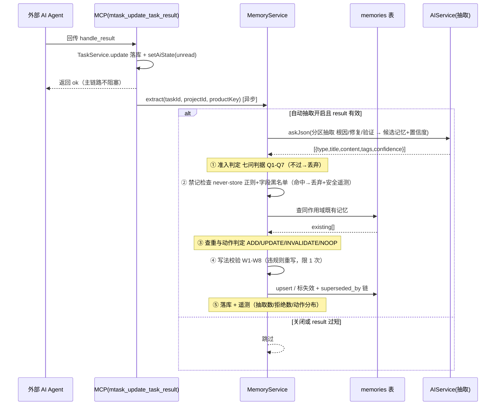
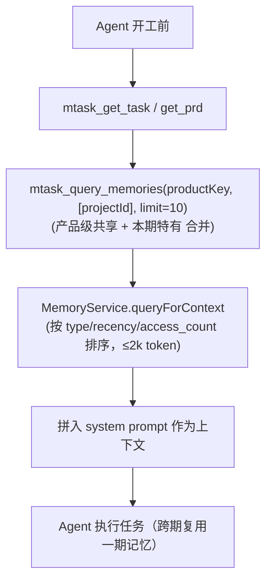

# 技术评估报告：引入「工作空间隔离的 AI 长期记忆」功能

> 评估对象：MTask（桌面端 AI 任务开发管理工具，Electron + Express + SQLite + React）
> 任务编号：T04113 ｜ 编写时间：2026-11-03
> 评估依据：对 `server/src`、`web/src`、`electron/`、`scripts/`、`package.json` 的逐文件源码核查，以及对 Claude 长期记忆公开机制的对照。所有架构结论均可在源码中定位，未引入任何虚构组件。
>
> **v2 修订（2026-11-03）**：根据实测场景反馈补充**产品（product）维度**。原方案以 `project_id` 为隔离单元，会导致同一产品多期项目（如 wiki 一期/二期/三期，各自是独立 `projects` 行）无法复用已固化记忆。现改为以 `product_id` 为记忆的**隔离与共享单元**，多期项目归属同一产品即可跨期共享记忆，跨产品仍严格隔离。下文 §2.1/§3.1/§3.3/§3.4/§4/§5/附 均据此更新。
>
> **v3 复审（2026-11-03，同日）**：对 v2 做批判性复审——回到源码逐条核对断言，并在 Node 22.22.2 的 `node:sqlite` 上按生产配置（`PRAGMA foreign_keys = ON`，对齐 `server/src/db/connection.ts:80`）**实测 9 组 DDL/级联行为**。复审判定：v2 的**方案方向正确，但落地清单有 6 处实质缺陷**（含 2 处会硬失败的模式），且**载体选型（新增 `products` 表）过重**。v3 据此：① 新增 §1.5 复审记录（复核表 + 缺陷 D1~D6 + 三方案实测对比）；② §3.1 起改为推荐 **`projects.product_key` 文本标签列**方案（实测更安全、改动更小），`products` 表降级为 Phase 2 备选并附实测约束。**结论仍是「有条件引入」，但前置条件已改写（见 §1.5.6）。**
>
> **v4 补充（2026-11-03，T04114）**：补齐「**提取高质量记忆的技能规则**」这一缺口——新增 §3.6（准入 / 动作 / 写法 / 禁记 / 维护 / 验收 六类判据 + 调研来源与采纳方式），并产出独立可复用规范 `docs/记忆提取技能规则规范.md`（含可直接落地的中文抽取提示词模板）；§3.2 提取时序图同步升级为六段流程。

---

## 1. 结论摘要

**建议：有条件引入（Conditional Yes）。**

核心理由：

1. **需求真实且有清晰落点**：当前外部 AI Agent（如经 mtask Skill + MCP 处理任务的 WorkBuddy）每次开工都只能拿到「任务字段 + PRD + 截图 + 摘要」四类上下文（源码核查：`server/src/mcp/server.ts` 的 `mtask_get_task` / `mtask_get_task_images` / `mtask_get_prd` / `mtask_summarize_task`），**全仓无任何长期记忆逻辑**。让 Agent 跨任务积累经验（如「该用户偏好 pnpm 而非 npm」「此项目 PRD 解析常撞 429 需退避」）价值明确。
2. **架构改动可控制在增量、非侵入范围**：记忆提取可挂在 `mtask_update_task_result` 处理器内（落库之后、`return ok` 之前），记忆查询作为 Agent 开工前的可选 MCP 调用，二者都不破坏既有 `handle_result` 落库、unread 驱动、派生单归并等逻辑。
3. **关键约束必须先澄清**：MTask **没有「多工作空间」实体**——"workspace" 仅是项目绑定的本地目录路径（`projects.workspace_path`），唯一真实的顶层组织单元是 `projects`。**原方案以 `project_id` 为记忆隔离单元存在缺陷**：同一产品多期项目（如 wiki 一期/二期/三期）是各自独立的 `projects` 行，若记忆只挂在 `project_id` 上，一期固化的记忆在二期无法复用、造成浪费。因此引入**产品维度**：`product_key` 作为记忆的**隔离与共享单元**（v3 复审后由「`products` 表 + 外键」改为「`projects` 文本标签列」，理由见 §1.5.4），多期项目归属同一产品即可跨期共享记忆；跨产品仍严格隔离。保留可选的 `project_id` 子作用域（仅某期特有的记忆）。
4. **提取质量必须由规则保证，而非由流程保证**（v3 复审新增）：本报告 §3.2 的提取流程只定义**机械动作**，不定义「什么才算高质量记忆」。§3.6 与独立规范 `docs/记忆提取技能规则规范.md`（T04114）补齐了**准入 / 动作 / 写法 / 禁记 / 维护 / 验收**六类判据，并给出可直接落地的中文抽取提示词。依据是行业共识：**记忆系统的质量由召回决定，不由存量决定**——而召回质量 100% 由写入侧规则决定。

**条件（必须同时满足才建议开工）**：
- 记忆提取必须是**异步、非阻塞**的（不能拖慢任务回传完成）；
- 注入上下文必须设**令牌上限**（防止记忆膨胀挤占任务提示词窗口）；
- 提供**用户可审查/编辑/删除**的管理页与明确的隔离作用域，杜绝跨项目泄露。

> ⚠️ v3 复审后，上述条件已不足。**新增三项开工前必须解决的前置**（详见 §1.5.6）：产品归属可批量回填、导出/导入顺序正确、删除产品不得级联删记忆。

---

## 1.5 v3 复审记录（2026-11-03）

> 本节是对 v2 稿的批判性复审，不是复述。方法是：**逐条回到源码核对 v2 的每一处断言**，并对涉及 SQLite 语义的部分**在运行时实测**（而非凭记忆推断）。

### 1.5.1 复核方法与取证范围

- **源码复核**：`server/src`（`db/schema.ts`、`db/connection.ts`、`mcp/server.ts`、`services/SettingsService.ts`、`util/projectRouting.ts`、`services/FieldService.ts`、`services/ChangeBus.ts`、`services/TaskService.ts`）、`web/src`（`api/client.ts`、`ui/settingsTabs.ts`、`pages/TasksPage.tsx`、`ui/gitScopePicker.tsx`、`ui/WorkspaceSelect.tsx`）。
- **运行时实测**：Node v22.22.2 的 `node:sqlite`，按生产配置 `PRAGMA foreign_keys = ON`（对齐 `server/src/db/connection.ts:80`）构造内存库，跑 9 组 DDL/级联/导入顺序用例（脚本：`%TEMP%/t04113-v3-sqlite-probe*.cjs`）。**下面每条"实测"结论均来自该脚本输出，不是推断。**

### 1.5.2 v2 断言逐条复核

| v2 断言 | 判定 | 证据 |
|---|---|---|
| `projects.workspace_path` 只是路径字符串，无 workspace 表 | ✅ 成立 | `schema.ts:943` 为 `ensureColumn` 补列；全仓无 workspace 表 |
| 全仓无「产品」实体 | ✅ 成立 | `server/src` 全量 `\bproducts?\b` **零命中** ⇒ 新表名无冲突占用 |
| `ensureColumn` 可向后兼容补 `product_id` | ⚠️ **半成立** | `ensureColumn` = `ALTER TABLE ADD COLUMN`（`schema.ts:1063-1069`）。实测：**带 `REFERENCES` + 隐式 NULL 默认 → 可行**，外键真登记、非法插入被拒、删产品触发 SET NULL（T1）；**带 `REFERENCES` + `DEFAULT ''` → 硬失败**：`Cannot add a REFERENCES column with non-NULL default value`（T2）。而本仓既有 `ensureColumn` 列**一律 `DEFAULT ''` 风格**（`workspace_path`/`archived`/`timezone`…）——两者不可兼得，v2 未点出 |
| `memories.product_id` CASCADE / `project_id` SET NULL | ✅ 成立 | 实测 T5/T8：删项目 → 记忆 `project_id` 置 null；删产品 → 记忆行清零 |
| 「新建关联工作空间」是真实 UI 落点 | ✅ 成立，且可更精确 | T00771 工作空间绑定弹窗：`TasksPage.tsx:1703`（新建项目后弹出、**可跳过**）、`:5435`（`renderWsPickDialog`）、`:5551`（挂载点）；`ui/WorkspaceSelect.tsx:13` 的 `variant='bare'` 正是「新建项目」弹窗内嵌复用位 |
| 缓存失效可监听 ChangeBus | ✅ 成立，但 v2 漏了约束 | `ChangeBus.ts:13` 的 `ChangeKind` 是**封闭联合** `'tasks'\|'plans'\|'queue'\|'projects'` ⇒ 需扩 `'memories'`；`ChangeBus.ts:18` 仅在 tasks/plans 时 `cacheClear('projects')`，记忆索引缓存需独立 cache key（`util/ttl-cache`） |
| MCP 复用 `resolveProjectIdOf` | ✅ 函数存在，但**是项目作用域** | `mcp/server.ts:761` 是闭包内 `const` 箭头函数（PRD/矩阵系列共用）。产品需**另写** `resolveProductIdOf`；且项目按名解析的现行列判据是 `ACTIVE_PROJECT_WHERE = COALESCE(history_at,'')='' AND COALESCE(archived,0)=0`（`util/projectRouting.ts:37`），产品需同款「现行/归档/历史」三态判据 |
| 导出加 `'memories'` 即可 | ❌ **不完整，v2 漏了两处** | ① 还要加 `'products'`；② **三张顺序表**都要改且**方向相反**：`EXPORT_TABLES`(`SettingsService.ts:54`)、`INSERT_ORDER`(`:52`，父表先插)、`DELETE_ORDER`(`:51`，子表先删)——v2 只提了第一张 |
| v2 未说明 `products` 是否进 `CORE_TABLES` | ❌ 漏项 | **不能进**：`SettingsService.ts:182-188` 的 `validateBundle` 要求 `CORE_TABLES.every(...)` 全在，进则**旧备份文件全部被判非法而无法导入** |

### 1.5.3 v2 的六个实质缺陷

**D1｜「未归入产品」= 新功能对存量项目不可用**（实测 T9）
`memories.product_id NOT NULL` + FK ⇒ 存量项目未绑定产品时，抽取钩子**无处落库**。v2 §3.3 写「缺失则拒绝，强制产品作用域」，等于把新功能一刀切关在存量项目之外——而 MTask 的存量项目普遍未绑定。

**D2｜导出/导入会硬失败**（实测 T4）
先 upsert 带 `product_id` 的 projects 行、而 products 行尚未导入 → `FOREIGN KEY constraint failed`。而 `EXPORT_TABLES` 的顺序被源码显式声明为「bundle 的表序是导出文件版面的一部分，不能随入参顺序变」（`SettingsService.ts:111-113`）⇒ 必须在数组**头部**插 `'products'`，且 `INSERT_ORDER` 也要把 products 提到 projects 前。v2 完全没提这两处。

**D3｜「删产品级联清空记忆」是数据丢失陷阱**
`projects.product_id ... ON DELETE SET NULL`（项目解绑、存活）配 `memories.product_id ... ON DELETE CASCADE`（记忆清空）⇒ **删一个产品，会让仍在使用它的项目凭空失去全部记忆**。v2 §3.1 把这条写成「特性」（级联清空），实为必须显式确认 + 迁移/解绑的破坏性操作。

**D4｜归档/沉淀态与记忆共享的交互未处理**
`projects` 有 `archived` 与 `history_at` 两态（`projectRouting.ts:37`）。wiki 一期"沉淀"后，恰恰是**最该被二期复用**的记忆来源；若抽取/查询跟随"现行项目"过滤，一期记忆会失联。**记忆可见性必须与项目现行态解耦**——这是 v2 完全没意识到的语义缺口。

**D5｜时区跨期不一致**
`projects.timezone` 是**项目级**（`schema.ts:663`、`client.ts:172-173`）。产品级记忆跨期共享时可能跨越不同时区，"工作日/截止时间"类记忆会失真。需对时区敏感的记忆类型设限。

**D6｜「产品轴」与现有「workspace 轴」正交，v2 未澄清**
MTask 现有分组轴是「同一 `workspace_path` 的多项目」（`ui/gitScopePicker.tsx:12`：「多项目必须同一 `workspace_path`，否则『同一批提交』在不同仓库各自解析、产物语义不成立」；`utils/gitSummaries.ts:119` 亦按 workspacePath 分组）。而产品轴是「同一产品线、跨仓库跨期」——**两轴正交**。v2 未点明，读者极易把「产品」误读为「工作空间」，而这正是 v1 口径被误解的根源。

### 1.5.4 「产品」用什么载体？三方案实测对比

| 方案 | 改动量 | 实测/源码风险 | 结论 |
|---|---|---|---|
| **A. `products` 表 + 外键**（v2 方案） | 新表 + 2 处补列 + **3 张顺序表** + 产品 CRUD + 命名解析器 + 删产品语义 | 命中 D1/D2/D3 全部；`REFERENCES` 列只能用 NULL 默认（不能 `DEFAULT ''`）；删产品级联删记忆 | Phase 2 备选 |
| **B. `projects.product_key` 文本标签列** | 1 次 `ensureColumn`（`TEXT DEFAULT ''`，实测 T3 可行）+ 1 张新表 | **无 FK ⇒ 无导入顺序敏感、无级联删除、无 NOT NULL 死锁**；`product_key` 随 projects 行**自动随导出携带**（projects 本就在 `EXPORT_TABLES`）；「已有产品」下拉可由 `SELECT DISTINCT product_key FROM projects` **现算**，无需字典表 | ✅ **推荐 Phase 1** |
| **C. 复用项目自定义字段**（`project_fields`） | 0 schema | ❌ **已排除**：`project_fields` 是**按项目定义**的（`schema.ts:792-805`，含 `uniq_project_fields_name ON (project_id,name)`），一期/二期各自定义「产品线」字段互不相识；`web/src/pages/TasksPage.tsx:330` 已明写「跨项目字段定义不同，无法统一谓词」 | 不可行 |

**推荐 B**：与用户诉求「产品标签**创建**和**关联**」直接对应——标签存在项目上，*创建* = 写入新标签名，*关联* = 复用同一标签；标签候选集由现有 `product_key` 去重现算，零新表。归一化（小写 + trim）保证「Wiki」「wiki」「Wiki 」同为一个产品。

### 1.5.5 修正后的落点清单（方案 B）

- **数据库层**：`projects` 表增量补 `product_key TEXT DEFAULT ''`（`ensureColumn`，**不带 REFERENCES**——实测 T2 证明 `DEFAULT ''` + `REFERENCES` 会被 SQLite 硬拒）；新建 `memories` 表（`product_key TEXT` 归一化存储，**不设外键**）。
- **服务层**：`MemoryService`（建/查/改/删 + `extract()` + `queryForContext()`）；`ProductTagService`（标签归一化 + 候选集查询 + 重命名/解绑的批量更新）。
- **导出/导入**：`memories` 加入 `EXPORT_TABLES`（**无顺序敏感性**——无 FK 依赖）；**`products` 无需加入任何顺序表**（方案 B 没有这张表）→ **D2 自动消失**。
- **MCP 层**：`mtask_save_memory` / `mtask_query_memories` / `mtask_list_memories` / `mtask_update_memory` / `mtask_delete_memory` + `mtask_list_product_tags`（供 Agent 发现已有标签）。
- **AI Agent 交互层**：任务后 → `mtask_update_task_result`（`mcp/server.ts:1060` 落库、`:1062` setAiState 之后）触发**异步** `MemoryService.extract`，从 `TaskService.update` 返回值取 `project_id` → 查 `project_key` → 落库；任务前 → `mtask_query_memories(productKey, [projectId])`。
- **前端**：① `TasksPage.tsx` 新建项目后的 T00771 绑定弹窗内**加一栏产品标签**（下拉 + 可新建）；② 项目编辑区支持改标签；③ `settingsTabs.ts` 的 `data` 组加 `'memory'` 页签（现组内含 dashboard/categories/fields/recurring/history/archive/migration/dbadmin/apitokens/sonar，见 `settingsTabs.ts:39-49`），新建 `MemoryTab.tsx`（仿 `ApiTokensTab`）。

### 1.5.6 结论修订：开工前置条件（替换 §1 的旧条件）

1. **产品归属可批量回填**（解 D1）：提供一次性回填工具，把存量项目按命名/描述启发式归入产品标签；**未归属项目不启用自动抽取**，并以遥测计数暴露，而不是静默失败。
2. **导出/导入表序正确**（解 D2）：方案 B 天然规避；若走方案 A，`EXPORT_TABLES` 头插 products、`INSERT_ORDER` 前置 products、`DELETE_ORDER` 后置 memories——三处缺一即导入失败。
3. **删除产品不得级联删记忆**（解 D3）：删除走「显式确认 → 记忆迁移到目标产品或解绑为无产品」，禁止依赖 FK 级联。
4. **记忆可见性与项目现行态解耦**（解 D4）：归档/沉淀的一期项目，其已固化记忆仍应可被同产品二期读到。
5. 记忆提取**异步非阻塞**、注入**设令牌上限**、提供**可审查/编辑/删除**的管理页（原条件保留）。

---

## 2. 架构影响分析

### 2.1 现状关键事实（决定方案形态）

| 维度 | 现状（源码实证） | 对记忆功能的影响 |
|---|---|---|
| 工作空间模型 | 无 workspace 表；`projects.workspace_path` 仅是路径字符串；唯一顶层组织单元是 `projects`；单 SQLite、单机、单用户、本地优先 | 记忆隔离键本应取 `project_id`，但见下「产品维度」行的缺口 |
| 产品维度（现状缺口） | **无「产品」实体**：同产品多期项目（如 wiki 一期/二期/三期）是各自独立的 `projects` 行，互相无关联；`projects` 表无产品归属列 | 纯 `project_id` 隔离会导致一期固化的记忆在二期无法复用；需引入产品标签（v3 复审后定为 `projects.product_key` 文本列，见 §1.5.4），记忆以 `product_key` 为**隔离与共享单元**，多期项目共享同一产品记忆 |
| Agent 任务后环节 | `mtask_update_task_result`→`TaskService.update({handle_result})`→`setAiState('unread')`（`server.ts:1060-1062`）；派生单归并在 `1063-1093` | 提取钩子插入 `1060` 之后、`1094 return ok` 之前，纯增量 |
| Agent 任务前上下文 | 仅 `get_task`+`get_task_images`+`get_prd`+`summarize_task`；全仓无 memory 检索 | 新增 `mtask_query_memories` 作为开工前可选调用 |
| 现有近似表 | `workspace_symbols`（代码符号索引，按 project_id）、`ai_card_provenance`（滚动 30 份溯源）、`task_result_history`（覆盖留档）、`exec_sessions`（编排遥测） | 均非持久语义记忆；可借鉴 `workspace_symbols` 的「project_id 隔离 + mtime 增量」范式，但不复用 |
| 配置落点 | `app_settings`（全局 KV，无用户维度）；`projects` 表列（项目级） | 记忆开关可置于 `projects` 列（项目级）或 `app_settings`（全局） |
| 前端设置结构 | `web/src/ui/settingsTabs.ts` 的 `SETTINGS_GROUPS`（preference/data/ops 三组）；记录型 CRUD 范式见 `ApiTokensTab` | 新增「记忆管理」子页，复用 `ApiTokensTab` 列表/增/删/改范式 |
| MCP 注册范式 | `server.registerTool('mtask_xxx', {title,description,inputSchema(zod)}, async(a)=>ok/err)`；工具全局操作，靠 `projectId/projectName` 参数定位作用域 | 新增 `mtask_*_memory` 工具，沿用同层注册 + 复用 `MemoryService` |

### 2.2 具体改动点

> ⚠️ **v3 复审后本节已修订**：下列改动点按**方案 B（`projects.product_key` 文本标签列）**给出。权威落点清单见 §1.5.5；若与 §1.5 冲突，以 §1.5 为准（§1.5 记录了 v2 方案在实测中暴露的 6 处缺陷 D1–D6）。

- **数据库层**：新建 `memories` 表（见 §3.1）；`projects` 表增量补 `product_key` 列（`schema.ts` 的 `ensureColumn`，`TEXT DEFAULT ''`，**不带 REFERENCES**）；加 `idx_memories_product`、`idx_memories_product_type`、`idx_memories_project` 三个索引。新表在 `schema.ts` 的 `initSchema` 内 `CREATE TABLE IF NOT EXISTS` 以保证老库兼容。
- **服务层**：新增 `MemoryService`（建/查/改/删 + `extract()` 提取 + `queryForContext()` 上下文装配），仿 `TokenService` 的 `list/create/update/remove` 单例结构；提取行为判据见 §3.6。
- **API 层**：`routes/index.ts` 增 `GET/POST/PUT/DELETE /memories`（委托 `MemoryService`）；并在 `SettingsService.EXPORT_TABLES` 白名单加入 `'memories'`，使其随 `/settings/export|import` 与 MCP `mtask_export_data`/`mtask_import_data` 迁移（否则换机恢复丢数据）。⚠️ 方案 B 无 `products` 表 ⇒ **不涉及 `INSERT_ORDER`/`DELETE_ORDER` 的顺序敏感问题**（§1.5.2 D2）。
- **MCP 层**：`server.ts` 增 `mtask_save_memory` / `mtask_query_memories` / `mtask_list_memories` / `mtask_update_memory` / `mtask_delete_memory` / `mtask_list_product_tags`，复用具名 `ok/err/json`；项目定位复用 `resolveProjectIdOf`（`mcp/server.ts:761`），产品标签需另写解析（按 `product_key` 归一化）。
- **AI Agent 交互层**：① 任务后 → `mtask_update_task_result` 内行 1060 之后触发 `MemoryService.extract`（**异步 fire-and-forget，不入主链路**，按当前项目的 `product_key` 落库，判据见 §3.6）；② 任务前 → Agent 在 `get_task` 之后调用 `mtask_query_memories(productKey, [projectId])` 取回「产品级共享 + 本期特有」记忆，拼入 system prompt。
- **前端**：`settingsTabs.ts` 加 `'memory'` 键 + `data` 组 tab；`SettingsPage.tsx` 渲染 `<MemoryTab/>`；新建 `MemoryTab.tsx`（仿 `ApiTokensTab`）；项目新建/编辑区加产品标签选择（§3.4 第 1 项）。

---

## 3. 详细设计方案

### 3.1 记忆数据模型（SQLite）

> v3 复审后改为**方案 B（`product_key` 文本标签列）**为推荐落地形态；方案 A（`products` 表）列为 Phase 2 备选，附实测约束。理由见 §1.5.4。

```sql
-- ① 产品标签：落在项目上的一列文本（归一化后同值即同一产品）
--    向后兼容老库、可空；不带外键（实测：REFERENCES + DEFAULT '' 会被 SQLite 硬拒）
-- ALTER TABLE projects ADD COLUMN product_key TEXT DEFAULT '';
CREATE TABLE IF NOT EXISTS memories (
  id              TEXT PRIMARY KEY,
  product_key     TEXT NOT NULL,       -- 隔离/共享单元（归一化：trim + 小写）
  project_id      TEXT,                -- 可选子作用域：仅某期项目特有的记忆；NULL=全产品共享
  type            TEXT NOT NULL CHECK(type IN ('user','feedback','project','reference')),
  title           TEXT NOT NULL,
  content         TEXT NOT NULL,
  tags            TEXT,                -- JSON 数组，如 ["PRD","429","限流"]
  source_task_id  TEXT,                -- 溯源：来自哪条任务（可空，手动创建时无）
  source_kind     TEXT NOT NULL DEFAULT 'auto',  -- auto(自动抽取) / manual(手动)
  access_count    INTEGER NOT NULL DEFAULT 0,
  last_accessed_at TEXT,
  created_at      TEXT NOT NULL,
  updated_at      TEXT NOT NULL
);
CREATE INDEX idx_memories_product      ON memories(product_key);
CREATE INDEX idx_memories_product_type ON memories(product_key, type);
CREATE INDEX idx_memories_project      ON memories(project_id);
```

> **为什么不用 `products` 表 + 外键**（v2 原方案，实测依据）：
> ① `ALTER TABLE ADD COLUMN` 带 `REFERENCES` 时，列默认必须是 NULL——本仓既有 `ensureColumn` 列一律 `DEFAULT ''` 风格，**两者不可兼得**（实测 T2 硬失败）；
> ② 外键会让**导出/导入顺序敏感**：先写 projects 行而 products 行未导入 → `FOREIGN KEY constraint failed`（实测 T4），需同时改 `EXPORT_TABLES`/`INSERT_ORDER`/`DELETE_ORDER` 三张表；
> ③ 删产品会级联清空记忆（实测 T5/T8），而项目侧是 `ON DELETE SET NULL`——**项目存活、记忆消失**的数据丢失陷阱。
>
> 方案 A 若在 Phase 2 启用，须满足上述三条的修正版：`REFERENCES` 列用隐式 NULL 默认、`products` 置于 `EXPORT_TABLES` **头部**且**不得进 `CORE_TABLES`**（否则旧备份全被判非法）、删产品走「显式确认 + 迁移」而非级联。

> **隔离与共享语义**：查询时以 `product_key` 为作用域，并合并「产品级共享记忆（`project_id IS NULL`）」与「本阶段项目特有记忆（`project_id = 当前项目`）」——即 wiki 二期能读到一期固化的产品记忆，同时不串入其他产品。**记忆可见性与项目归档/沉淀态解耦**：一期项目即便已归档（`projects.archived`/`history_at`，判据见 `util/projectRouting.ts:37`），其已固化记忆仍应可被同产品二期读到（D4）。
> 类型对齐 Claude 的四类记忆：`user`（用户角色/偏好）、`feedback`（纠正与确认的做法）、`project`（进行中工作/决策，代码与 git 不可派生的部分）、`reference`（项目外的信息源如 issue tracker）。这与 Claude 的 `type` 字段（`user/feedback/project/reference`）一一对应。

### 3.2 记忆提取与存储流程图解





### 3.3 MCP 接口字段定义示例

**保存 / 更新记忆**（`mtask_save_memory`）

| 字段 | 类型 | 说明 |
|---|---|---|
| `productKey` | string? | 所属**产品标签**（隔离/共享单元），与 `projectId` 二选一；缺失时按 `projectId` 回查其 `project_key`（仍缺失则拒绝，强制产品作用域） |
| `projectId` | string? | 可选**子作用域**：仅某期项目特有记忆；置空表示全产品共享 |
| `type` | enum | `user`/`feedback`/`project`/`reference` |
| `title` | string | 记忆标题（必填） |
| `content` | string | 记忆正文（必填） |
| `tags` | string[]? | 标签，用于检索与判重 |
| `id` | string? | 传入则更新已有记忆，否则新建 |

返回：`ok('已保存记忆 id=...', {memory})`。

**查询记忆（上下文注入）**（`mtask_query_memories`）

| 字段 | 类型 | 说明 |
|---|---|---|
| `productKey` | string? | **产品作用域（必填其一）**，所有查询强制 `WHERE product_key = ?`；**决不允许跨产品或无作用域的全局查询**，保障隔离 |
| `projectId` | string? | 可选子作用域：传入则结果合并「产品级共享（`project_id IS NULL`）」+「本阶段特有（`project_id = 当前项目`）」；不传则取整个产品全部记忆 |
| `type` | enum? | 按类型过滤 |
| `query` | string? | 关键词（LIKE / FTS5 over title+content+tags） |
| `limit` | int? | 默认 10，硬上限 20；返回内容按令牌预算截断 |

返回：`ok(json({memories:[...]}))`，每条含 `type/title/content/tags/source_task_id`。

**管理类**：`mtask_list_memories`（分页/类型过滤）、`mtask_update_memory`、`mtask_delete_memory`（均带 `productKey` 作用域校验）。

**标签发现**（`mtask_list_product_tags`）：返回现有产品标签候选集（`SELECT DISTINCT product_key FROM projects WHERE product_key <> ''` 现算，无需字典表），供 Agent 与前端「选择已有产品 / 新建产品标签」共用同一数据源。

### 3.4 前端「记忆管理」页面功能清单

复用 `web/src/pages/RecurringTokensTabs.tsx` 的 `ApiTokensTab` 范式（列表 + 新增 + 行内编辑/删除确认）：

1. **产品关联（新建关联工作空间时）**：在「新建 / 关联工作空间」流程中新增**产品标签创建与关联**能力——用户可「选择已有产品」或「新建产品标签」（如 "Wiki"），新建的项目自动带上 `product_key`（写 `projects.product_key`）；横向多期项目（Wiki 一期/二期/三期）只需都选同一产品即可共享记忆。存量项目可在项目设置里补绑产品。
2. **列表视图**：页面以**产品**为顶层维度（先选产品，再看该产品的记忆）；表格列 = 类型徽标 / 标题 / 内容摘要（截断） / 标签 / 作用域（产品级共享 / 本阶段特有） / 来源任务（可点击跳转） / 更新时间 / 访问次数。
3. **新增记忆**：表单（产品归属[默认当前产品]、可选子作用域项目、类型选择、标题、正文、标签），手动 `POST /memories`；支持从「当前任务结论」一键提取草稿。
4. **编辑 / 删除**：行内 `PUT` 编辑；删除前 `askConfirm` 二次确认（危险色 `var(--danger)`）——删除产品级记忆时提示「将清空该产品下全部记忆」。
5. **自动抽取开关**：项目级开关（置于 `projects` 列或 `app_settings`），控制任务回传后是否自动抽取。
6. **检索 / 过滤**：按类型、关键词、作用域筛选，便于人工审查记忆质量（对抗「记忆污染」）。
7. **隔离可见性**：页面严格按所选 `productKey` 展示记忆，UI 明确标注「本页记忆仅属于产品 X（含其下各期项目 + 产品级共享）」，跨产品按钮置灰，杜绝跨产品混淆。
8. **记忆审查视图（对应 §3.6 的抽样评审规程）**：支持按「被丢弃原因」筛选（提取器返回的 `dropped` 列表含判据编号），让用户能看出"哪条规则拒杀率过高"，而不是只看到"抽了 N 条"。

### 3.6 记忆提取技能规则规范（判定「什么才算高质量记忆」）

> **独立可复用规范**：`docs/记忆提取技能规则规范.md`（T04114 交付，含可直接落地的中文抽取提示词模板）。本节为报告内的摘要与判据表，评审时两者需一并看。

#### 3.6.1 为什么必须单列规则规范

§3.2 的提取流程只描述了**机械动作**（判重 → askJson → upsert），没有回答「抽出来的东西怎么判断是好记忆」。这在 MTask 场景是**成本问题**而非学术问题：记忆在**每次开工时都要注入**并占用上下文预算，而记忆库是**产品级共享、长期累积**的——一条低价值记忆会跨项目、跨任务反复付费，陈旧记忆还会**误导**后续 Agent（它会相信一条已经过时的结论）。

行业共识一致：**记忆系统的质量由召回决定，不由存量决定**（mem0 官方："A clean index of fewer facts beats a noisy index of many"）。因此写入侧规则是整个记忆系统的地基。

#### 3.6.2 六类判据总表

| 判据类 | 回答 | 关键规则 | 违反后果 | 强制层 |
|---|---|---|---|---|
| **准入** | 值不值得记 | 七问判据 Q1–Q7 + 四型门槛 | 记忆库膨胀、召回精度下降 | 提示词 + 服务端阈值 |
| **动作** | 与旧记忆冲突怎么办 | ADD / UPDATE / INVALIDATE / NOOP | 重复堆积、矛盾并存 | 提示词（判）+ 服务层（执行） |
| **写法** | 怎么写 | 八条硬性要求 W1–W8 | 召回不到、注入浪费、误导 | 提示词 + 写入前校验 |
| **禁记** | 什么不能记 | never-store 清单 | **密钥泄露** | **必须代码拦** |
| **维护** | 何时失效 | 分型保留期 + 访问衰减 + 淘汰 | 陈旧记忆误导后续 Agent | 定时任务 + 管理页 |
| **验收** | 质量好不好 | 精度/召回抽样 + 注入预算 + 污染率 | 无法判断改进是否有效 | 门脚本 + 人工评审 |

#### 3.6.3 准入：七问判据（Q1–Q7）

一条候选记忆必须**全部通过**才允许落库；任一否决即 `NOOP`。

| # | 判据 | 问法 | 不通过的典型 |
|---|---|---|---|
| Q1 | 行为改变 | 未来的会话**知道它会有何不同**？ | "本次任务用了 Node 18"（`package.json` 里就有） |
| Q2 | 仍真仍有用 | 现在还成立，且下次用到时还有用吗？ | "本次跑测试耗时 42s" |
| Q3 | 不可秒查 | 能否 1 秒内从源系统查到？ | "项目用 better-sqlite3" |
| Q4 | 具体可执行 | 含专名/数字/版本/路径/命令等**可定位信息**吗？ | "前端有个渲染 bug" |
| Q5 | 带理由 | 是决策吗？是否带**为什么**？ | "改用 pnpm"（无理由 → 下次会被推翻） |
| Q6 | 稳定/有期 | 若易变，是否标了**过期条件**？ | "本周在赶 PRD" |
| Q7 | 安全可存 | 是否触碰 never-store 清单？ | `API_KEY=sk-xxx` |

**四型记忆的额外门槛与保留期**（四型沿用 Claude 的 `user`/`feedback`/`project`/`reference`）：

| 型 | 额外准入 | 保留期 |
|---|---|---|
| `user` | 跨项目稳定（换项目仍成立） | 长期（至用户显式改写） |
| `feedback` | 必须有「不要再这样 / 以后要那样」的纠正语义 | 长期 |
| `project` | **不可由仓库/git 推导**（Q3 的直接落地） | 180 天，到期降权待复核 |
| `reference` | 有稳定出处（URL/文档/系统名） | 长期 |

> **取舍说明**：mem0 的抽取提示词明写 *"When in doubt, extract"*（宁多勿漏），另有社区实践主张 *"Prefer NOOP — memory pollution is worse than missing a minor fact"*。MTask 取**保守侧**，理由是记忆**产品级共享**、每条都长期占用注入预算，漏记一条的代价远小于长期塞一条噪声。折中：置信度阈值 0.7，低于则不入库但计入遥测。

#### 3.6.4 动作：ADD / UPDATE / INVALIDATE / NOOP

**决策顺序**（顺序本身是规则）：① 准入判定 → ② 禁记检查 → ③ 同义查重 → ④ 矛盾检查 → ⑤ 作用域旧版失效。

| 与既有记忆的关系 | 动作 | 落库效果 |
|---|---|---|
| 无相关既有记忆 | **ADD** | 新增一行 |
| 同一事实，候选**信息量更大** | **UPDATE** | **沿用既有行 id**（不新建行），内容替换 |
| 同一事实，候选**补充**了既有 | **UPDATE** | 合并：既有 + 候选增量 |
| 同一事实，既有信息量更大或相等 | **NOOP** | 不变（**不新建平行副本**） |
| **矛盾** | **INVALIDATE** | 旧行置失效（`invalidated_at` + `superseded_by`），新行 ADD，**旧内容保留** |
| 不通过 Q1–Q7 / 禁记清单 | **NOOP** | 不变 |

**「信息量更大」的判定死规则**（否则 UPDATE 沦为随机重写）：在保持同一事实陈述的前提下，新增了下列**任一**——① 具体专名/数字/版本/路径/命令；② 触发条件或适用范围；③ 决策理由；④ 失效边界或例外。五项均无新增 → **NOOP**（不是 UPDATE）。

> **为何把 mem0 的 `DELETE` 改成 `INVALIDATE`**：mem0 用物理删除，但 MTask 记忆是**产品级共享**的——物理删除会让同期其他项目正在引用的记忆凭空消失。软失效保留审计轨迹，能回答「是用户改主意了，还是抽取器抽错了」。物理删除只由用户在管理页显式触发。

#### 3.6.5 写法：八条硬性要求 W1–W8

| # | 要求 | 规则 |
|---|---|---|
| W1 | 一事一条 | 一条记忆只陈述一个事实 |
| W2 | 自足 | 代词换成具体名词，脱离上下文可读懂 |
| W3 | 保真具体 | 专名/数字/版本/路径/命令**原样保留**，不得泛化 |
| W4 | 时间锚定 | 相对时间转**绝对日期**；绝对日期不得转模糊 |
| W5 | 数值精确 | "416 页"不写成"约 400 页" |
| W6 | 语义精确 | 不得改变命题方向（"没睡到 2 点" ≠ "睡到 2 点"） |
| W7 | 变更留痕 | 状态迁移写清**从什么变成什么**（含「暂定/试用」标记） |
| W8 | 长度有界 | 15–80 词（中文约 30–120 字）；细节多则拆条，**不得为凑字数丢专名/日期/数字** |

**正反例（取自 mem0 官方保真清单，适配 MTask 场景）**：

| 弱写法 ❌ | 强写法 ✅ |
|---|---|
| "前端有个渲染 bug" | "TasksPage 勾选全选后未过滤已归档行，导致列表出现已归档任务" |
| "改用 pnpm" | "该仓库统一用 pnpm 而非 npm：`pnpm-lock.yaml` 已在库，CI 也按 pnpm 跑" |
| "构建产物在 dist" | "打包产物在 `release/`（asar + NSIS），`dist/` 只是 Electron 临时目录" |
| "PRD 解析要串行" | "PRD 解析为多轮 AI 串行，总预算 270s（桌面壳代理超时约 300s）" |
| "项目用 better-sqlite3" | （**不入库**——Q3：`package.json` 一查就有） |

#### 3.6.6 禁记：never-store + 四项代码强制

**never-store 清单**：API Key / Token / 密码 / 私钥 / Cookie / `Bearer` 头；带账密的连接串；`api_key_enc`/`secret_enc` 的**密文本身**（可解密的等价凭据）；身份证/手机号/银行卡/住址；整段 PRD 原文、完整日志、完整 diff。

**四项必须落在代码里（不能只写进提示词）**：

| # | 强制项 | 理由 |
|---|---|---|
| C1 | 写入前跑 never-store 正则 + 字段名黑名单，命中即丢弃并记安全遥测 | 模型自检不可靠（*"a deterministic check is not"*） |
| C2 | 写入限流：单次回传 ≤ 5 条、单产品每小时上限 | 一次会话突然写 200 条 = 抽取器坏了或被投毒 |
| C3 | 置信度阈值 0.7，低于不入库（记遥测） | 保守侧取舍 |
| C4 | 查询强制带 `product_key`，禁止无作用域全局检索 | 隔离硬约束（§4.2） |

**记忆投毒三道防线**（记忆是写进未来 prompt 的路径，天然是攻击面）：① 只存**声明式事实**、不存原文（祈使句不得成为记忆行）；② 溯源标记 `source_kind`（`user_said` > `auto` > `inferred` > `tool_output`），外部内容不得压过用户陈述；③ 召回记忆以**独立标记的参考块**注入（如 `<memory-context>` 段），**不拼进指令块**、不拥有指令权限。

#### 3.6.7 维护：分型保留期与淘汰

| 机制 | 规则 |
|---|---|
| 分型 TTL | `user`/`feedback`/`reference` 无固定 TTL；`project` 180 天；通用「任务状态」类 30 天（**按型分，不用全局值**） |
| 访问衰减 | 记录 `access_count`/`last_accessed_at`，长期未访问者**降权而非删除**（存储强度 ≠ 提取强度） |
| 容量上限 | 单产品 200 条，超限按 `access_count` 最低 / `updated_at` 最旧淘汰 |
| 月度整理 | 归档已完结任务导出的记忆、合并近重复、删除无人遵守的规则 |
| 陈旧优于无 | **陈旧记忆比没有记忆更糟**——Agent 会信任它；到期项要么失效要么降权，不留僵尸条目 |

#### 3.6.8 验收：指标与门断言

| 指标 | 目标 | 可自动化断言 |
|---|---|---|
| 精度（抽样人工评审判「值得记」占比） | ≥ 80% | — |
| 召回（该记未记占比） | ≤ 15% | — |
| 注入预算 | ≤ 2k token | ✅ `queryForContext` 截断断言 |
| 污染率（含 never-store 的记忆行） | **= 0** | ✅ 构造 `sk-`/`password=`/`Bearer ` 候选 → 断言落库 0 条 + 安全遥测告警 |
| 矛盾率（互斥且都未失效） | **= 0** | ✅ 矛盾候选 → 断言旧行 `invalidated_at` 非空且仍物理存在 |
| C2 限流 | 单次 ≤ 5 条 | ✅ 投 20 条候选 → 断言入库 ≤ 5 |
| C3 阈值 | < 0.7 不入库 | ✅ 投 confidence=0.5 → 断言不入库且 `dropped` 含该条 |
| ADD/UPDATE 判定 | UPDATE 不新建行 | ✅ 同事实「信息量更小」版 → 断言 NOOP 且行数不变；「更大」版 → 断言行 **id 不变** |

> 门脚本建议落点：`scripts/verify-t04114-memory-rules.mts`（接 `scripts/lib/gate-boot.mts`）。

#### 3.6.9 调研来源与采纳方式

| 来源 | 核心机制 | 采纳方式 |
|---|---|---|
| **mem0**（GitHub `mem0/configs/prompts.py` 原文） | `ADD/UPDATE/DELETE/NONE` 四动作；「同义保留信息量更大者」；`linked_memory_ids`；完整性规则族（No Fabrication / No Echo / No Meta-Extraction / No Detail Contamination / No Within-Response Duplication）；保真具体与时间锚定；严格 JSON 输出 | **直接采纳**动作四分类 + 完整性规则族；**改造**写法判据（见独立规范 §12.1） |
| **Zep / Graphiti**（arXiv:2501.13956 + v4 文档） | 实体/事实分离抽取；事实须落在两个不同实体之间；`relation_type` 全大写；重复合并、**矛盾失效而非并存**；**schema 即推理边界**；reflexion 补漏循环 | **直接采纳**schema-as-boundary + 矛盾失效；**改造**二元图结构为四型扁平记忆；**采纳**反思补漏为 Phase 2 增强 |
| **Anthropic Claude Code**（官方 memory 文档） | `CLAUDE.md`（人写规则）vs auto memory（Agent 自记）分层；auto memory 索引**前 200 行 / 25KB**、细节进 topic 文件按需读；**重复犯错才写**；规则写法 = **规则 + 理由 + 错例**；冲突显式暴露而非默默取最新 | **直接采纳**「重复触发才写」与规则三段式；**改造**分层方式（MTask 只做自动层 + 人工审查页）；**采纳**注入预算截断 |
| **Anthropic Memory Tool**（`memory_20250818`） | 客户端文件操作；路径穿越防护 + 限制在记忆根目录；系统注入 `ALWAYS VIEW YOUR MEMORY DIRECTORY BEFORE DOING ANYTHING ELSE` 与 `ASSUME INTERRUPTION` | **直接采纳**路径/作用域约束；**改造**为产品维度作用域；**采纳**「开工前必须先注入」 |
| **Letta / MemGPT** | core（常驻，2000 字符/块）/ recall / archival 三层；**精确串替换**式自编辑；块可只读；sleep-time 整理 | **直接采纳**「常驻层有硬上限」与「精确替换而非整体重写」；**改造**三层为 MTask 的产品级共享 + 项目级特有两层 |
| **保留策略（多家共识）** | 「未来会话知道它会有何不同」；只记稳定+可复用+**不可秒查推导**的事实；决策带理由；派生结论带日期与「需复核」标记；**supersede 而非覆盖**；never-store **由代码强制**；**写入限流**；召回记忆是**不可信输入**，须独立标记成参考块 | **直接采纳**全部；其中「代码强制」与「注入隔离」为安全硬要求 |

> **本节与 §3.1/§3.2 的关系**：§3.1 给**数据模型**、§3.2 给**流程**，§3.6 给**行为判据**——三者缺一不可。规范独立成文的另一个理由：提取规则会随实践迭代，混在评估报告里不便于单独版本化与复用。

---

## 4. 性能与安全评估

### 4.1 性能

- **写入开销**：提取走**异步队列**（不在 `mtask_update_task_result` 主链路），单次抽取一次 LLM 调用（可复用 `AIService.askJson` + `PRD_IMPORT_CARD` 式 `cardKey` 计量）。最坏情况仅延迟记忆落库，不影响任务 `done` 状态。
- **读取开销**：`idx_memories_product_type` 索引下查询为 O(log n)；单用户本地规模（单产品记忆数百条量级）下 LIKE/FTS5 检索可忽略；`queryForContext` 硬限 10 条、≤2k token，注入成本恒定。
- **缓存策略**：按 `product_key` 在内存缓存记忆索引（监听 `ChangeBus` 失效——注意 `ChangeKind` 是封闭联合 `'tasks'|'plans'|'queue'|'projects'`，需扩 `'memories'`；且 `ChangeBus.ts:18` 仅在 tasks/plans 时清 `'projects'` 缓存，记忆索引需独立 cache key），避免每次任务前都打库；与现有 `stmt-cache` 思路一致。产品维度缓存天然支持「多期项目共用一份索引」，比按 `project_id` 缓存更省。
- **增长控制**：单产品记忆数量上限（建议 200），超限按 `access_count` 最低 / `updated_at` 最旧淘汰（对齐 Claude「合并或丢弃陈旧条目」），防止无限膨胀。

### 4.2 安全

- **隔离性（硬约束）**：以 `product_key` 为**唯一隔离边界**——所有查询强制 `WHERE product_key = ?`，MCP 查询**禁止跨产品或无作用域的全局检索**；可选的 `project_id` 仅作为「产品内子作用域」过滤（区分产品级共享 vs 某期特有），不构成跨产品边界。即使未来多工作空间/多用户，此结构天然可升级为「product_key + owner_id」复合隔离。
- **权限体系**：记忆管理页处于设置区，复用现有本地鉴权（`accessTokenGuard` + `csrfGuard`）；MCP 工具复用 `accessToken` 守卫。单用户本地场景无跨用户泄露面，但**跨项目泄露是真实风险**，已用作用域强制规避。
- **内容敏感度**：记忆内容源自任务 `handle_result`，属业务数据（非第三方密钥），按现有加密策略**明文存储即可**（加密仅用于 `api_key_enc`/`secret_enc` 类密钥列）。但记忆应纳入**导出/导入与备份**（`EXPORT_TABLES` 加入 `'memories'`），否则换机恢复会丢失。
- **记忆污染风险（最重要）**：LLM 可能抽取低价值/错误信息。缓解：① 抽取设置信阈值，低置信不落库；② 判重合并而非重复建；③ 提供用户可审查/编辑/删除的管理页；④ `queryForContext` 截断 + 仅取 top-N，控制对主任务提示词的挤占。

---

## 5. 实施路线图建议（待评审通过后建派生单）

> 本节为建议，非本次评估的交付动作；实际编码应在评审通过后拆分为派生任务。

- **Phase 0（已完成）**：本评估报告。
- **Phase 1 — MVP（建议最小可用）**：
  - `projects.product_key` 补列（`TEXT DEFAULT ''`，**不带 REFERENCES**——实测证明 `DEFAULT ''` + `REFERENCES` 会被 SQLite 硬拒）+ `memories` 表（`product_key` 归一化，**不设外键**）+ `MemoryService`（基础 CRUD + `extract` 异步钩子）；
  - 新建 / 关联工作空间时**创建并关联产品标签**（无则新建、有则选择），存量项目补绑产品；
  - **提取规则规范落地**（`docs/记忆提取技能规则规范.md`）：准入七问 Q1–Q7、动作四分类 ADD/UPDATE/INVALIDATE/NOOP、写法 W1–W8、never-store 代码强制 C1–C4（详见 §3.6）；
  - REST `/memories` CRUD + 前端「记忆管理」页（产品维度展示 + 手动增/改/删 + 自动抽取开关 + 丢弃原因审查视图）；
  - MCP `mtask_save_memory` / `mtask_query_memories` / `mtask_list_memories` / `mtask_update_memory` / `mtask_delete_memory` / `mtask_list_product_tags`（均带 `productKey` 强制作用域）；
  - 自动抽取：任务回传后异步把 `handle_result` 按 §3.6 六段流程（候选→准入→禁记→查重/动作→写法校验→落库+遥测）落库。
- **Phase 2 — 质量增强**：语义判重与合并（FTS5 或可选向量检索）、`queryForContext` 相关性排序（产品级共享记忆优先于本期特有）、`product_key` 内存索引缓存、单产品数量上限与分型保留期、**反思补漏循环**（Graphiti reflexion，抽取后回检漏抽并重跑）。
- **Phase 3 — 完善**：四类记忆（user/feedback/project/reference）精细化抽取提示词、记忆跨任务关联、导出/导入集成（`memories` 加入 `EXPORT_TABLES`；方案 B 无 `products` 表，**不涉及顺序敏感**，见 §1.5.2）、抽取成功率与丢弃原因遥测（复用 `ai_usage` / `ai_card_provenance` 范式）、记忆质量抽样评审与门脚本（`scripts/verify-t04114-memory-rules.mts`）。

---

## 附：与 Claude 长期记忆机制对照

| 维度 | Claude 机制（公开文档） | MTask 落地对应 |
|---|---|---|
| 隔离单位 | 每个 git 仓库一个 memory 目录（同仓 worktree 共享） | `product_key`（产品为隔离/共享单元，对应"仓库"；同产品多期项目共享，跨产品严格隔离） |
| 索引结构 | `MEMORY.md` 索引（会话开始加载前 200 行/25KB）+ 按需读取的 topic 文件 | `memories` 表；`queryForContext` 取 top-N 注入（等价"索引加载"），细节行按需 `mtask_query_memories` 取回 |
| 记忆类型 | `user`/`feedback`/`project`/`reference` | 同四型，落 `type` 列 |
| 存储位置 | 客户端可控（目录或 DB key），路径穿越防护 | 本地 SQLite `memories` 表，`product_key` 作用域即"路径穿越防护"（`project_id` 仅为产品内子作用域） |
| 检索时机 | 任务前检查记忆 + 按需读取（just-in-time） | Agent 开工前 `mtask_query_memories` 注入 |
| 衰减/维护 | 超阈值提醒缩写、合并或丢弃陈旧条目 | 单项目数量上限 + 低访问淘汰（Phase 2） |

> 结论一致性：Claude 的「仓库级隔离 + 索引加载 + 四类记忆 + 客户端可控存储」范式在 MTask 中可通过 `product_key` 隔离（多期项目共享、跨产品严格隔离） + `memories` 表 + `type` 分类 + 异步抽取/查询 完整映射，无架构冲突。

---

> **编写与一致性声明**：本报告所有模块名、文件路径、行号、表/列、MCP 工具名均来自对 `D:/code/otherProjects/26_MTask` 源码的实地核查（5 路并行 Explore + Web 文档对照）。如发现与运行实例不符，以源码为准并回报修订。
